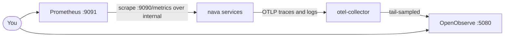

Every nava service emits three signals. Locally, all of them land in two browser UIs that `task stack:up` starts (profile `operator`).

| Signal | Leaves the service as | Lands in | Open it at |
|---|---|---|---|
| Traces | OTLP/HTTP push to `otel-collector`, tail-sampled | OpenObserve, Traces view | `http://127.0.0.1:5080` |
| Logs | `slog` lines on stdout, and OTLP to `otel-collector` | OpenObserve, Logs view, stream `default`; also `docker compose logs` | same |
| Metrics | Prometheus text on the admin listener `:9090/metrics` | Prometheus, scraped over `internal` | `http://127.0.0.1:9091` |

Log in to OpenObserve with `OPENOBSERVE_USER` and `OPENOBSERVE_PASSWORD`. Both have dev-only defaults; see `.env.example`.



## Find one request

Every signal carries the same ids:

| From | To | Link |
|---|---|---|
| Client | Everything | The `X-Request-Id` response header is `request_id` in the logs and `nava.request_id` on the span. An error body's `instance` is `urn:nava:request:<id>` |
| Log line | Trace | `trace_id` and `span_id` on every request log line |
| Metric | Trace | Exemplars on duration buckets carry a `trace_id` (Prometheus runs with exemplar storage on) |

In OpenObserve's Logs view, in the SQL box:

```
request_id = '<request id>'          -- one request
trace_id = '<32-hex trace id>'       -- one trace
severity = 'ERROR'                   -- by level
```

Free text: type a word in the search box, or `match_all('timeout')`. Expand a log line and choose **View Trace** to open its trace. In the Traces view, pick service `nava-core` and the time range.

**Why is this request slow?** Open its trace. The spans show each database round trip and each call to Keycloak or Temporal with its duration. The P3-36 work on the [benchmarks page](../benchmarks/index.md) reads creates exactly this way.

## Sampling

The Collector keeps 10 % of ordinary traces (`OTEL_TAIL_SAMPLE_PERCENT`). Errors and requests slower than 500 ms are always kept. Set `OTEL_TAIL_SAMPLE_PERCENT=100` when you start the stack to keep everything.

If OpenObserve is not running (a stack without the `operator` profile), the Collector logs a failed export for each batch, drops it after 5 s of retries and stays healthy.

## Metrics and alerts

- **Targets.** Prometheus, Status > Targets, job `nava`: the admin listeners of nava-core, nava-worker, nava-relay, nava-groupsync, nava-purge and nava-onboard. A target that is down means the service is down or its admin listener is unreachable.
- **Labels are bounded.** Metrics carry the HTTP method, status, route pattern (never the raw path), scheme, protocol and `error.type`. Tenant and user ids are never labels: to find the tenant, follow the log line.
- **Alert rules** live in `deploy/compose/prometheus/rules/`. There is no Alertmanager locally, so a firing alert shows on Prometheus's Alerts page.

| Alert | Fires when | Where to look |
|---|---|---|
| `AuditSealLag` (warning) | An audit entry has been unsealed for more than 600 s | `audit_seal_failures_total` and the nava-worker `audit seal failed` log line, which names the tenant |
| `AuditDeadLineage` (critical) | A seal lineage is more than 10 minutes overdue | The nava-purge `audit seal lineage dead` log line. Recovery is `POST /api/v1/audit/chain:reseed` |
| `AuditDeadLineageCheckDown` (warning) | The dead-lineage check has reported nothing for 5 minutes | The nava-purge `audit dead lineage check failed` log line: a lost grant, a dropped policy or a renamed column |
| `AuthzPolicyInvalid` (warning) | `authz_policy_invalid_total` grew in the last 10 minutes for an entity type: a stored access policy was voided and grants nothing (ADR-010 R7, S30) | The nava-core log line `authz: access policy voided, it grants nothing` names the entity type and ACL version; the explainer's `invalid` list gives the policy and pointer. Republish a valid document and file a bug on the check that let it through. Its sibling `authz_read_branches_fallback_total` has no alert; see [Core: record ACL](../system/core-acl.md#the-sp-2-branch-threshold-adr-010-d6) |
| `EntityRecordEstimatesStale` (warning) | `authz_under_estimate_age_seconds` above 10,800 s (3 hours) for 15 minutes: the nava-worker estimates job has not refreshed some tenant (S31, ADR-010-A2 A2-R3). Cost only, never rows | `entity_record_estimates_refresh_failures_total` and the nava-worker log, which names the failing tenant. With `NAVA_ESTIMATES_REFRESH_INTERVAL=0` it fires by design. See [nava-worker](../system/nava-worker.md#the-estimates-refresh-job-s31) |
| `GroupsyncOrgUnitsAboveCertified` (warning) | `groupsync_org_units_live_max` above 10,111 for 10 minutes: a tenant's live org-unit tree is larger than ADR-010-A2 is certified for (A2-7, A2-R6). Region-only lists may exceed 150 ms | Find the tenant in the nava-groupsync log line "largest live org-unit tree" (`tenant_id`, `live_org_units`), logged at INFO when the largest tenant or its count changes (TICK-1132). The line names only the largest tenant; to list all of them, as the database superuser: `SELECT tenant_id, count(*) FROM org_units WHERE deleted_at IS NULL GROUP BY 1 HAVING count(*) > 10111` (row-level security hides other tenants from the service roles). Re-decide A2-R6 with the Solution Architect. Never refuse the sync. See [nava-groupsync](../system/nava-groupsync.md#org-units-s31) |
| `GroupsyncOrgUnitsUnrooted` (warning) | `groupsync_org_closure_unrooted_units_total` grew in the last 15 minutes: some live org units have no closure self row, so no region rule sees their tickets (S31, TICK-1116). It can miss the first sample of a series that starts at 1; the WARN line repeats every cycle and covers that case | The nava-groupsync WARN line `live org units have no closure self row and are outside every region` names the tenant. Never refuse the sync. See [nava-groupsync](../system/nava-groupsync.md#org-units-s31) |
| `GroupsyncOrgClosureDriftRepaired` (warning) | `groupsync_org_closure_drift_repairs_total` grew in the last 15 minutes: group sync found the stored region tree different from the live one and repaired it (TICK-1124, trigger of AR-TICK-1118-01). It fires on a first repair after a restart. Accepted limits: a restart at 1 followed by another repair before any scrape sees 0 (a gap up to about 1 h) fires nothing, and a scrape gap longer than about 1 h can fire it with no repair; the WARN line, written once per repair, is the trace | The nava-groupsync WARN line `the stored org closure differed from the live org tree and was repaired` names the tenant. Re-look at AR-TICK-1118-01 |

`authz_policy_ref_missing_total{entity_type}` (nava-worker, S32) counts workflow named-policy tests that named no policy, so denied. It has no alert and should stay at zero; a rise means a workflow names a removed or misspelt policy (ADR-010 R5). The nava-worker warning `authz: workflow policy reference names no policy, it denies` gives `entity_type`, `ref_entity_type` and `policy`, and each one has a `policy_ref_refused` audit entry ([S32](../stories/s32.md#finding-the-missing-policy-entry)).

**Region access metrics (S31).** None carries a tenant label.

| Metric | Service | What it is |
|---|---|---|
| `authz_under_list_shape_total{shape}` | nava-core | Region terms of list requests by page shape, `c3` or `walk` (the rare-type shortcut counts as `walk`) |
| `authz_under_probe_seconds` | nava-core | Duration of each P3 probe. No alert. One list runs at most 16 probes of at most 20,001 records each, plus one lookup per live unit under U when the type has few records there (about 10 µs per unit, A2-7); a p95 above 25 ms for 15 minutes reopens that load ([decision](../../../delivery/decisions/2026-11-25-s31-probe-load-deferred.md), `AR-S31-05`) |
| `authz_under_estimate_age_seconds` | nava-worker | Age of the oldest per-tenant estimate refresh |
| `entity_record_estimates_refresh_failures_total` | nava-worker | Tenants whose estimate refresh failed |
| `groupsync_org_subtree_max` | nava-groupsync | Most live units under any one unit a user belongs to. No alert and no log line of its own |
| `groupsync_org_units_live_max` | nava-groupsync | Largest live-unit count of any tenant in the cycle |
| `groupsync_org_closure_unrooted_units` | nava-groupsync | Live units with no closure self row, so outside every region. Alert: `GroupsyncOrgUnitsUnrooted`, on the counter. The WARN line repeats every cycle |
| `groupsync_org_closure_drift_repairs` | nava-groupsync | Times the stored closure differed from the live tree and was repaired (not a first import, not a delta). No tenant label. Alert: `GroupsyncOrgClosureDriftRepaired` |

## What is never in telemetry

Spans carry no client values or personal data. Logs carry no raw path, query, headers, client IP or tokens. The full list of controls and known gaps is in [observability-notes.md](../../../architecture/observability-notes.md).
