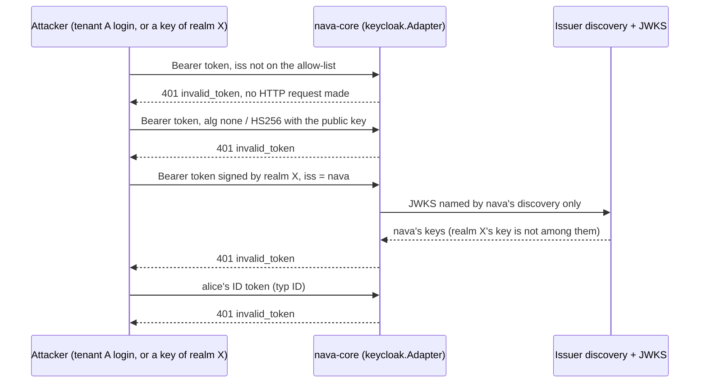

## Boundary

Only a Keycloak **access token** for the platform's API, signed by a key of a
trusted issuer's own JWKS, gets past the edge. An ID token, a refresh token, a
token of another realm, or a token signed with a key the attacker controls is
refused before any tenant is looked up.

## Enforcement point

`keycloak.Adapter` in `internal/identity/keycloak/keycloak.go` is the only
package that imports a JWT or JWKS library (depguard and navalint, CI-11). It
applies, in order:

- `iss` must be on the configured allow-list (`NAVA_OIDC_ISSUERS`), checked
  before any HTTP request, so a token cannot make the service fetch from a
  host it names.
- The signing key comes only from the JWKS that the issuer's own discovery
  document names. That `jwks_uri` must be on the issuer's scheme and host,
  under its path, and neither fetch follows a redirect.
- `alg` must be `RS256` and `kid` must be set; the key itself must be an RSA
  signing key for RS256 (no `none`, no HS256 signed with the public key).
- `exp` is required; `exp` and `nbf` allow 30 s of clock skew.
- `typ` must be `Bearer` and `azp` set, so an ID token is refused.
- One audience per resolver: `nava-api` for tenants, `nava-operator-api` for
  operators. An operator must also be on `Config.Operators`, so a role
  mapping alone never makes anyone an operator.
- An unknown `kid` forces at most one JWKS fetch per issuer per 30 s, shared
  by concurrent callers, so a rotated key works without a restart and an
  unauthenticated caller cannot drive key fetches.

A refusal is 401 `invalid_token`; the error and the log carry no token or
claim value.

## Proving tests

| Attack | Test |
|---|---|
| `alg none`, HS256 with the RS public key, unknown `kid`, wrong `iss` or `aud`, missing `exp`, `exp`/`nbf` past the 30 s skew, `typ` ID or Refresh, no `azp`, no `sub`, tampered body, JSON serialisation, oversized token | `TestVerifyMatrix` (one row each, with the valid token and the 29 s edges as controls) |
| ID token | `TestIDTokenRejected`; CI-5.05 in `TestCI5` |
| A key of realm X signs a token with `iss` of `nava` | `TestRealmKeyCannotSignForAnotherIssuer`; CI-5.04 in `TestCI5`, on the production adapter |
| Unknown issuer drives a fetch | `TestUnknownIssuerMakesNoRequest` |
| `jwks_uri` on another host, or outside the issuer's path | `TestDiscoveryDocumentChecked`, `TestJWKSURIUnderIssuer`, `TestDiscoveryJWKSOnOtherHostNotFetched` |
| Random-`kid` flood | `TestUnknownKidsFetchAtMostOncePer30s`, `TestConcurrentUnknownKidsShareOneFetch` |
| Key rotation still works | `TestRotatedKeyAcceptedWithoutRestart` |
| Tenant user asks for, or exchanges into, the operator audience | `TestTenantCannotRequestOperatorAudience`, `TestTenantCannotExchangeForOperatorAudience`, `TestOperatorAllowList` |
| Forged-issuer token at the running API | `TestForgedIssuerTokenRejectedByAPI` (stack) |
| No token value in errors | `TestErrorsCarryNoTokenValues` |

The live catalogue is CI-5 (`TestCI5`, `make identity-attacks`), described in
[identity-ci5.md](../../../security/identity-ci5.md).

## Fixture that turns it red

`TestKC2612FixtureOrgPickerTamperSucceeds` runs CI-5.06's organization-picker
tamper against the pinned negative-fixture Keycloak (26.1.2) and **requires
the tamper to succeed** there, so a passing CI-5.06 on the current Keycloak
means the attack is refused, not that the case cannot see it. Every row of
`TestVerifyMatrix` that must be refused is paired with a valid control that
must be accepted.

## Accepted risks

<!-- gen:accepted-risks ids=AR-030,AR-045 -->

## Related

- [Tenant resolution](02-tenant-resolution.md), the next step.
- [Keycloak](../system/keycloak.md) component page.
