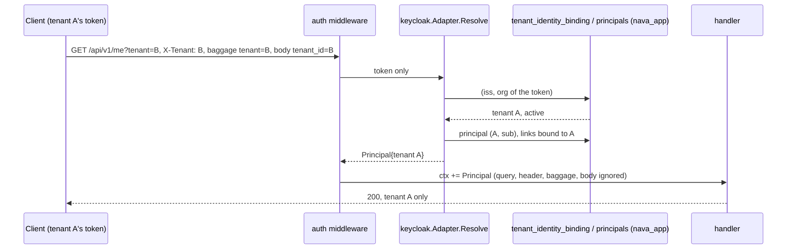

## Boundary

The tenant of a request comes **only** from the validated token, through the
binding of its issuer and organization. Nothing the client controls (path,
query, body, header, W3C baggage) can name or change it. A token that maps to
no tenant, to two tenants, to a tenant that is not active, or to a principal
whose federated identity is not bound to that tenant gets 401.

## Enforcement point

`internal/platform/auth` wraps every `/api/v1` operation. It reads the bearer
token, calls `identity.IdentityResolver.Resolve`, and puts the returned
`identity.Principal` in the request context. Handlers read it with
`identity.FromContext` and pass its `TenantID` to `tenancy.InTenantTx`.

`keycloak.Adapter.Resolve` (ADR-001 A.1 steps 2 to 5):

1. The token must name exactly one organization.
2. `tenant_identity_binding (issuer, org_id)` gives the tenant; the pair is
   `UNIQUE`, so one organization never resolves to two tenants.
3. The bound tenant's `tenants.state` must be `active`, read inside
   `InTenantTx(tenant)`.
4. The token's `idp` claim, if present, must be an IdP alias bound to that
   tenant.
5. The principal (`tenant`, `sub`) must exist, be enabled, and have its
   federated links known and all bound to the tenant.

Any refusal is 401 `tenant_unresolved` with a fixed reason; a store failure is
500, so a database outage never makes clients drop good tokens. The log
carries the reason, never the token or a claim value; `tenant_id` is a log
field and a span attribute after auth, never a metric attribute.

## Proving tests

| Attack | Test |
|---|---|
| Zero or two organizations, unbound `idp`, foreign federated link, NULL links, no principal row | `TestResolveRefusals`; against PostgreSQL `TestT17RefusalsAgainstPostgres` |
| Binding to a tenant that is not active | `TestResolveTenantNotActive`, `TestT17aRefusesNonActiveTenant` |
| Forged tenant in query, header, body or baggage | CI-2 HTTP paths in `TestRegisteredPaths`; `TestMeIgnoresForgedTenant`, `TestGetMeIgnoresSuppliedTenant`, `TestForgedBaggageIsNotInTheContext` |
| Same `sub` in two tenants | `TestGetMeSameSubjectInTwoTenants` |
| A second binding of one `(issuer, org)` | `TestT09DuplicateBindingRejected`; CI-5.12 |
| A token scope naming another tenant's organization; a broker taking over another tenant's user | `TestOrganizationScopeCannotNameAnotherTenant`, `TestBrokerCannotTakeOverUserOfAnotherTenant`; CI-5.01, .02, .06 to .11, .13 in `TestCI5` |
| Logs, spans, metrics | `TestRefusalLogsNoToken`, `TestServerSpanCarriesTenantOnlyAfterAuth`, `TestMetricHasNoTenantAttribute` |

## Fixture that turns it red

Every HTTP path in the isolation suite first requires a baseline
`GET /api/v1/me` to answer 200 for tenant A, so no path can pass on a 401; a
path passes only on a 200 whose body names tenant A and never tenant B. The
CI-5 mutation checks are recorded in
[identity-ci5.md](../../../security/identity-ci5.md#findings): binding tenant B
to `idp-tenant-b` makes CI-5.09 fail, and giving the CI-5.10 seed principal no
link makes that path fail.

## Accepted risks

<!-- gen:accepted-risks ids=AR-035,AR-037 -->

## Related

- [Token validation](01-token.md), the step before.
- [Transaction](03-transaction.md), where the resolved tenant becomes a setting.
- [Core: tenant transactions](../system/core-tenancy.md).
