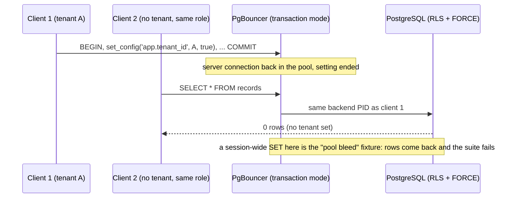

## Boundary

The tenant setting `app.tenant_id`, which every row-level security policy
reads, lives for **one transaction** only. A pooled server connection that
served tenant A must carry nothing of tenant A into the next client's
transaction, even when PgBouncer hands that client the same backend.

## Enforcement point

- `tenancy.InTenantTx(ctx, pool, tenantID, fn)` in
  `internal/tenancy/tenancy.go` is the only Go code that sets the tenant. It
  sends `BEGIN` and `set_config('app.tenant_id', <tenant>, true)` in one round
  trip; `true` is the `SET LOCAL` form, so the setting ends with the
  transaction.
- PgBouncer runs in **transaction** mode, so a server connection is returned to
  the pool at commit or rollback, after the setting has ended.
- The `navalint` `setconfig` rule fails the build on `set_config` or
  `app.tenant_id` in a Go string constant outside `internal/tenancy` (with the
  test exceptions listed in the normative text).
- Worker activities get their tenant from a verified source:
  `workerguard`'s `InTenantTx` wrapper refuses a tenant that did not come from
  the guarded workflow context.

The full path from token to transaction, and the batching helpers on top of
it, are on [Core: tenant transactions](../system/core-tenancy.md).

## Proving tests

| Claim | Test |
|---|---|
| Tenant set in the same round trip as `BEGIN` | `TestBeginSetsTheTenantInOneRoundTrip` |
| Setting ends with the transaction | `TestTenantIsTransactionLocal` |
| A later client on the same backend sees no tenant | `TestTenantNotVisibleThroughPgBouncer`; CI-2 "after an earlier `SET LOCAL`" state in `TestCI2EveryRoleEveryTenantTable`, which asserts the same backend PID through PgBouncer |
| No tenant reaches nothing | `TestNoTenant`; CI-2 "no tenant" and "empty `app.tenant_id`" states |
| Batched and first-batch statements stay in the tenant | `TestBatchCannotReachAnotherTenant`, `TestFirstBatchCannotReachAnotherTenant` |
| The number allocator's transaction leaves no setting behind | `TestAllocTxIsOneSendAndLeavesNoSetting` |
| Group sync's pooled connections do not leak tenant context | `TestTenantContextDoesNotLeakAcrossPooledConnections` |
| Worker activity needs a verified tenant | `TestInTenantTxNeedsVerifiedTenant` |

## Fixture that turns it red

The isolation suite's **pool bleed** fixture replaces `SET LOCAL` with a
session-wide `SET` through PgBouncer. The next transaction on the same backend
then sees tenant A's rows, and `TestFixturesMakeTheSuiteFail` requires that
PASS line to turn FAIL.

## Accepted risks

AR-005 is the one marked **Control disputed**: the `set_config` lint sees
constants only, and no database grant stops run-time SQL from setting the
tenant. It is open with the Security & Multi-Tenancy Reviewer.

<!-- gen:accepted-risks ids=AR-005,AR-008,AR-009 -->

## Related

- [Tenant resolution](02-tenant-resolution.md), the step before.
- [Database](04-database.md), where the setting becomes a predicate.
