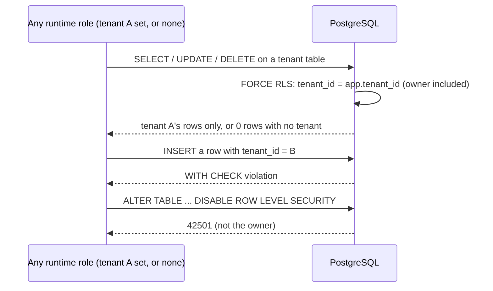

## Boundary

PostgreSQL is the floor under every caller: a handler, a worker activity, the
relay, purge, onboarding or a hand-written query. Whatever the Go code above
forgets, a role connected with tenant A's setting, or with no setting, reaches
**0 rows** of tenant B, or an error. No runtime role can switch the floor off.

## Enforcement point

ADR-001 invariants I1 (tenant wall in the database) and I3 (least-privilege
roles):

- Every tenant table has `tenant_id`, `ENABLE` **and** `FORCE ROW LEVEL
  SECURITY`, and a policy on
  `NULLIF(current_setting('app.tenant_id', true), '')::uuid`. `FORCE` makes the
  policies apply to the table owner as well.
- **Owner vs app.** `nava_migrator` owns the schema and is granted to no one;
  runtime roles (`nava_app`, `nava_worker`, `nava_relay`, `nava_purge`,
  `nava_onboard`, `nava_groupsync`, `nava_erasure`, `nava_audit_reader` and
  the others) own nothing, cannot run DDL, and none has `SUPERUSER` or
  `BYPASSRLS`.
- **Per-service roles.** `db/grants.yaml` lists each role's table and column
  grants; `migrate` grants exactly those and revokes anything else.
- A policy that does not test `app.tenant_id` must be on the ADR-001 Annex A.3
  allow-list (`catalog.AllowList()`, `internal/db/catalog/policy.go`), and has
  a fixed `FOR`, `TO` and predicate. Today it has 13 policies; these are the
  only places a role can reach rows across tenants:
  - `outbox_relay_select`: `SELECT` by `nava_relay`, `USING (true)`.
  - `outbox_relay_update`: `UPDATE` by `nava_relay`, `USING` pending rows
    (`dispatched_at IS NULL AND dead_at IS NULL`), `WITH CHECK (true)`.
  - `binding_lookup`: `SELECT` by `nava_app` and `nava_groupsync`, `USING (true)`.
  - `binding_onboard`: `INSERT` by `nava_onboard`, `WITH CHECK` the tenant is
    `provisioning`.
  - `idempotency_purge` and `idempotency_purge_select`: `DELETE` and `SELECT`
    by `nava_purge`, `USING` the key is expired (`expires_at < now()`).
  - `outbox_purge` and `outbox_purge_select`: `DELETE` and `SELECT` by
    `nava_purge`, `USING` dispatched more than 7 days ago or dead more than
    30 days ago.
  - `workflow_ref_purge` and `workflow_ref_purge_select`: `DELETE` and `SELECT`
    by `nava_purge`, `USING` closed more than 30 days ago.
  - `audit_chain_head_purge_select`: `SELECT` by `nava_purge`, `USING` the R17
    predicate (shared with the `chain:reseed` gate).
  - `record_counters_purge` and `record_counters_purge_select`: `DELETE` and
    `SELECT` by `nava_purge`, `USING` a period counter more than 2 days past
    its `period_end` (ADR-005 §4.3; never an open, in-grace or NULL row).

  So `nava_purge` selects and deletes expired rows of every tenant.
  `PinnedTenantPolicies()` adds a state test to the tenant predicate for the
  onboarding and group-sync policies (for example the tenant is `provisioning`,
  or its group is tombstoned).
- Unique keys and foreign keys include `tenant_id`, so a row of tenant A can
  never reference a row of tenant B.
- `pgbouncer.get_auth(text)` is the one `SECURITY DEFINER` exception: the
  infrastructure function in `db/grants.yaml`, granted only to
  `pgbouncer_auth`, which returns no row for a superuser, `BYPASSRLS` or
  `REPLICATION` role. `main` has no views. The proof is CI-1
  (`ci1SecurityDefiner`), which fails on any other `SECURITY DEFINER` function.

The policy text of every table is on [Row-level security](../database/rls.md),
and every role's grants are on [Roles and grants](../database/roles-and-grants.md).

## Proving tests

| Claim | Test |
|---|---|
| Every role, every tenant table, every granted statement, in the no-tenant, empty-tenant and after-`SET LOCAL` states, directly and through PgBouncer, reaches 0 rows of B; with tenant A set, only A's rows | `TestCI2EveryRoleEveryTenantTable` (the owner included) |
| Tenant tables are found fail-closed (every platform table not in `db/global-tables.yaml`), and each needs seed rows for both tenants | `TestT11TenantTablesFailClosed` |
| Every table forces RLS; the policy allow-list catches a leaking policy | `TestT09EveryTableForcesRLS`, `TestT09PolicyAllowListCatchesLeaks`, `TestExemptionsAreAllowListed` |
| Foreign keys include the tenant | `TestT09ForeignKeyIncludesTenant`, `TestP302ForeignKeysRejectCrossTenant` |
| No superuser or `BYPASSRLS` role; the migrator is granted to no one; the app cannot run DDL | `TestD28NoSuperuserOrBypassRLS`, `TestMigratorOwnsDatabaseAndIsGrantedToNoOne`, `TestAppCannotRunDDL` |
| One `SECURITY DEFINER` exception (`pgbouncer.get_auth`); no views on `main` | `TestT10GateEmptySecurityDefinerExceptions`, `TestT10GatePassesSecurityInvokerView` |
| System roles (relay, purge, onboard, backup) reach only what their row of ADR-001 allows (CI-9) | DB paths in `TestRegisteredPaths` |

## Fixture that turns it red

`TestFixturesMakeTheSuiteFail` applies each fixture and requires a PASS line
to turn FAIL: `NO FORCE` on `records` (caught on the owner line), RLS disabled
on `outbox`, a fail-open policy, and a session-wide `SET` through PgBouncer.
`TestCI9FixturesMakePathsFail` widens one system role's grant or policy at a
time (a `records` column granted to the relay, a data column granted to purge,
a purge policy that stops testing expiry, an onboarding policy without its
state test) and requires its path to fail.

## Accepted risks

AR-001 and AR-002 are the two High and Medium residuals of ADR-001 that touch
this layer: a stolen `nava-worker` certificate can set any `app.tenant_id`, so
RLS cannot stop it, and Temporal histories in the shared cluster are not
encrypted.

<!-- gen:accepted-risks ids=AR-001,AR-002,AR-003,AR-029,AR-031,AR-032,AR-041 -->

## Related

- [Transaction](03-transaction.md), where the setting is applied.
- [Temporal](05-temporal.md), the other side of AR-001 and AR-002.
- [Row-level security](../database/rls.md), [Roles and grants](../database/roles-and-grants.md).
