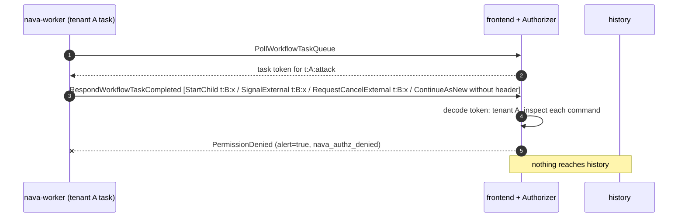

## Boundary

All tenants share one Temporal namespace, one worker fleet and one task
queue. A workflow running for tenant A must not start, signal, cancel or
continue into a workflow of tenant B, and a platform process holding one
Temporal certificate must not call an API outside its row of the allow-list
or reach the server's internal ports. Record data must not be written into
Temporal history.

## Enforcement point

Three layers, lowest first:

1. **Certificate and network.** mTLS with the installation CA; the gateway
   forwards only the frontend port; internode traffic uses its own CA, so a
   platform certificate cannot join the cluster.
2. **Authorizer** (`temporal-server/authz`, a custom server build pinned by
   ADR-001-A1). Each certificate CN is an identity with a fixed row of allowed
   API methods and workload types (the D9 allow-list, golden-tested). For a
   worker's task completion it decodes the task token, takes the tenant from
   the workflow id prefix `t:<tenant>:`, and refuses any command that targets
   another tenant's workflow id, continues-as-new without the matching
   `nava-tenant` header, or is not on the command list. Each deny is logged
   with `alert=true` and counted in `nava_authz_denied`.
3. **Worker guard** (`internal/workerguard`, in the worker process). The SDK
   interceptors check the `nava-tenant` header on start, signal, child,
   continue-as-new and memo calls, and withhold any result, failure or payload
   that carries record data before it reaches history (CI-7).

The workflow id is built from the tenant of the JWT on the platform side, never
from a client value (R-CORE); that rule is enforced in `nava-core` code and
tests, not by the Authorizer (AR-004).

## Proving tests

| Attack | Test |
|---|---|
| Certificate from another CA, or none; a CN that is not an identity | `TestCI6_RogueCACertificateRejectedAtHandshake`, `TestCI6_UnlistedCertificateDeniedByAuthorizer`, `TestAdversarialUnverifiedCertificateDenied` |
| Internal ports and internode handshake | `TestCI6_PlatformNetworkCannotReachInternalPorts`, `TestCI6_PlatformCertificateRejectedAtInternodeHandshake` |
| Any method outside an identity's row | `TestCI6_RelayCoreWorkerOutsideAllowListDenied`, `TestCI6_OperatorLimitedToPinnedList`; allow-list pinned by `TestAllowListGolden`, `TestAllowListMatchesADRRules` |
| Cross-tenant child, signal, cancel | `TestCI6_WorkerCrossTenantChildDeniedWithAlert`, `TestCI6_WorkerCrossTenantSignalExternalDeniedWithAlert`, `TestCI6_WorkerCrossTenantCancelExternalDeniedWithAlert` |
| Continue-as-new with no, a mismatched, or a cron header | `TestCI6_WorkerContinueAsNewMissingTenantHeaderDenied`, `TestCI6_WorkerContinueAsNewMismatchedTenantHeaderDenied`, `TestCI6_WorkerContinueAsNewCronScheduleDenied` |
| Unlisted command, undecodable token, unprefixed workflow id | `TestCI6_WorkerUnlistedCommandTypeDenied`, `TestCI6_WorkerUndecodableTaskTokenDenied`, `TestCI6_WorkerTaskWithoutTenantPrefixDenied` |
| Tenant prefix on workflow ids, task tokens and history reads | `TestAdversarialF2CoreWorkflowIDTenantPrefix`, `TestAdversarialF2ActivityTaskTokenTenantPrefix`, `TestAdversarialF2WorkerHistoryTenantPrefix`, `TestAdversarialWorkerCrossNamespaceCommandsDenied` |
| Worker-side header checks | `TestSignalGuard`, `TestChildGuard`, `TestContinueAsNewGuardMissingHeader`, `TestAdversarialChildNavaTenantIdOtherKeyType`, `TestAdversarialUpsertNavaTenantIdOtherKeyType`, `TestCI6_WorkerStartWithMissingOrMismatchedHeaderFailsWorkflow`, `TestCI6_WorkerWrongTenantSignalDroppedWithAlertWorkflowKeepsRunning`, `TestWorkflowRefCloseIsTenantScoped` |
| No record data in history | `TestCI7_RecordedHeadersCarryOnlyTenantAndTraceContext`, `TestCI7_ActivityResultWithRecordDataNotRecorded`, `TestCI7_WorkflowFailureWithRecordDataNotRecorded` and the other `TestCI7_` cases listed in [temporal-ci6.md](../../../security/temporal-ci6.md) |
| Allowed path still works | `TestCI6_Allowed_SameTenantChildCompletes` (control) |

The last local CI-6 report is [ci6-report.md](../../../security/ci6-report.md).

## Fixture that turns it red

A mutation was run by hand while writing CI-6: with the child target switched
to the attacker's own tenant, the cross-tenant child test fails (the call is
allowed and no alert is logged), so the deny depends on the tenant, not only
on the command type. Each worker-command test also requires that no
`WorkflowTaskCompleted` appears in the attacker's history, so a deny that
still wrote history fails.

## Accepted risks

AR-001 (a stolen `nava-worker` certificate reaches every tenant) and AR-002
(histories are not encrypted in M1) are the accepted residuals of sharing one
Temporal cluster across tenants.

<!-- gen:accepted-risks ids=AR-001,AR-002,AR-004,AR-013,AR-016,AR-019,AR-025,AR-040,AR-042,AR-043,AR-S11a-01,AR-TICK-386-01 -->

## Related

- [Database](04-database.md), the other side of AR-001.
- [Temporal server](../system/temporal-server.md), [nava-worker](../system/nava-worker.md).
