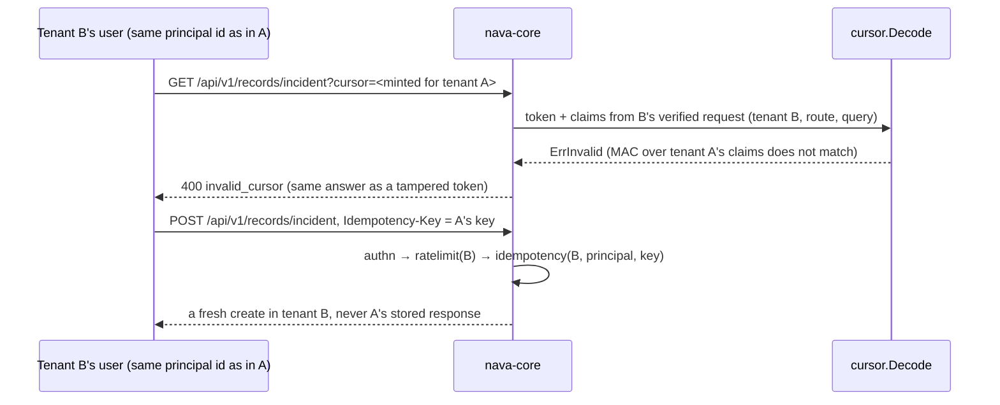

## Boundary

The API hands clients two kinds of value they later send back: **pagination
cursors** and **idempotency keys**. Neither may carry tenant A's state into a
request of tenant B, or let one tenant's replay answer with another tenant's
stored response. A failure must not tell the caller which binding failed.

## Enforcement point

**Cursors** (`internal/platform/cursor`). A cursor is
`<key id>.<position>.<mac>`, where the MAC is HMAC-SHA256 over the key id, the
claims and the position. The claims (tenant, principal, route, query, and
workflow where used) are **not** in the token: the decoder takes them from the
verified request. So a cursor minted for tenant A fails for tenant B even
with the same principal id, and a cursor from one route fails on another.
Every failure is the single `ErrInvalid`, answered as `invalid_cursor`, so a
caller cannot tell a tampered token from a cross-tenant one. Keys rotate; a
retired key no longer verifies. The position is signed, not encrypted.

**Idempotency keys** (`internal/platform/idempotency`). A key is scoped to
`(tenant_id, principal_id, key)` in `idempotency_keys`, under RLS. That scope
holds only if the middleware runs behind authentication and behind the
per-tenant rate limit, so every tenant write route must be wrapped in
`authn → ratelimit → idempotency`. The write-chain tripwire in
`internal/server/write_chain_test.go` checks that order on the real handler.

## Proving tests

| Attack | Test |
|---|---|
| Replay tenant A's cursor as tenant B, same principal id | `TestCrossTenantCursorIsInvalidCursor`, `TestAdversarialCrossTenantReplaySamePrincipalID` |
| Replay a cursor on another route | `TestRouteClaimStopsCrossEndpointReplay` |
| Supply a tenant in the request to change the claims | `TestClaimsForIgnoresClientTenant`, `TestTenantClaimIsRequired`, `TestCursorRoutesRefuseAPrincipalWithoutATenant` |
| Tamper, swap key ids, smuggle claim values, use a retired key | `TestTamperedTokenIsInvalid`, `TestAdversarialKeyIDSwap`, `TestAdversarialClaimValueSmuggling`, `TestAdversarialRetiredKeyCannotVerify` |
| Probe which check failed | `TestAdversarialEveryFailureIsTheSameValue` |
| CI-8 cursor paths through the real handler | `TestCursorPathsHold` |
| Reuse tenant A's idempotency key as tenant B | `TestReplayReuseAndScope`, `TestIdempotencyKeyIsNotSharedAcrossTenants`, `TestCreateRecordSameKeyInTwoTenantsCreatesTwo`, `TestAdversarialIdempotencyKeyDoesNotCrossTenants` |
| One tenant's open claim blocks another tenant | `TestCreateRecordSameKeyHeldOpenInOtherTenantDoesNotBlock` |
| Another principal of the same tenant reuses the key | `TestIdempotencyKeyIsScopedByPrincipal` |

## Fixture that turns it red

`TestWriteChainTripwireFixtures` mounts the real auth, rate-limit and
idempotency middleware around one write route. The correct chain passes; each
broken chain must fail: idempotency missing, idempotency before the rate
limit, idempotency outside authn, the rate limit outside authn, authn only,
and no middleware. `TestWriteChainTripwireIsRedOnTheRealHandler` probes today's
handler as if `POST /api/v1/me` were a write route (it has no idempotency
layer), and requires the probe to fail.

## Accepted risks

<!-- gen:accepted-risks ids=AR-S10-01 -->

## Related

- [ACL and masks on reads](09-acl-masks-read.md): a masked sort key never enters a cursor.
- [Idempotency tables](../database/idempotency.md).
