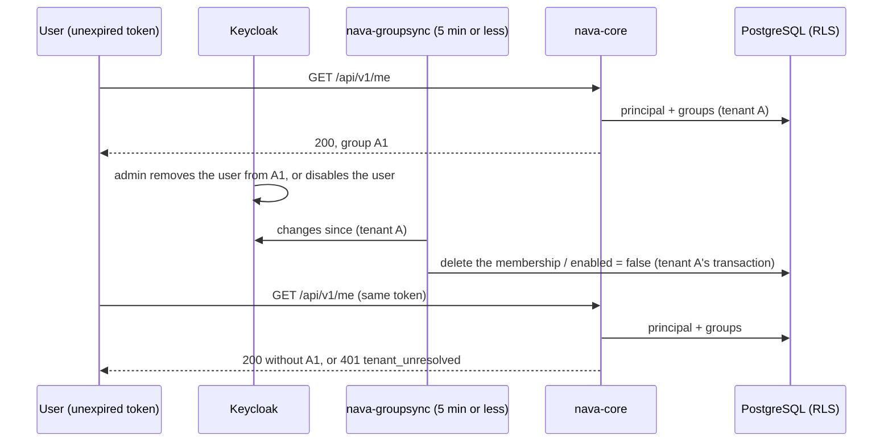

## Boundary

A user removed from a group, or disabled, loses that access **within 10
minutes**, even while holding an unexpired token. Nobody can raise their own
tenant, role or group through Keycloak self-service, a service account,
token exchange or the operator role. Group sync and invitations act only
inside one tenant.

## Enforcement point

- **Groups and `enabled` come from the database, not the token.** The API
  reads the principal's groups and its `enabled` flag from the synced rows on
  every request (`pgstore.principalSQL`). Once one `nava-groupsync` cycle has
  applied a change, an unexpired token already sees it.
- **The bound (D-P9).** `nava-groupsync` runs at most every 5 minutes
  (`config.MaxGroupsyncInterval`), and the realm's access-token lifespan is at
  most 300 s.
- **Group sync is per tenant.** Each cycle applies one tenant's snapshot inside
  that tenant's transaction as `nava_groupsync`; a hostile snapshot that names
  another tenant's rows changes nothing there.
- **Keycloak.** The account console and profile cannot change any attribute
  that feeds a tenant, role or group claim; token exchange is disabled; service
  accounts carry no organization; `nava-operator` cannot be self-assigned, and
  an operator must also be on the adapter's allow-list
  ([token](01-token.md)).
- **Operator and tenant tokens do not cross.** A tenant admin's token is
  refused on `/api/v1/operator/*`; an operator token (audience
  `nava-operator-api` only) gets 401 on a tenant endpoint.

## Proving tests

The eight T26 cases (TICK-82), one named test or registered path each:

| # | Case | Test |
|---|---|---|
| 1 | A group removal takes effect within 10 minutes | path `T26-1` in `TestRegisteredPaths` (real `groupsync.Syncer` between two calls with one token) |
| 2 | A disabled user's token stops working within 10 minutes | path `T26-2` in `TestRegisteredPaths` |
| 3 | Self-service cannot change a tenant, role or group attribute | `TestSelfServiceCannotChangeTenantRoleOrGroupAttributes` |
| 4 | A service-account token cannot act in any tenant | `TestServiceAccountTokenCannotActInAnyTenant` |
| 5 | Token exchange stays disabled | `TestTokenExchangeStaysDisabled` |
| 6 | A tenant admin token is refused on operator routes | path `T26-6` in `TestRegisteredPaths` |
| 7 | A user cannot self-assign `nava-operator` | `TestUserCannotSelfAssignOperatorRole` |
| 8 | An operator token on a tenant endpoint gets 401 | path `T26-8` in `TestRegisteredPaths` |

Cases 3, 4, 5 and 7 need the real Keycloak and run in
`make stack-test-identity`; the isolation report lists them as `STACK`.

Group sync and invitations across tenants: `TestHostileSnapshotNeverTouchesAnotherTenant`,
`TestTombstoneIsolatedPerTenant`, `TestTenantACannotReachTenantBGroups`,
`TestDisableUserInAnotherTenantsSubtreeIsRefused`,
`TestInviteCannotEnrolAnotherTenantsUser`, `TestInviteCannotSquatAnotherTenantsEmail`,
`TestGetMeTombstonedAndDisabledPrincipals`.

## Fixture that turns it red

`TestStackPathsExist` fails when a stack case's named test is renamed or
deleted, so the four Keycloak-only cases cannot silently drop out of the
report. Cases 1 and 2 call the real handler with the same token before and
after the sync cycle, and require the first call to show the group (or to
succeed), so a case that never had the access cannot pass.

## Accepted risks

<!-- gen:accepted-risks ids=AR-022,AR-030,AR-036,AR-038,AR-045,AR-S8-01,AR-TICK-529-04 -->

## Related

- [nava-groupsync](../system/nava-groupsync.md), [Keycloak](../system/keycloak.md).
- Full case notes: [deprovisioning-identity-boundary.md](../../../security/deprovisioning-identity-boundary.md).
