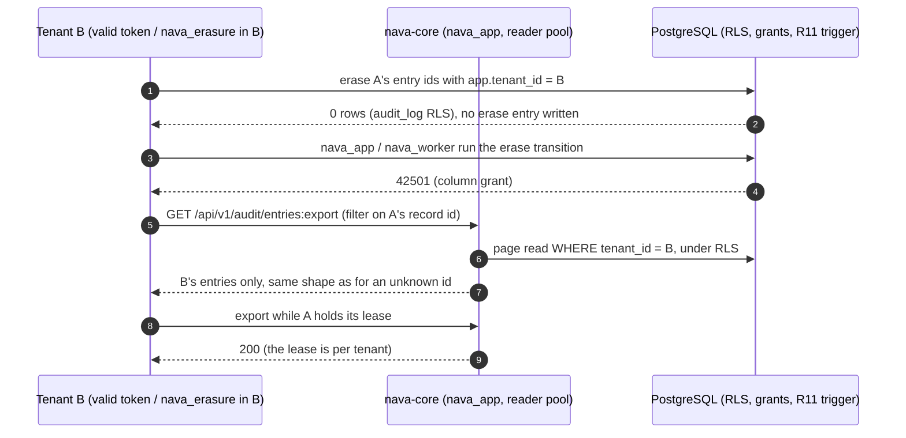

## Boundary

Tenant B, holding a valid token or a database login bound to tenant B, must
not export, erase, hide or learn the existence of tenant A's audit entries.
Only the `nava_erasure` role can erase, it cannot read what it erases, and
every erasure must be visible to the offline verifier.

## Enforcement point

Lowest layer first (ADR-004 R11, R17, R19 to R24, ADR-004-A1):

- **`audit_log` RLS** on every read and every erase transition.
- **Column grants.** Only `nava_erasure` may update the erase columns;
  `nava_app` and `nava_worker` get 42501. `nava_erasure`'s `SELECT` grant
  leaves out `diff` and `diff_salt`, and only `nava_audit_reader` may read them.
- **R11 `BEFORE UPDATE` trigger.** An entry can be erased once; a second
  erase is rejected.
- **Export, lease and reseed predicates.** The export page read, the export
  lease and the reseed gate each filter on the caller's tenant, under RLS.
  The lease is a per-tenant row, so one tenant's export never blocks
  another's.
- **Write-time and read-time secret checks.** Secret values are refused at
  write (R6) and masked at read (R7), so they never reach export bytes.
- **The erase helper is test-only.** No `cmd/*` binary links
  `internal/audit/erasetest`.
- **Offline verifier, step 7.** A diff nulled without a sealed erase entry
  verifies `tampered`; an unsealed erase verifies `pending` (see
  [audit chain](10-audit-chain.md)).

## Proving tests

| Guard | Test |
|---|---|
| `audit_log` RLS | `TestCIA4EraseNeverCrossesTenants`, `TestCIA4NoTenantContextReachesNothing` |
| Erase-column grants | `TestCIA7AppAndWorkerCannotErase` |
| R11 trigger | `TestCIA7SecondEraseIsRejected` |
| No `diff` read for `nava_erasure` | `TestCIA7ErasureCannotReadDiff`, `TestP510bErasureCannotReadDiff` |
| Verifier step 7 | `TestCIA7NulledDiffWithoutEraseEntryIsTampered`, `TestCIA7EraseVerifiesPendingThenPass` |
| Export page and stubs | `TestCIA4ExportAndStubsNeverCrossTenants` |
| Export lease | `TestCIA4ExportLeaseIsPerTenant` |
| Reseed gate | `TestCIA4ReseedReadsOnlyItsOwnHead`, `TestReseedGateIsTenantScoped` |
| No secret in export bytes | `TestCIA5ExportBytesCarryNoCanary` |
| Erase helper not shipped | `TestNoBinaryLinksTheEraseHelper` |

The CI-A4 and CI-A5 tests run through the real handler, sealer and offline
verifier in `make test-integration`.

## Fixture that turns it red

Each guard was shown red with only that guard removed; the table with each
mutation and its result is in
[audit-erasure-export-isolation.md](../../../security/audit-erasure-export-isolation.md#guards-and-their-red-runs).
For example, with `audit_log` RLS disabled tenant B erases tenant A's entry,
and with the R11 trigger disabled a second erase moves `erasure_ref`. Each
test pins its own layer: the masker failing closed, or the read-time mask,
is not counted as the guard.

## Accepted risks

<!-- gen:accepted-risks ids=AR-TICK-409-06,AR-TICK-549-01 -->

## Related

- [Audit chain](10-audit-chain.md), where an erasure must stay visible.
- [Audit tables](../database/audit.md).
