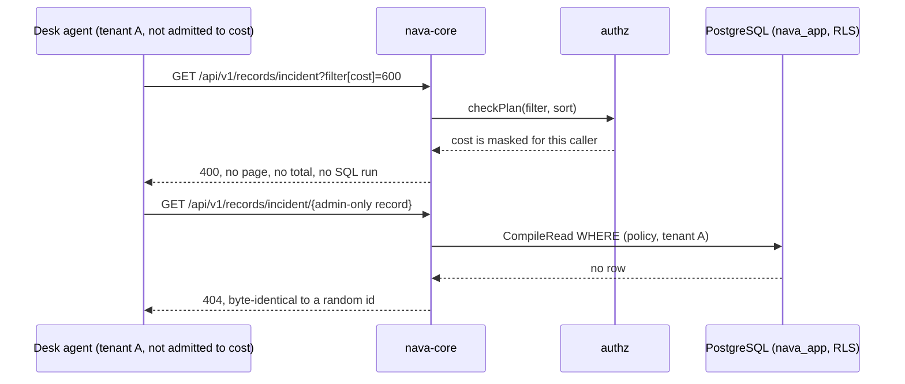

## Boundary

A user of the right tenant whom the record ACL does not admit, or who may not
read a masked field, learns nothing about that record or field through any
read surface: get, list (filter, sort, total, cursor), history, the access
explainer, or an error response. A record they cannot see answers exactly like
a record that does not exist.

## Enforcement point

`internal/authz` is the one authorization layer (ADR-001 I5), evaluated inside
the query and in the caller's tenant transaction:

- **Rows.** `CompileRead` turns the tenant's published policy into the
  `WHERE` of the record query, with the share `EXISTS` matched on `tenant_id`
  and the `(kind, id)` pair. `canRead` maps a hidden record to the
  missing-record 404, before `If-Match`, so there is no 403 or 412 oracle.
- **Fields.** `authz.Shape` drops masked fields from every response body,
  including history `before` and `after` (`changed` is computed after
  shaping).
- **Queries.** `checkPlan` (`authz.CheckQueryFields`) refuses a filter or sort
  on a masked field with a 400 **before any SQL runs**, so neither the result,
  the total nor the timing depends on the hidden value.
- **Explainer.** Requires the tenant admin first, runs in the caller's tenant,
  and lists only masked fields the admin can read.
- **Subjects.** `authz.NotInTenant` refuses another tenant's group or user in a
  policy or mask, with the same 422 as an unknown id (`foreign_id` in a
  format-2 document; the id is not echoed). Since S30 the database repeats
  it: the `acl_versions_tenant_ids` trigger (`SECURITY INVOKER`) refuses a
  row naming another tenant's id, and no runtime role can turn it off.
- **Composed rules (S30).** A `ref` resolves only inside the same document
  and version, never across tenants. A policy the planner cannot use is
  **voided**: it grants nothing on any read surface and the explainer lists
  it under `invalid`. Only `nava_app` may insert an `acl_versions` row
  (ADR-010-A1 A1-3).

How the ACL is compiled and how masks apply are on
[Core: ACL](../system/core-acl.md) and [Core: field masks](../system/core-masks.md).

## Proving tests

The S10 attack rows (P3-37) are registered isolation paths under CI-8, run by
`TestRegisteredPaths` through the real handler as `nava_app` via PgBouncer;
each row and its red mutation is in
[s10-acl-attacks.md](../../../security/s10-acl-attacks.md#rows).

| Surface | Test |
|---|---|
| Filter, sort, default sort on a masked field: 400 before SQL | `TestMaskedFieldInFilterIsRefusedBeforeSQL`, `TestMaskedFieldInSortIsRefusedBeforeSQL`, `TestMaskedFieldInDefaultSortIsRefusedBeforeSQL`, `TestCheckMaskFields` |
| A masked sort key never enters a cursor | `TestListRecordsMaskedSortKeyInCursor` |
| List and get bodies are shaped | `TestListRecordsItemsAreShaped`, `TestShapeDropsMaskedFieldsAndNeverMutates` |
| History of a change to a masked field only | `TestHistoryOfAMaskedOnlyChange` |
| PATCH is no oracle for a masked value | `TestPatchIsNoOracleForAMaskedField` |
| GET, history and PATCH (no, `*`, stale and current `If-Match`) on a record the ACL denies answer exactly like a missing record, and the refused PATCH writes nothing | `TestUnreadableRecordIsTheMissingRecord` (the admin's GET of the same record is the control) |
| An unreadable match is in neither the page nor `total` | `TestListRecordsHidesUnreadableFromPageAndTotal` |
| A unique-violation 409 caused by an unreadable record names no id or number of it and carries no `Location` or `ETag` | `TestUniqueViolationDoesNotIdentifyAnUnreadableRecord` |
| The not-found body itself is fixed and has no `instance` (supporting, not the proof above) | `TestNotFoundBodyIsIdenticalAndHasNoInstance` |
| Another tenant's records and groups in a list | `TestListRecordsCrossTenant`, `TestListRecordsFilterOnAnotherTenantsGroup` |
| Explainer lists only what the admin may read, and matches enforcement | `TestExplainNeverListsAFieldTheAdminCannotRead`, `TestExplainMatchesTheEnforcementOnState`, `TestExplainAccessNamesTheRuleAndHidesWhatTheAdminCannotRead`, `TestRequireTenantAdminTxNeverReadsGroupsOrPaths` |
| Every mask on a field must admit; row-dependent mask subjects never match | `TestEveryMaskOnAFieldMustAdmit`, `TestRowDependentMaskSubjectsNeverMatch` |
| Masks on audit entries | `TestAuditEntriesMaskFieldsHiddenFromTheReader` |

### S30: composed rules (TICK-943)

The S30 rows are in
[s30-composable-access-rules.md](../../../security/s30-composable-access-rules.md#attack-table).

| Attack | Result | Test |
|---|---|---|
| Tenant A's document names tenant B's group, user or principal | 422 `foreign_id`, same bytes as an unknown id; a direct insert gets 23514 from the trigger | `TestPutAccessFormat2ForeignIDsAreForeignID`, `TestTICK940ForeignIDs` |
| A `ref` to a name defined only in tenant B's document or an older version | 422 `unresolved_ref`, same bytes as a name nobody defined | `TestS30RefNeverResolvesAcrossTenantsOrVersions` |
| A voided policy stored past the checks | Grants nothing on list, read or PATCH (the missing-record 404, never 412 or 428); listed in the explainer's `invalid` | `TestS30VoidedPolicyGrantsNothingAnywhere`, `TestS30Format2DenyTraceHasAFalseStep` |
| Tenant A's explainer pointed at tenant B's record, user or group | The missing-record 404; no tenant B policy or condition name | `TestS30ExplainerStaysInItsTenantUnderFormat2` |
| Tenant B's admin `GET`/`PUT` on a key only tenant A has | The unknown-key 404, no `ETag` | `TestS30AnotherTenantsKeyIsTheUnknownKeyForGetAndPut` |
| Masks under format 2 | Same bodies and `masked_fields` as format 1 | `TestS30MasksBehaveTheSameUnderEitherFormat` |
| `under` with tenant B's org unit | 422 `foreign_id` at the id's pointer from the route (TICK-950), the same body as a tombstoned or unknown unit; a direct insert gets 23514 `foreign_id` from the trigger (TICK-947, which closed `AR-S30-01`) | `TestS31UnderChecksUnitsAtTheRouteAndGrantsBySubtree` |
| A runtime role skips the tenant-id trigger, or `nava_worker` publishes | 42501 for every runtime role; the worker's insert fails | `TestRuntimeRolesCannotSkipTheTenantIDTrigger`, `TestTICK940WorkerCannotPublish` |

## Region access (S31)

The full review is [s31-org-unit-isolation.md](../../../security/s31-org-unit-isolation.md)
(TICK-952): **no exploitable isolation gap**. Every guard holds at the
database: FORCE RLS on `org_units`, `org_unit_members` and
`org_unit_closure`, grants, and foreign keys that carry `tenant_id`. The
`under` leaf and the primary-unit lookup also filter by tenant on top of RLS.

| Attack | Result | Test |
|---|---|---|
| Read or write tenant B's `org_unit_members` as any runtime role | Only A's rows are read; every write is refused (42501 or 23503) or reaches 0 rows | the `org_unit_members:` paths in `internal/tenancy/isolation/registry.go` |
| Give a record of A a unit of B, through the body or a forged primary membership | The body is `422 field_not_writable` for every source; the forged lookup fails closed on `records_org_unit_fkey` | `TestRecordNeverGetsAnotherTenantsOrgUnit`, `TestCreateRefusesOrgUnitInBody`, `TestTICK947RecordOrgUnitIsTenantScoped` |
| A tombstoned unit, or a forged member of one, grants through `under` | Refused by the live FK; a forged row adds nothing to U, nor does its live subtree | `TestUnderSetIgnoresForgedCrossTenantAndTombstonedRows`, `TestTICK947MembershipConstraints` |
| U holds a unit of B, or a binding made in A is evaluated for B | Never; a binding for another tenant voids the policy, `not under` included | `TestUnderSetBoundInOneTenantGrantsNothingToAnother` |
| A crafted directory payload un-tombstones, renames or reparents B's unit | Nothing of B changes; group sync has no `DELETE` | `TestDirectoryPayloadNeverUntombstonesAnotherTenantsUnit`, `TestTICK947GroupsyncCannotDeleteOrgUnits` |
| `nava_primary_org_unit` names a path that exists only in B | No primary is set, so a new ticket's unit stays NULL | `TestPrimaryOrgUnitPathOnlyInAnotherTenantSetsNoPrimary`, `TestCreateAfterSyncWithForeignPrimaryPathLeavesOrgUnitNull` |

An orphaned unit (its parent missing, which only a forged row can produce)
has no closure row, so `under` is false and `not under` is true for it. The
count of such units is the metric `groupsync_org_closure_unrooted_units`.

**Within one tenant.** The list shape the probe picks can show in latency
whether more than K\* records sit under a policy's units: one coarse bit,
inherent to ADR-010-A2, accepted as `AR-TICK-1040-01`. A slow probe's SQL
text includes `LIMIT K*+1`, so keep `log_min_duration_statement` and
`auto_explain` off for the app role and never ship the PostgreSQL server log
anywhere a tenant can read it. A user moved out of a unit keeps `under`
access until the next sync (`AR-TICK-901-01`, ADR-010 R3).

## Fixture that turns it red

Each S10 row was shown red by a named mutation: `checkPlan` returning nil
gives 200 on a masked filter; `canRead` answering 403 fails the oracle check;
no shaping puts `cost` into history `after`; the explainer's `Readable` filter
dropped names a field the admin cannot read. Row 7 (share forgery) needs both
the tenant predicate dropped **and** RLS off on `record_shares` to go red,
which shows the two layers are independent.

## Accepted risks

Errors and logs are part of the read side: AR-006 (a recovered panic value is
logged as is) and AR-010 (`error.type` export shape) apply here.

S30 added `AR-S30-01` (`under` refused at the route only), closed by TICK-947,
and `AR-TICK-971-01` (a crafted document costs up to about 90 ms per publish
at the default byte limit, about 340 ms at the 128 KiB ceiling), on the
[ADR-010-A1 page](../adr/adr-010-a1.md#residuals) and in
[accepted-risks.md](../../../security/accepted-risks.md).

<!-- gen:accepted-risks ids=AR-006,AR-010,AR-TICK-653-01,AR-TICK-653-02,AR-TICK-1040-01,AR-S31-01 -->

## Related

- [Opaque tokens](06-opaque-tokens.md), for cursors.
- [ACL tables](../database/acl.md).
