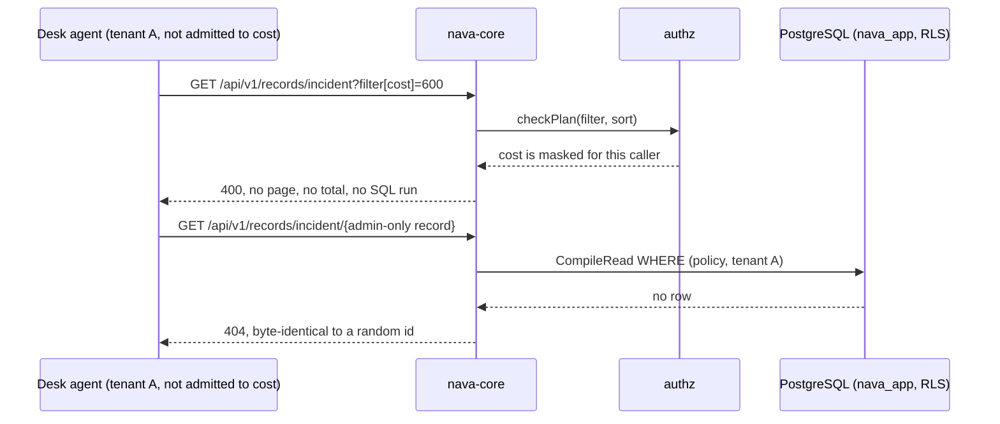

## Boundary

A user of the right tenant whom the record ACL does not admit, or who may not
read a masked field, learns nothing about that record or field through any
read surface: get, list (filter, sort, total, cursor), history, the access
explainer, or an error response. A record they cannot see answers exactly like
a record that does not exist.

## Enforcement point

`internal/authz` is the one authorization layer (ADR-001 I5), evaluated inside
the query and in the caller's tenant transaction:

- **Rows.** `CompileRead` turns the tenant's published policy into the
  `WHERE` of the record query, with the share `EXISTS` matched on `tenant_id`
  and the `(kind, id)` pair. `canRead` maps a hidden record to the
  missing-record 404, before `If-Match`, so there is no 403 or 412 oracle.
- **Fields.** `authz.Shape` drops masked fields from every response body,
  including history `before` and `after` (`changed` is computed after
  shaping).
- **Queries.** `checkPlan` (`authz.CheckQueryFields`) refuses a filter or sort
  on a masked field with a 400 **before any SQL runs**, so neither the result,
  the total nor the timing depends on the hidden value.
- **Explainer.** Requires the tenant admin first, runs in the caller's tenant,
  and lists only masked fields the admin can read.
- **Subjects.** `authz.NotInTenant` refuses another tenant's group or user in a
  policy or mask, with the same 422 as an unknown id.

How the ACL is compiled and how masks apply are on
[Core: ACL](../system/core-acl.md) and [Core: field masks](../system/core-masks.md).

## Proving tests

The S10 attack rows (P3-37) are registered isolation paths under CI-8, run by
`TestRegisteredPaths` through the real handler as `nava_app` via PgBouncer;
each row and its red mutation is in
[s10-acl-attacks.md](../../../security/s10-acl-attacks.md#rows).

| Surface | Test |
|---|---|
| Filter, sort, default sort on a masked field: 400 before SQL | `TestMaskedFieldInFilterIsRefusedBeforeSQL`, `TestMaskedFieldInSortIsRefusedBeforeSQL`, `TestMaskedFieldInDefaultSortIsRefusedBeforeSQL`, `TestCheckMaskFields` |
| A masked sort key never enters a cursor | `TestListRecordsMaskedSortKeyInCursor` |
| List and get bodies are shaped | `TestListRecordsItemsAreShaped`, `TestShapeDropsMaskedFieldsAndNeverMutates` |
| History of a change to a masked field only | `TestHistoryOfAMaskedOnlyChange` |
| PATCH is no oracle for a masked value | `TestPatchIsNoOracleForAMaskedField` |
| GET, history and PATCH (no, `*`, stale and current `If-Match`) on a record the ACL denies answer exactly like a missing record, and the refused PATCH writes nothing | `TestUnreadableRecordIsTheMissingRecord` (the admin's GET of the same record is the control) |
| An unreadable match is in neither the page nor `total` | `TestListRecordsHidesUnreadableFromPageAndTotal` |
| A unique-violation 409 caused by an unreadable record names no id or number of it and carries no `Location` or `ETag` | `TestUniqueViolationDoesNotIdentifyAnUnreadableRecord` |
| The not-found body itself is fixed and has no `instance` (supporting, not the proof above) | `TestNotFoundBodyIsIdenticalAndHasNoInstance` |
| Another tenant's records and groups in a list | `TestListRecordsCrossTenant`, `TestListRecordsFilterOnAnotherTenantsGroup` |
| Explainer lists only what the admin may read, and matches enforcement | `TestExplainNeverListsAFieldTheAdminCannotRead`, `TestExplainMatchesTheEnforcementOnState`, `TestExplainAccessNamesTheRuleAndHidesWhatTheAdminCannotRead`, `TestRequireTenantAdminTxNeverReadsGroupsOrPaths` |
| Every mask on a field must admit; row-dependent mask subjects never match | `TestEveryMaskOnAFieldMustAdmit`, `TestRowDependentMaskSubjectsNeverMatch` |
| Masks on audit entries | `TestAuditEntriesMaskFieldsHiddenFromTheReader` |

## Fixture that turns it red

Each S10 row was shown red by a named mutation: `checkPlan` returning nil
gives 200 on a masked filter; `canRead` answering 403 fails the oracle check;
no shaping puts `cost` into history `after`; the explainer's `Readable` filter
dropped names a field the admin cannot read. Row 7 (share forgery) needs both
the tenant predicate dropped **and** RLS off on `record_shares` to go red,
which shows the two layers are independent.

## Accepted risks

Errors and logs are part of the read side: AR-006 (a recovered panic value is
logged as is) and AR-010 (`error.type` export shape) apply here.

<!-- gen:accepted-risks ids=AR-006,AR-010,AR-TICK-653-01,AR-TICK-653-02 -->

## Related

- [Opaque tokens](06-opaque-tokens.md), for cursors.
- [ACL tables](../database/acl.md).
