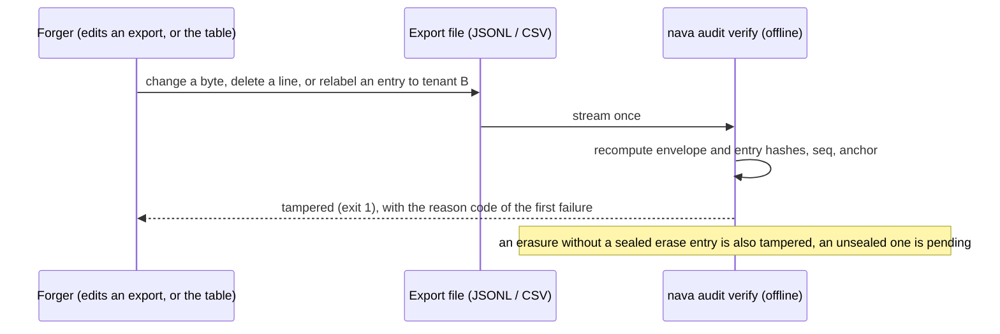

## Boundary

Each tenant's audit entries are sealed into **its own** hash chain. Anyone
holding an export can check it **offline**, with no access to the platform,
and any edit, deletion, reordering, relabelling to another tenant, or
unrecorded erasure is reported as tampered.

## Enforcement point

- **Append.** `internal/audit` takes the tenant from the transaction
  (`TenantOf`), never from a parameter; with no tenant it writes nothing.
- **Seal.** The sealer assigns each tenant's entries a gapless `seq` and links
  each entry hash to the previous one, per tenant, under that tenant's head
  lock. The tenant id is part of the hashed envelope, so moving an entry to
  another tenant breaks the chain.
- **Verify.** `nava audit verify <file>` (`cmd/nava`, package
  `internal/audit/verify`) streams the export once and recomputes every hash.
  It links no network, database or platform package other than the chain and
  verify packages, so it runs on an auditor's machine.

| Outcome | Exit | When |
|---|---|---|
| `pass` | 0 | every check holds |
| `tampered` | 1 | the first failing check, with its reason code |
| (usage) | 2 | bad arguments, unreadable file |
| `pending` | 3 | an erased entry is listed only by an unsealed erase entry |
| `unverifiable` | 4 | a `stubs=false` file, honestly flagged |
| `empty` | 5 | no sealed entry in the window |

The table is from the normative
[audit-verify.md](../../../architecture/audit-verify.md#outcomes-and-exit-codes).

## Proving tests

| Attack | Test |
|---|---|
| Relabel an entry to another tenant | `TestAdversarialTenantRelabelBreaksChain`, `TestUnsealedTenantMismatch` |
| Sealers of two tenants, or two sealers of one tenant | `TestSealTenantIsolation`, `TestConcurrentSealersNeverDuplicateSeq` |
| Change any field | `TestEveryFieldIsHashed`, `TestChainBreaks` |
| Byte edits, deleted or duplicated lines, re-anchoring | `TestGoldenVectorsTampered`, `TestTamperedExportsFail`, `TestSeqDuplicateAndMissing`, `TestAfterSeqAnchorsOnThatSeq` |
| Honest exports still verify | `TestFilteredExportsVerify`, `TestUnfilteredExportVerifies`, `TestStubsOmitted` |
| Exit codes are stable and documented | `TestExitCodes`, `TestHelpDocumentsExitCodes` |
| The verifier stays offline | `TestImportBoundary`, `TestOfflineImports` |
| Append takes the tenant only from the transaction | `TestAppendTenantFromTransaction`, `TestAppendNoTenant` |

## Fixture that turns it red

The golden tampered vectors (`internal/audit/chain/vectors`) are committed
export files that must each fail with a fixed reason code; an honest vector
set must pass. The S13 acceptance run shows the same by hand with the built
binary: an untouched export exits 0, a byte-edited one and a line-deleted one
exit 1 (see [S13 acceptance](../../../acceptance/S13/README.md)).

## Accepted risks

AR-TICK-409-01 is the main one: the chain has no external anchor in M1, so the
database owner or migrator could rewrite a whole tenant's chain consistently.

<!-- gen:accepted-risks ids=AR-TICK-409-01,AR-TICK-409-02,AR-TICK-422-01 -->

## Related

- [Exports and erasure](08-exports-erasure.md).
- [Audit tables](../database/audit.md).
