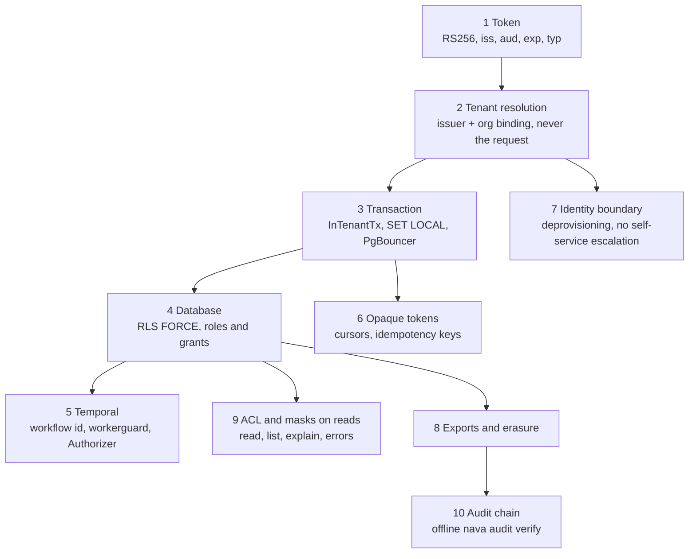

## Threat model

The attacker holds a **valid token for one tenant** (tenant A), and wants a
row, a field, an id or a workflow of another tenant (tenant B). Variants of
the same attacker hold tenant A's admin rights, tenant A's external IdP, or
one stolen platform credential (a database login or a Temporal certificate).
Every page in this section answers the same question for one layer: **which
request would get tenant A something of tenant B's, and what stops it?**

The pages follow a request from the edge to storage and then to what leaves
the system. Each one states the boundary, the enforcement point in the code
on `main`, the tests that prove it, the fixture or mutation that shows each
test can fail, and the accepted risks that apply to that layer.

## Pages

| # | Layer | Page |
|---|---|---|
| 1 | Token validation | [Token](01-token.md) |
| 2 | Tenant resolution | [Tenant resolution](02-tenant-resolution.md) |
| 3 | Tenant transaction | [Transaction](03-transaction.md) |
| 4 | Database floor | [Database](04-database.md) |
| 5 | Temporal | [Temporal](05-temporal.md) |
| 6 | Cursors and idempotency keys | [Opaque tokens](06-opaque-tokens.md) |
| 7 | Identity boundary and deprovisioning | [Identity boundary](07-identity-boundary.md) |
| 8 | Audit export and erasure | [Exports and erasure](08-exports-erasure.md) |
| 9 | Record ACL and field masks on the read side | [ACL and masks on reads](09-acl-masks-read.md) |
| 10 | Audit hash chain | [Audit chain](10-audit-chain.md) |
| | Every accepted risk | [Accepted-risk register](accepted-risks.md) |

## How isolation is proven

The isolation suite (`internal/tenancy/isolation`, `make isolation`, ADR-001
Annex B CI-2) seeds tenants A and B and runs every role against every tenant
table, plus registered SQL, HTTP, DB, API and stack paths, as tenant A against
tenant B's data. Its fixtures each break one control and must turn a PASS line
into a FAIL, so a suite that cannot fail is caught. The full description is
[isolation-suite.md](../../../security/isolation-suite.md).

## Coverage

Quoted from `Coverage()` in `internal/tenancy/isolation/registry.go`, at the
commit in this page's footer (the security-relevant ids; the function also lists the ADR-004-A1 reader cases):

| ADR test id | Coverage |
|---|---|
| CI-2 | full: generic checks on every tenant table; forged-tenant HTTP paths (T17); the forged write on POST /api/v1/records/incident, StoredUnderA (P3-18) |
| CI-8 | full: the record routes' byte-identical 404 on GET, PATCH and history, stale If-Match 412, and (e)/(f) (TICK-87); cursor cases from T23; idempotency cases from T22; the masked-field filter 400 (d) and the S10 attack rows on the record ACL, masks, admin routes and explainer (P3-37) |
| CI-9 | full: nava_relay, nava_purge, nava_onboard and nava_backup reach (T12); nava_backup through T08's pg_hba cases |
| T26 | full: deprovisioning within D-P9's 10 minutes and the Epic 03 identity boundary (TICK-82); cases 1, 2, 6 and 8 run here, cases 3, 4, 5 and 7 need the real Keycloak and run in make stack-test-identity |
| CI-A4 | full (ADR-004, P5-19, P5-42): audit_log through the parent, its DEFAULT partition, audit_chain_head and record_write_keys as every runtime role, with no tenant and with onboarding's pinned policies; GET /api/v1/audit/entries and record history for tenant B's admin, auditor and agent. export, stubs, reseed and erasure (P5-42, TICK-447): TestCIA4* in internal/server (make test-integration), tenant B against tenant A through the real handler, sealer, verifier and nava_erasure |
| CI-A5 | full (ADR-004, P5-19, P5-42): table bytes of audit_log and entity_definition_versions after record and S8 canaries, the controls uncompressed and under 1,900 bytes stored; export bytes in TestCIA5ExportBytesCarryNoCanary in internal/server (P5-42, make test-integration) |
| CI-10 | partial → P3-42 (S11b): (g) signal ping-pong needs the interpreter; (f) the start key is per tenant, here; (a)–(e) are TestCI10_* in internal/records/pipeline and the outbox depth limit TestCI10_* in internal/outbox, both against real PostgreSQL in make test-integration |

The committed report is
[isolation-report-ci2-ci8.md](../../../acceptance/s9-evidence/isolation-report-ci2-ci8.md)
and [isolation-report-ci10.md](../../../acceptance/s9-evidence/isolation-report-ci10.md),
recorded on 2026-11-02 at `fd74f548`. It predates S10's P3-37 registrations,
so it still shows CI-8 as partial; the table above is what `main` reports.

## Accepted risks

Every risk the project has knowingly accepted is in the
[register](accepted-risks.md), rendered from
[`docs/security/accepted-risks.md`](../../../security/accepted-risks.md). Each
layer page lists the rows that apply to it.
