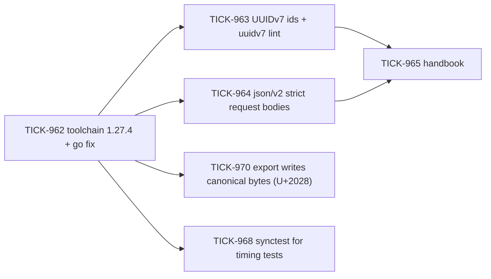

Story TICK-961 (tasks TICK-962, TICK-963, TICK-964, TICK-968, TICK-970, this handbook task TICK-965). Status: **in progress** on the story branch `TICK-961/go-1-27-upgrade`. Every task is merged into the branch; story acceptance on a fresh stack and the merge to `main` are still to come.

## What a user can now do

- **Build with Go 1.27.4.** Both modules (`go.mod`, `temporal-server/go.mod`) say `go 1.27.0`, `toolchain go1.27.4`; every image builds on `golang:1.27.4`, and CI reads the version from `go.mod`. See [Go toolchain and setup](../operations/go-toolchain.md).
- **Trust that every new id is a UUIDv7.** The five places that still minted random v4 primary keys (entity types, group sync, workflow definitions, workflow step ids, child workflow ids) now use `uuid.NewV7`, and `task lint` fails on a new `uuid.New` in `internal/` or `cmd/`. See [Id generation](../system/id-generation.md).
- **Get a clear 422 for an ambiguous body.** A request body with a duplicate member name or invalid UTF-8 is refused with the operation's usual 422 code and one `{pointer, rule}` error, instead of being silently "repaired". See [API errors and strict JSON bodies](../system/api-errors.md).

Nothing changes for stored data: no migration, no rewritten id, no golden hash file regenerated.

## Flow

## API operations

Every operation with a request body (`onboardTenant`, `createEntityType`, `publishEntityTypeVersion`, `putEntityTypeAccess`, `publishWorkflowDefinitionVersion`, `createRecord`, `patchRecord`) gains the 422 `duplicate` / `invalid_utf8` case. No operation, path or code was added.

## How to try it

From the story branch, with Go and go-task (no stack needed for 1 and 2):

1. `go version` reports go1.27.4 (downloaded on first use if the installed Go is older).
2. Add `_ = uuid.New()` to any file under `internal/` and run `task lint`: the `uuidv7` analyzer names the line. Revert.
3. On a running stack, `POST /api/v1/records/{entity}` with `{"data":{"title":"a","title":"b"}}`: `422 record_invalid` with `errors: [{"pointer":"/body/data/title","rule":"duplicate"}]`.

## Invariants kept

- **Determinism.** The audit chain hash is hand-written RFC 8785 JCS and passes `internal/audit/chain/vectors` unchanged. Go 1.27's v1 encoder escapes U+2028/U+2029 under `SetEscapeHTML(false)`; TICK-970 makes the export write the canonical bytes directly, and untagged tests now push those characters through every envelope writer.
- **Idempotency (I7).** The request hash is still computed with v1 over the same bytes; no golden value changed.
- **Tenant wall (I1).** The isolation suites stayed green on every task PR.

## Cut and deferred

- **stdlib `uuid`** (move off `github.com/google/uuid`, 340 files): its own story, TICK-966, in backlog. Trigger: no open story branch changes Go files under `internal/` or `cmd/`, or `google/uuid` is deprecated.
- **Hashed and stored JSON to `encoding/json/v2`** (idempotency request hash, record `data`, outbox payloads, export framing): stays on v1. Trigger: the next change to one of those sites, or v1 leaving the standard library.

Both are recorded in `docs/delivery/decisions/2026-11-15-tick-961-go-1-27-upgrade.md`.

## Verdict and evidence

- Not yet accepted. The Technical Lead's verdict will be posted on TICK-961 after fresh-stack verification; this page moves to `delivered` with the merge to `main`.
- Task evidence: PRs #736 (TICK-962), #739 (TICK-963), #740 (TICK-964), #741 (TICK-968), #733 (TICK-970), each merged into the story branch with GitHub Actions green.
