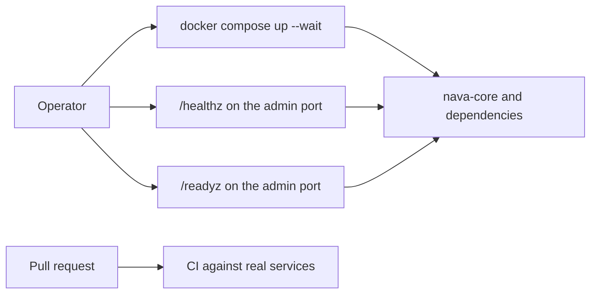

Story TICK-43. Verdict **READY**, 2026-10-25, recorded in the
[acceptance kit](../../../acceptance/s1-platform-foundation.md).

## What a user can now do

- Bring up the whole platform on one machine with one command: PostgreSQL,
  PgBouncer, Keycloak, Temporal, the Collector, `nava-core` and the worker.
- Ask the service whether it and its dependencies are well. It stays ready when
  only Keycloak or Temporal is down, and stops taking traffic within seconds
  when the database goes.
- Every pull request is checked against real PostgreSQL, Keycloak and Temporal,
  and a failing test turns it red.

## Flow

## API operations

No public API operations. `/healthz`, `/readyz` and `/metrics` are served on
the admin port, which is not published and is not part of `api/openapi.bundled.yaml`.
The public port answers 404 for all three (negative checks S1.4 and S1.5).

## How to try it

1. Start the stack and the local forwards (the admin port is reachable only
   through them):
   `sh docs/acceptance/guide/tools/seed.sh`, then
   `sh docs/acceptance/guide/tools/tunnels.sh up`.
2. In Bruno open the collection `docs/acceptance/guide/bruno/`, select the
   `local` environment and run the folder `S1`. Or headless:
   `sh docs/acceptance/guide/tools/api-test.sh S1`.

| Bruno request | What it checks |
|---|---|
| `S1/S1-1.bru` | `GET /healthz` lists every dependency |
| `S1/S1-2.bru` | `GET /readyz` |
| `S1/S1-3.bru` | `GET /metrics` |
| `S1/S1-4.bru` | negative: `/healthz` is not on the public port |
| `S1/S1-5.bru` | negative: `/metrics` is not on the public port |
| `S1/S1-6.bru` | the Keycloak realm is up with the pinned issuer |

The step-by-step kit, including stopping Keycloak and PostgreSQL to watch
`/healthz` and `/readyz` change, is the
[acceptance guide page for S1](../../../acceptance/guide/s1.html) and the
[kit](../../../acceptance/s1-platform-foundation.md); this page does not copy it.

## Verdict and evidence

- Verdict: READY, all acceptance criteria pass (QA, 2026-10-25, on `main`).
- Recorded run used: the committed Bruno run
  [acceptance-run.md](../../../acceptance/guide/acceptance-run.md) (2026-10-29,
  145 requests and 466 tests, 0 failed) and the kit above. Not re-run for this
  page.
- Regression of milestone 1 on `main`:
  [S1 evidence](../../../acceptance/regression-milestone-1-evidence/s1-platform-foundation.md).
