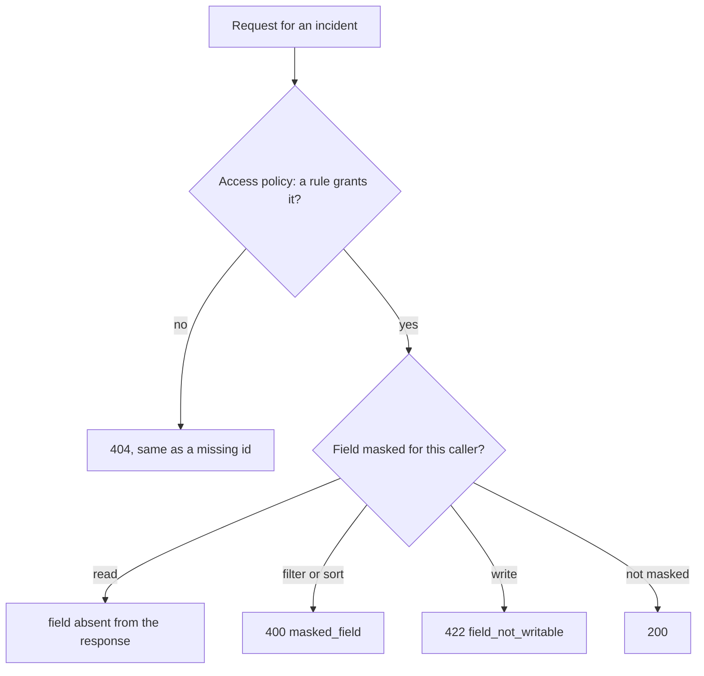

Story TICK-336 (kit TICK-623). Verdict **READY**, 2026-11-11, recorded in the
[acceptance kit](../../../acceptance/s10-access.md). C1 to C5, A3 and the admin
routes pass.

## What a user can now do

- As an agent, see only the incidents assigned to your own groups. As a
  requester, see only the incidents you raised. A list's `total` counts the same set.
- Open an incident you may not see and get exactly the `404` a missing id gets.
- As a tenant admin, hide a field from everyone outside a group. A hidden field
  cannot be filtered or sorted (`400 masked_field`) or written
  (`422 field_not_writable`) by anyone the mask leaves out.
- As a tenant admin, ask why a user can read an incident and get the granting
  rule (`explainAccess`). Publishing an access policy is audited under `acl_policy`.

## Flow

## API operations

<!-- gen:operations ids=listRecords,getRecord,patchRecord,getRecordHistory,getEntityTypeAccess,putEntityTypeAccess,explainAccess,getMe -->

## How to try it

1. On a fresh stack, `sh docs/acceptance/guide/tools/seed.sh`, then
   `sh docs/acceptance/guide/tools/tunnels.sh up`.
2. In Bruno run the folder `S10` (66 requests), or headless
   `sh docs/acceptance/guide/tools/api-test.sh S10`. At `S10-31` the admin
   publishes masks on `description` and `assignee`; `S10-66` removes them.

| Operation | Bruno request file |
|---|---|
| `listRecords` | `S10/S10-39.bru` to `S10/S10-41.bru` (agent and admin lists, C1), `S10/S10-42.bru` (requester, C2), `S10/S10-54.bru` (tenant B sees none of A's), `S10/S10-3.bru`, `S10/S10-4.bru` (bad filter, bad cursor) |
| `getRecord` | `S10/S10-45.bru` to `S10/S10-47.bru`, `S10/S10-50.bru`, `S10/S10-51.bru` (the same 404), `S10/S10-55.bru` (masked field absent), `S10/S10-52.bru`, `S10/S10-53.bru` (tenant B) |
| `patchRecord` | `S10/S10-43.bru` (requester edits while new), `S10/S10-44.bru` (403 once in progress), `S10/S10-48.bru` (404, never 412), `S10/S10-58.bru`, `S10/S10-59.bru` (masked write refused, unmasked write ok) |
| `getRecordHistory` | `S10/S10-49.bru` (the same 404) |
| `getEntityTypeAccess` | `S10/S10-10.bru` (200 with ETag), `S10/S10-11.bru` (403), `S10/S10-12.bru` (404), `S10/S10-23.bru` (401), `S10/S10-32.bru` (publish audited) |
| `putEntityTypeAccess` | `S10/S10-15.bru` (200), `S10/S10-13.bru` (428), `S10/S10-14.bru` (412), `S10/S10-16.bru` (422 pointer), `S10/S10-22.bru` (400), `S10/S10-24.bru`, `S10/S10-25.bru`, `S10/S10-26.bru`, `S10/S10-31.bru`, `S10/S10-66.bru` |
| `explainAccess` | `S10/S10-18.bru`, `S10/S10-61.bru` to `S10/S10-65.bru` (allow or deny with the rule), `S10/S10-19.bru` (another tenant: 404), `S10/S10-20.bru`, `S10/S10-21.bru`, `S10/S10-27.bru` |
| `getMe` | `S10/S10-8.bru`, `S10/S10-9.bru`, `S10/S10-29.bru`, `S10/S10-30.bru` (principal ids and groups) |

Requests `S10-1`, `S10-6`, `S10-7` and `S10-28` sign in; `S10-17` and `S10-33` to
`S10-38` create the incidents the checks read. The requester user is the seeded
`auditor@tenant-a.test` (a limit the kit lists).

## Verdict and evidence

- Verdict: READY, 2026-11-11, all criteria pass.
- Recorded run used: the kit's committed output
  [s10-fresh-stack-run.txt](../../../acceptance/s10-evidence/s10-fresh-stack-run.txt):
  a fresh local stack, 66 of 66 requests, 220 of 220 tests. Setup is in
  [fresh-stack-setup.md](../../../acceptance/s10-evidence/fresh-stack-setup.md).
  Not re-run for this page.
- A deny names no rule: rules are allow-only, so a `deny` has `rule_id: null`.
