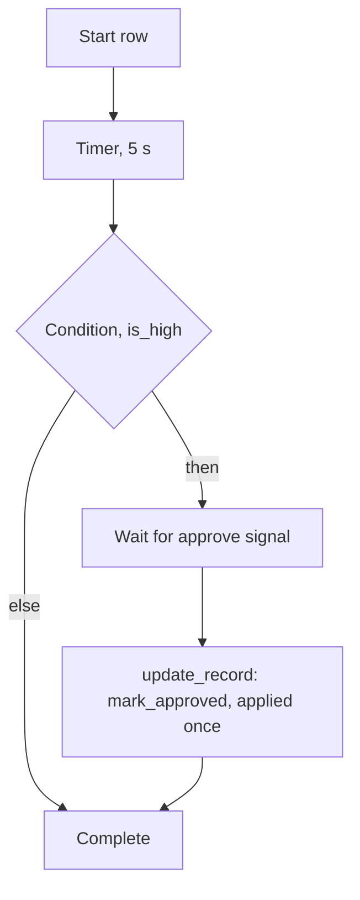

Story TICK-334 (kit TICK-352). Verdict **READY**, 2026-11-01, recorded in the
[acceptance kit](../../../acceptance/s11a-workflow-interpreter.md). All four
criteria and the cross-tenant check pass. Scope is the interpreter only: records
starting workflows is S11b, which is in progress and not on `main`.

**The interpreter is registered only in the `interptest` build, not running in
the stack.** The always-on `nava-worker` image links none of it
(`TestProductionBuildLinksNoFakes`). The demo swaps in `nava-worker-interptest`,
which runs definitions and records from files and a file-log writer. The real
ports come with the records-path stories.

## What a user can now do

- Watch a workflow written in the platform's own definition format run on
  Temporal: it waits on a timer, takes the branch its condition picks, waits for an
  `approve` signal, updates the record and completes.
- Publish a new version of a definition while runs are in flight. Those runs
  finish on the version they started with; new runs use the new one.
- Kill the worker in the middle of a record update and restart it. The update is
  applied once, not twice.
- See the CI replay check refuse a code change that would break runs already in flight.

Tenants never see workflows: no API route exposes them, and the Temporal UI is
reachable only through the operator tunnel. There is no sign-in and no Bruno folder.

## Flow

## How to try it

Needs Docker, Go and `make`, on a clone of the story branch (the kit has the full steps):

| Criterion | Command |
|---|---|
| 1. timer, branch, signal | `make demo-interpreter TENANT=a KEY=try PRIORITY=high`, then `make demo-interpreter-approve TENANT=a KEY=try` |
| 2. version pinning | `make demo-interpreter-pinning TENANT=a KEY=pin PRIORITY=high` |
| 3. crash, applied once | `make demo-interpreter-up PAUSE=1`, `make demo-interpreter-crash TENANT=a KEY=crash`, `make demo-interpreter-writes` |
| 4. replay check | the `unit` job fails `TestReplayRecordedHistories` on a non-deterministic change |

The [acceptance guide page for S11a](../../../acceptance/guide/s11a.html) and the
[kit](../../../acceptance/s11a-workflow-interpreter.md) hold the step-by-step
version and screenshots.

## Verdict and evidence

- Verdict: READY, 2026-11-01, four of four criteria pass, plus the cross-tenant check.
- Recorded run used: the kit's committed run log
  [run.log](../../../acceptance/s11a-workflow-interpreter/run.log), on a fresh
  stack built from the story branch. Criterion 4 was read from GitHub Actions
  runs; they are not linked here, because handbook evidence points to committed
  files only. Not re-run for this page.
- Isolation: tenant B cannot signal tenant A's waiting run (refused before any
  row is written).
