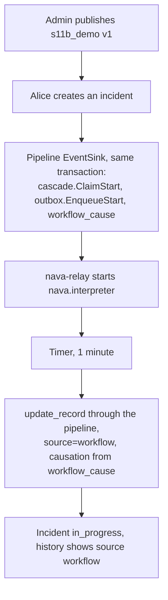

Story TICK-337 (kit TICK-713). Verdict **READY**, 2026-11-13, from the
acceptance kit's fresh-stack run. All four criteria pass. CI-10 now reports
**full**: its (g) row passes. The verdict date is the day the kit merged into
the story branch (`c8ca986f`).

S11b builds on [S11a](s11a.md). The interpreter that S11a ran only in the
`interptest` build now runs in the production `nava-worker`, and record writes
start it.

## What a user can now do

- As a tenant admin, publish a workflow definition on the `incident` type
  (`publishWorkflowDefinitionVersion`). The definition is triggered by
  `record.created` or `record.updated`, and its versions are immutable. The
  server assigns the step ids. A step that names a field the schema lacks is
  refused with `422`.
- Create an incident and watch the workflow change it: the demo waits one
  minute and then sets `state=in_progress`. The record's history shows that
  write with `source: workflow`.
- Publish a new version while a run is waiting. That run finishes on the
  version it started with, and new runs use the new one.
- Tenant B's writes never start or signal a tenant A workflow.

## Flow

## API operations

<!-- gen:operations ids=publishWorkflowDefinitionVersion,getWorkflowDefinition,createRecord,getRecord,getRecordHistory -->

## How to try it

1. On a fresh stack, `sh docs/acceptance/guide/tools/seed.sh`, then
   `sh docs/acceptance/guide/tools/tunnels.sh up`.
2. In Bruno, run the folder `S11b` (30 requests), or run it headless with
   `sh docs/acceptance/guide/tools/api-test.sh S11b`. The run takes a little
   over a minute, because `S11b-24` waits for the timer.

| Criterion | Bruno request file |
|---|---|
| 1. The admin publishes the demo definition | `S11b/S11b-18.bru` |
| 2. About a minute after the create, the state is `in_progress` and the history shows `source=workflow` | `S11b/S11b-19.bru`, `S11b/S11b-22.bru`, `S11b/S11b-24.bru`, `S11b/S11b-25.bru` |
| 3. A run that is waiting when v2 is published stays on v1 | `S11b/S11b-21.bru`, `S11b/S11b-23.bru`, `S11b/S11b-26.bru`, `S11b/S11b-27.bru` |
| 4. Tenant B's incidents start no tenant A workflow | `S11b/S11b-20.bru`, `S11b/S11b-28.bru`, `S11b/S11b-29.bru` |

- `S11b-1` to `S11b-16` cover the definition API: publish, step ids, read,
  `422` validation, `403`, `404`, `401`, and the `Idempotency-Key`
  (`400`, `409`).
- `S11b-1`, `S11b-2` and `S11b-17` sign in.
- `S11b-30` retires the demo. The API has no disable path yet, so it publishes
  a version that waits a day and writes nothing. Every tenant A incident
  created later on the same stack starts one run of that version. The run
  holds an open `workflow_ref` and a Temporal workflow for 24 hours, then ends
  without changing a record. A fresh stack has none.

The [acceptance guide page for S11b](../../../acceptance/guide/s11b.html)
holds the step-by-step version.

## Verdict and evidence

- Verdict: READY, 2026-11-13. Four of four criteria pass as
  `admin@tenant-a`, Alice and Bob.
- Recorded run used: the stack case
  [`s11b_workflows.sh`](../../../../deploy/compose/test/cases/s11b_workflows.sh).
  It runs the Bruno folder on a fresh stack in CI, then checks the database
  behind each criterion: the start rows, the version each run started on, and
  that tenant B has no start. Alice's incident was `in_progress` 61 s after
  she created it. The GitHub Actions run is not linked here, because
  handbook evidence points to committed files only. Not re-run for this page.
- Crash case: `TestInterpreterCrashRealPipelineAppliesOnce` kills the worker
  with SIGKILL after the real `pipeline.Write` commits and then restarts it.
  The write is applied once.
- Isolation: the CI-10 (g) row passes,
  `TestCI10_G_SignalPingPongBetweenTwoRunsStopsAtDepth9`. Two runs signalling
  each other on one record stop at depth 9 with `ErrCascadeTooDeep`, after
  8 writes. It runs as `nava_worker` under RLS, through the real `EventSink`.
  See [security](../security/index.md#coverage).
- Worker pools: 10 + 4 + 1 = 15 fits the `nava_worker` PgBouncer pool
  (`TestWorkerPoolsFitPgBouncer`). See [benchmarks](../benchmarks/index.md).
- Recorded deferrals: TICK-484, mapping `pipeline.ErrRetryable` to a retryable response once the EventSink adds row locks; and TICK-796, taking the newest cause only from delivered rows, plus a plan-shape test for `newestCauseSQL`.
