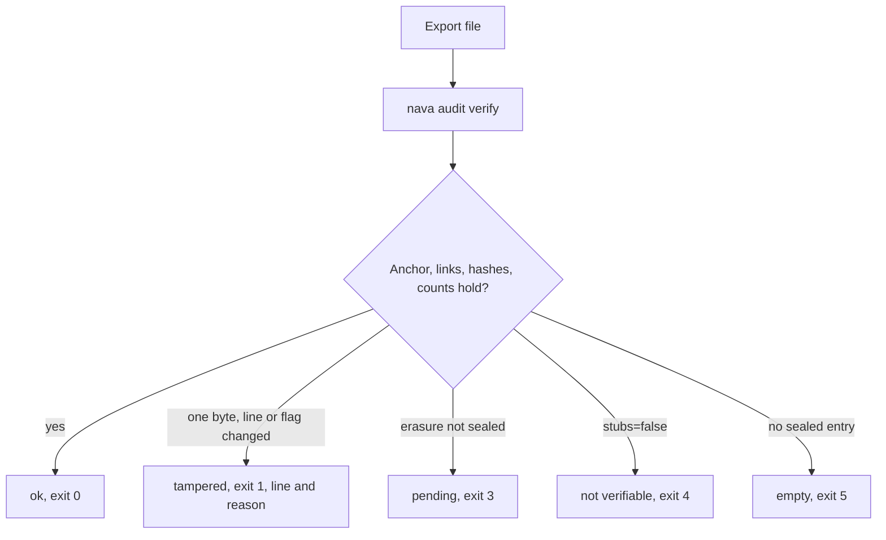

Story TICK-418 (kit TICK-426). Verdict **READY**, 2026-11-02 (TICK-418
VERDICT: ACCEPTED), recorded in the
[acceptance kit](../../../acceptance/S13/README.md).

## What a user can now do

- Take an audit export file and check, on a laptop with no access to the
  platform, that it is complete and unchanged: `nava audit verify <file>`.
- Tell the verdicts apart by exit code: `0 ok`, `1 tampered` (names the line,
  seq and a reason code), `2` usage, `3 pending` (an erasure not sealed yet),
  `4 not verifiable: stubs omitted`, `5 empty`.
- Verify a filtered export (the other entries are hash-only stubs) and a
  redacted one (the diff text is flagged as not attested).

This story is a command line tool; it has no API operation. The export itself is [S16](s16.md).

## Flow

## How to try it

No database, Docker or network. From a clone, `task build` writes `bin/nava`; then
from `docs/acceptance/S13`:

- `../../../bin/nava audit verify export-ok.jsonl` prints `ok` and exits 0.
- The same on `export-byte-edited.jsonl`, `export-line-deleted.jsonl`,
  `export-first-entry-deleted.jsonl` and `export-no-anchor.jsonl` exits 1.
- `sh scripts/acceptance/s13.sh` runs every sample and compares output and exit
  code with `docs/acceptance/S13/expected/`.

The kit lists all fourteen sample files with the expected output. There are no
Bruno requests for S13.

## Verdict and evidence

- Verdict: READY, 2026-11-02, every step's output and exit code matches the kit.
- Recorded run used: the committed kit [README](../../../acceptance/S13/README.md)
  and its samples with their `expected/` files. The samples are built by the
  golden-vector generator, and `go test ./tools/acceptance/s13kit` fails if one
  drifts. Not re-run for this page.
- Known limits the verifier does not claim to catch: a full entry replaced by its
  own stub, and a file rewritten consistently as a whole. Nothing authenticates
  the file itself; compare an overlapping `entry_hash` with an export you hold.
