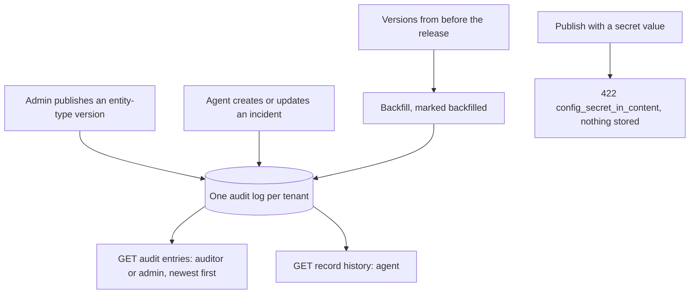

Story TICK-419 (kit TICK-437). Verdict **READY**, 2026-11-04, recorded in the
[acceptance kit](../../../acceptance/S14/README.md). All four criteria and the
isolation check pass.

## What a user can now do

- As a tenant admin or auditor, see every entity-type publish and every
  incident change of the tenant on one timeline, newest first, with who, from
  where, and what changed.
- See entity-type versions that existed before this release on that timeline,
  marked `backfilled`.
- As an agent, read an incident's own history but not the tenant's timeline
  (`403`). Another tenant sees nothing of yours.
- Be refused when a publish would store a secret value in an entity-type schema:
  `422 config_secret_in_content`, naming the path and never the value.

## Flow

## API operations

<!-- gen:operations ids=listAuditEntries,publishEntityTypeVersion,getEntityType,createRecord,patchRecord,getRecordHistory,getMe -->

## How to try it

1. `sh docs/acceptance/S14/tools/upgrade-setup.sh`: it starts a stack at `main`,
   publishes a version, upgrades to this checkout and seeds (needed because AC2
   is about versions that existed before the release).
2. `sh docs/acceptance/guide/tools/api-test.sh S14A`, or open the folder `S14A`
   ("S14 audit") in Bruno. Folder `S14` ("S14 audit timeline") holds the
   read-only reader checks.

| Operation | Bruno request file |
|---|---|
| `listAuditEntries` | `S14A/S14-22.bru` (auditor: publish and both record changes), `S14A/S14-23.bru` (admin), `S14A/S14-24.bru` (backfilled), `S14A/S14-25.bru`, `S14A/S14-27.bru` (403), `S14/S14-3.bru` to `S14/S14-10.bru` (pages, filters, 400, 401, 403) |
| `getEntityType` | `S14A/S14-17.bru` (current incident version) |
| `publishEntityTypeVersion` | `S14A/S14-18.bru` (201), `S14A/S14-30.bru` (422 secret), `S14A/S14-31.bru` (nothing stored) |
| `createRecord` | `S14A/S14-19.bru` (Alice), `S14A/S14-21.bru` (Bob, tenant B) |
| `patchRecord` | `S14A/S14-20.bru` |
| `getRecordHistory` | `S14A/S14-26.bru` (Alice), `S14A/S14-28.bru`, `S14A/S14-29.bru` (Bob: the same 404) |
| `getMe` | `S14A/S14-15.bru`, `S14A/S14-16.bru` |

`S14A/S14-11` to `S14A/S14-14` and `S14/S14-1`, `S14/S14-2` sign in. Users are
the seeded admin, auditor, Alice and Bob.

## Verdict and evidence

- Verdict: READY, 2026-11-04, four of four criteria pass.
- Recorded run used: the kit's committed
  [run-summary.json](../../../acceptance/S14/evidence/run-summary.json): 21
  requests and 76 of 76 tests in folder `S14A`, plus 10 requests and 28 of 28
  tests in folder `S14`, on a fresh stack. Not re-run for this page.
- Known limit: tenants that existed before S14 have no auditors group until
  `nava-onboard reconcile-auditors` runs; until then only tenant admins hold `audit.read`.
