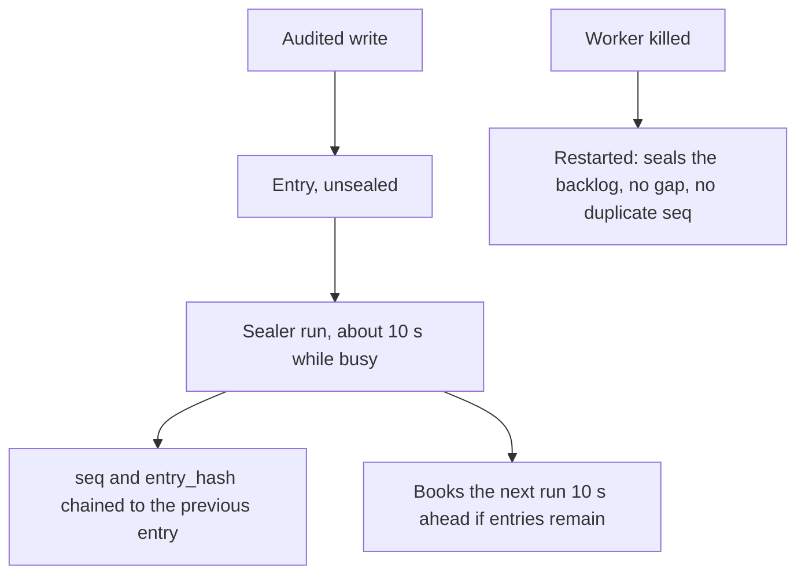

Story TICK-420 (kit TICK-443, timings updated for ADR-004-E7). Verdict
**READY**, 2026-11-07, recorded in the
[acceptance kit](../../../acceptance/S15/README.md). All four criteria and the
isolation check pass.

## What a user can now do

- Rely on every audit entry of a tenant getting a place in that tenant's chain
  (`seq`) and a hash chained to the entry before it, without anyone doing anything.
- Expect a busy tenant's entries to be sealed about 10 seconds after they are
  written. A quiet tenant is still sealed within 5 minutes of its next write,
  then back to about 10 seconds.
- Lose nothing and number nothing twice if the sealing worker dies: the next
  worker carries on where the chain stopped.
- Have a newly onboarded tenant sealed from its first entry on.

## Flow

## API operations

<!-- gen:operations ids=onboardTenant,createRecord,getRecordHistory,listAuditEntries -->

## How to try it

1. `sh docs/acceptance/S15/tools/upgrade-setup.sh` (about 10 minutes: the stack
   starts just before migration B and is upgraded, so tenants A and B get a chain head).
2. `sh docs/acceptance/S15/tools/run-kit.sh`: runs the Bruno folders `S15`,
   `S15K` (after a worker kill) and `S15I` (after idle), with the kill and the
   SQL check in between. About 20 minutes.

| Operation | Bruno request file |
|---|---|
| `onboardTenant` | `S15/S15-5.bru` (a new tenant is sealed from its first entry) |
| `createRecord` | `S15/S15-6.bru`, `S15/S15-8.bru`, `S15/S15-10.bru` (Alice), `S15/S15-12.bru` (Bob), `S15I/S15I-3.bru` (write after idle) |
| `getRecordHistory` | `S15/S15-14.bru` (tenant B: 404) |
| `listAuditEntries` | `S15/S15-7.bru`, `S15/S15-9.bru`, `S15/S15-11.bru` (sealed within about 10 s), `S15/S15-13.bru` (A's chain: no gap, nothing of B), `S15I/S15I-4.bru` (idle tenant within 300 s), `S15K/S15K-2.bru` (after the kill: no gap, no duplicate) |

`S15/S15-15.bru` reads `audit_unsealed_oldest_seconds` and
`audit_seal_failures_total` from the worker's `/metrics`. `S15/S15-1.bru` to
`S15/S15-4.bru`, `S15I/S15I-1.bru`, `S15I/S15I-2.bru` and `S15K/S15K-1.bru` sign
in. No API field shows `sealed`: a sealed entry has `seq` and `sealed_at`; the
hashes are in the [S16](s16.md) export.

## Verdict and evidence

- Verdict: READY, 2026-11-07, four of four criteria pass.
- Recorded run used: the kit's committed evidence, for example
  [ac1-seal-latency.txt](../../../acceptance/S15/evidence/ac1-seal-latency.txt):
  21 requests, 71 of 71 tests, from a fresh stack. Not re-run for this page.
- Known limits: no reseed of a dead chain here (that is S16); migration B needs a
  maintenance window; a stack created at the branch never seals the seeded
  tenants, hence the upgrade script.
