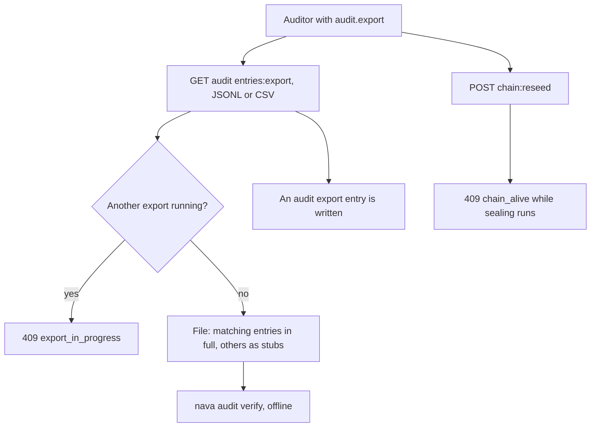

Story TICK-421 (kit TICK-448). Verdict **READY**, 2026-11-08, recorded in the
[acceptance kit](../../../acceptance/S16/README.md). All five criteria and the
isolation check pass.

## What a user can now do

- Download the tenant's audit log as JSONL or CSV, all of it or filtered by time
  window, subject or domain, and check it offline with `nava audit verify`
  (see [S13](s13.md)).
- Get `ok` when nothing in the range was removed or changed, and `tampered`
  naming the line when even one byte was.
- Open the CSV in a spreadsheet without any cell running as a formula.
- Run one export per tenant at a time (`409 export_in_progress` for a second),
  and find every export recorded in the audit log.
- Be refused a chain reseed while sealing is alive (`409 chain_alive`).
  Callers without `audit.export` get `403`.

## Flow

## API operations

<!-- gen:operations ids=exportAuditEntries,reseedAuditChain,listAuditEntries,createRecord -->

## How to try it

1. `sh docs/acceptance/S15/tools/upgrade-setup.sh` (the same upgraded stack as S15).
2. `sh docs/acceptance/S16/tools/run-kit.sh`: builds `bin/nava`, runs the Bruno
   folder `S16` (21 requests) and the saved-file checks. In Bruno, save the body
   of `S16-6` (JSONL) or `S16-20` (CSV) and run `bin/nava audit verify <file>`.

| Operation | Bruno request file |
|---|---|
| `exportAuditEntries` | `S16/S16-6.bru` (filtered to one incident), `S16/S16-7.bru` (whole log), `S16/S16-8.bru`, `S16/S16-9.bru` (filters, `stubs=false`), `S16/S16-20.bru` (CSV), `S16/S16-12.bru` (Bob: 403), `S16/S16-14.bru` to `S16/S16-16.bru`, `S16/S16-21.bru` (401, 403, 400s) |
| `reseedAuditChain` | `S16/S16-11.bru` (409 chain_alive), `S16/S16-13.bru` (Bob: 403), `S16/S16-17.bru` to `S16/S16-19.bru` (403, 401, 400) |
| `listAuditEntries` | `S16/S16-5.bru` (the incident is sealed), `S16/S16-10.bru` (the export is in the log) |
| `createRecord` | `S16/S16-4.bru` (Alice's incident) |

`S16/S16-1.bru` to `S16/S16-3.bru` sign in.

## Verdict and evidence

- Verdict: READY, 2026-11-08, five of five criteria pass.
- Recorded run used: the kit's committed evidence in `docs/acceptance/S16/evidence/`
  (Bruno 21 requests and 65 tests; kit checks 33 of 33), listed in the
  [kit](../../../acceptance/S16/README.md). AC5 (an erased entry still verifies)
  is evidenced by a CI job, not on the stack: there is no erasure API until
  Epic 30. That run is not linked here, because handbook evidence points to
  committed files only. Not re-run for this page.
- Known limit: a dead-lineage reseed is covered by integration tests, not on the stack.
