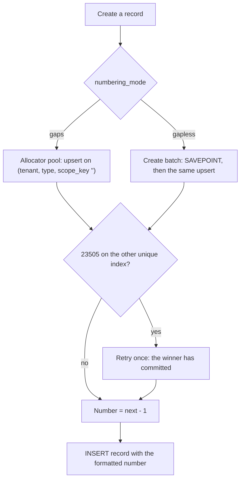

Story TICK-664 (kit TICK-668). Verdict: **ACCEPTED**, 2026-11-13, by the Technical Lead after a fresh-stack kit run on `672a9e66` (15/15 requests, 42/42 tests) with `ci:full` green; story PR #623 merged. The
[acceptance kit](../../../acceptance/S17/README.md) records PASS on all four criteria for its own run of 2026-11-12.

## What a user can now do

Nothing changes for a user, and that is the point. After the upgrade every ticket type keeps
counting from where it was, on a `gaps` type and on a `gapless` type. The first incident
after the upgrade is `INC0000043` when the last one was `INC0000042`. Creating tickets from
many places at once still never gives two tickets the same number, and one tenant cannot take
a number from another tenant's counter.

Under the hood this is release **R1** of ADR-005: `record_counters` gains `scope_key` and
`period_end`, and both allocation paths upsert on `(tenant_id, entity_definition_id,
scope_key)`. It is the first of three releases:

| Release | Story | What changes |
|---|---|---|
| R0 | before S17 | primary key `(tenant_id, entity_definition_id)` |
| R1 | S17 (this page) | M1 and M2 add the columns and the 3-column unique index; the old primary key stays, so R0 still runs and R1 can be rolled back to R0 |
| R2 | S18 | M3 makes the 3-column key the primary key. After M3 the pre-S17 build can never be deployed again |

## Flow

## API operations

<!-- gen:operations ids=createRecord,getRecord,patchRecord -->

## How to try it

1. From the repository root, on the story branch, with Docker running (Git Bash or any POSIX
   shell): `sh docs/acceptance/S17/tools/run-kit.sh`. It starts a fresh stack on the pre-S17
   build, creates incidents until each tenant's last number is `INC0000042`, upgrades the same
   stack so the `migrate` service applies M1 and M2, runs the Bruno folder `S17` (15 requests)
   and checks the database and the runbook. You should see `api-test: PASS` and `s17: PASS`.
2. `S17_FORCE_FAIL=1 sh docs/acceptance/S17/tools/run-kit.sh` makes one extra create after the
   upgrade, so the kit must exit 1.

The exact numbers hold once, on a stack the script has just prepared.

| Step | Bruno request file |
|---|---|
| Sign in as the tenant A admin and tenant B agent | `S17/S17-1.bru` to `S17/S17-3.bru` |
| Modes survive the upgrade | `S17/S17-4.bru`, `S17/S17-5.bru` |
| First create after the upgrade is `INC0000043` (gapless, then gaps) | `S17/S17-6.bru`, `S17/S17-7.bru`, `S17/S17-8.bru` |
| 8 concurrent creates, unique numbers | `S17/S17-9.bru` (gapless), `S17/S17-10.bru` (gaps) |
| Tenant B cannot read or change tenant A's incident; counters stay separate | `S17/S17-11.bru` to `S17/S17-15.bru` |

## Verdict and evidence

- Verdict: ACCEPTED, 2026-11-13 (story PR #623).
- Recorded run used: the kit's committed evidence in `docs/acceptance/S17/evidence/`
  (15 requests, 42 tests, all passed, run 2026-11-12), and the forced-failure run in
  `docs/acceptance/S17/evidence/forced-failure/` (exit 1, 3 of 42 tests fail by design),
  listed in the [kit](../../../acceptance/S17/README.md). Not re-run for this page.
- Criterion 3's SQL-level isolation checks are the isolation suite's, run in CI. That run is
  not linked here, because handbook evidence points to committed files only.
- Known limit: the 200 ms allocation budget can fail a first `gaps` create on a cold host
  (`503 retry_later`, a gap by design). Fix task TICK-778.
- Not in this story: M3, number formats and the admin API (S18).

See also [numbering in the database](../database/numbering.md),
[core numbering](../system/core-numbering.md), [ADR-005](../adr/adr-005.md) and
[ADR-005-E1](../adr/adr-005-e1.md).
