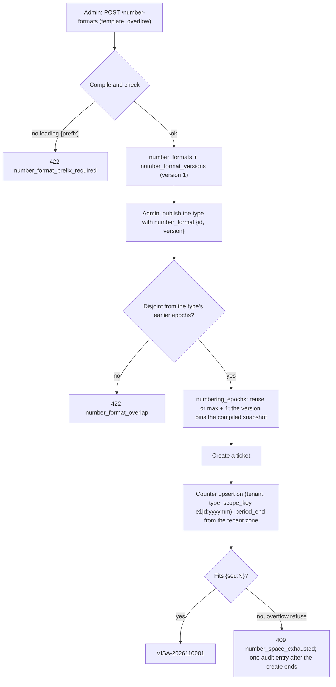

Story TICK-669 (kit TICK-677). Verdict: **pending**. Date: **pending**. Both are set when the Technical Lead posts the story verdict after the fresh-stack check. The [acceptance kit](../../../acceptance/S18/README.md) records **PASS** on all five criteria and the ADR-004-E9 check for its own run of 2026-11-15 on `e8129d90`.

## What a user can now do

A tenant admin writes a number format such as `{prefix}-{yyyy}{MM}{seq:4}`, publishes it, and links it to a ticket type. New tickets of that type get numbers like `VISA-2026110001`, counted per month in the tenant's time zone. Other types keep their default numbering (`INC0000043` carries on from `INC0000042`).

- A format that could clash with numbers the type already issued is refused when it is linked, with the reason (`422 number_format_overlap`, naming the rule).
- A template without a leading `{prefix}`, or with a letter right after it, is refused with the position (`422 number_format_prefix_required`).
- Publishing an unrelated change to the type (adding a field) keeps its format and its numbering. Existing tickets never change number.
- Under `overflow: refuse`, a create whose counter no longer fits `{seq:N}` is refused with `409 number_space_exhausted`, and the refusal is audited (ADR-004-E9).
- The tenant's time zone (IANA name, default `UTC`) is read and set by the admin. A change affects only future scope keys.
- Another tenant's format is invisible: reading it is the same `404` as a made-up id, and linking it is the same `422 number_format_not_found`.

Under the hood this is release **R2** of ADR-005. Its first migration, M3, makes `(tenant_id, entity_definition_id, scope_key)` the primary key of `record_counters`. After M3 the pre-S17 build can never be deployed again.

## Flow

## API operations

<!-- gen:operations ids=listNumberFormats,createNumberFormat,getNumberFormat,publishNumberFormatVersion,republishLinkedTypes,getTenantTimeZone,putTenantTimeZone,publishEntityTypeVersion,createRecord -->

The link is not a new operation: `publishEntityTypeVersion` takes an optional `number_format` `{id, version}`. A publish that sends no `number_format` keeps the current link.

## How to try it

1. From the repository root, on the story branch, with Docker running (Git Bash or any POSIX shell): `sh docs/acceptance/S18/tools/run-kit.sh`. It deletes the stack's volumes, starts a fresh stack on the S17 build from the sibling worktree `../s18-pre`, seeds it, creates the `visa` and `permit` types and some default-numbered tickets, upgrades the same stack (the `migrate` service applies S18's 14 migrations, M3 first), and runs the Bruno folder `S18` (38 requests) with tenant A's zone set to `Pacific/Kiritimati`. You should see `api-test: PASS` and `s18: PASS`.
2. `S18_FORCE_FAIL=1 sh docs/acceptance/S18/tools/run-kit.sh` makes one extra Visa create before the criterion-1 create, so the kit must exit 1.

The exact numbers hold once, on a stack the script has just prepared. Users are the dev-only seed users; `admin@tenant-b.test` is added by the kit (`tools/kit.mjs admin-b`).

| Step | Bruno request file |
|---|---|
| Sign in; `admin@tenant-b` is in tenant B's admins | `S18/S18N-1.bru` to `S18/S18N-4.bru` |
| Set tenant A's zone, create the format, an agent cannot write or link it | `S18/S18N-5.bru` to `S18/S18N-8.bru` |
| Link the format; `VISA-<yyyymm>0001`, then `…0002`; other types unchanged | `S18/S18N-9.bru` to `S18/S18N-15.bru` |
| Templates without a leading `{prefix}` are refused | `S18/S18N-16.bru`, `S18/S18N-17.bru` |
| An overlapping link is refused; the type is unchanged | `S18/S18N-18.bru` to `S18/S18N-21.bru` |
| An unrelated publish keeps the format and the numbers | `S18/S18N-22.bru` to `S18/S18N-26.bru` |
| Tenant B: same 404 and same 422 as a made-up id | `S18/S18N-27.bru` to `S18/S18N-31.bru` |
| A full `refuse` format: 409 and one audit entry, none in tenant B | `S18/S18N-32.bru` to `S18/S18N-38.bru` |

The folders `S18-API` (format API statuses, TICK-672) and `S18-TZ` (time-zone route) run in the shared Bruno suite.

## Verdict and evidence

- Verdict: pending. Date: pending.
- Recorded run used: the kit's committed evidence in `docs/acceptance/S18/evidence/` (38 requests, 100 tests, all passed, 2026-11-15 05:12Z), including `schema-after-upgrade.txt` (the 3-column `record_counters_pkey`) and `counters-after-run.txt` (`period_end` 1 December 00:00 Kiritimati). The forced-failure run is in `docs/acceptance/S18/evidence/forced-failure/` (exit 1, 3 of 100 tests fail by design). Not re-run for this page.
- The SQL-level isolation of the three new tables and the period counter rows is the isolation suite's (`internal/tenancy/isolation/registry.go`), run in CI. Not linked here: handbook evidence points to committed files only.
- Known limits: a refused create still moves a `gaps` counter (the number is taken and refused, `counter: 10` in the audit entry); every later create is refused until a wider format is linked.
- Not in this story: `{field:…}` tokens and plugin writes of formats (S19, S20); a mixed R1/R2 fleet; the period-counter purge is covered by its own integration tests, not the kit.

See also [numbering in the database](../database/numbering.md), [core numbering](../system/core-numbering.md), [nava-purge](../system/nava-purge.md), [ADR-005](../adr/adr-005.md) and [S17](s17.md).
