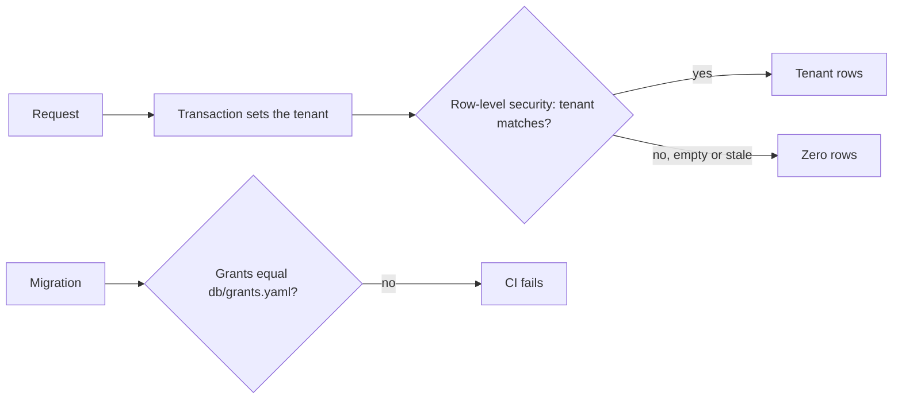

Story TICK-44. Verdict **READY**, 2026-10-26, recorded in the
[acceptance kit](../../../acceptance/s2-tenant-isolation.md). The first run failed
criterion 3; it was fixed (TICK-233, TICK-235) and run again.

## What a user can now do

- Rely on the database itself to keep each tenant's rows away from every other
  tenant. A query that names no tenant, an empty tenant, or a tenant left over
  from an earlier request returns nothing.
- Rely on each part of the platform (API, worker, relay, purge, onboarding,
  group sync, backup) logging in as its own database user, each able to do only
  its own job.
- Rely on CI to refuse a migration that grants a role more than
  `db/grants.yaml` lists.

## Flow

## API operations

No public API operations. The story is a database and CI guarantee. Its Bruno
requests only probe the tenant boundary through the existing `GET /api/v1/me`
and a record id.

## How to try it

1. `sh docs/acceptance/guide/tools/seed.sh` (seeds tenants A and B).
2. In Bruno run the folder `S2`, or headless
   `sh docs/acceptance/guide/tools/api-test.sh S2`.

| Bruno request | What it checks |
|---|---|
| `S2/S2-1.bru`, `S2-2.bru` | sign in as a tenant A user and a tenant B user |
| `S2/S2-3.bru` | `GET /me` is tenant A |
| `S2/S2-4.bru` | `GET /me` is tenant B, none of A's groups |
| `S2/S2-5.bru` | negative: tenant B named in headers, query and body is ignored |
| `S2/S2-6.bru` | negative: the same from tenant B |
| `S2/S2-7.bru` | negative: a tenant B record by id returns nothing |

The database half (catalogue queries, `make isolation`) is in the
[acceptance guide page for S2](../../../acceptance/guide/s2.html) and the
[kit](../../../acceptance/s2-tenant-isolation.md); this page does not copy it.

## Verdict and evidence

- Verdict: READY, all 4 criteria pass (QA, 2026-10-26).
- Recorded run used: the committed Bruno run
  [acceptance-run.md](../../../acceptance/guide/acceptance-run.md) (2026-10-29,
  145 requests and 466 tests, 0 failed) and the kit. Not re-run for this page.
- Regression of milestone 1 on `main`:
  [S2 evidence](../../../acceptance/regression-milestone-1-evidence/s2-tenant-isolation.md).
