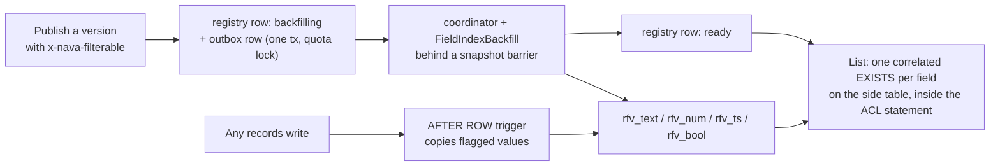

Story TICK-739, plan [PLAN-007](../../../delivery/plan-adr-006.md) (TICK-736),
design [ADR-006](../adr/adr-006.md), with erratum [E1](../adr/adr-006-e1.md) (the barrier waits past `xmax`; READ COMMITTED writers only), amendment [A1](../adr/adr-006-a1.md) (the 350 ms bands), amendment [A2](../adr/adr-006-a2.md) (the count runs under a time budget and `total` may be unknown; [PLAN-007-A2](../../../delivery/plan-adr-006-a2.md)) and erratum [E2](../adr/adr-006-e2.md) (the budget's value; [PLAN-007-E2](../../../delivery/plan-adr-006-e2.md)). **In progress: built on the story branch
`TICK-739/filterable-fields`, not on `main`, and not yet accepted.** Every
build task is merged into the story branch, and so is the acceptance kit
(TICK-749, PR #794). TICK-1022 (the ≥ 40% ACL count) is fixed by A2's count
budget and TICK-1084's one-group rewrite. Still open: TICK-749's verdict and
this handbook update.

**Scope cut, 2026-11-26 (owner-approved).** The 350 ms p95 target for a ≥ 40%
filter under a narrowing row ACL is no longer part of S21 criterion 2. That
list keeps the right rows, isolation and the A2 count budget; the kit records
its p95 but does not assert it. The target moved to Story S21c (TICK-1159),
with TICK-1097, TICK-1098, TICK-1099, TICK-1095 and TICK-1002. Accepted risk
`AR-S21-01` (Info); decision
`docs/delivery/decisions/2026-11-26-s21-40pct-acl-latency-split.md` (PR #910).
Trigger to revisit: a tenant reports slow filtered lists,
`RecordsListTotalUnknown` fires in production, or the owner prioritises S21c.

## What a user can now do

A tenant admin marks a top-level field of a ticket type as filterable by adding
`"x-nava-filterable": true` to the property in a published version. The
platform indexes the existing records in the background. Once the field is
ready, an agent filters a 400k-record list on it in tens of milliseconds
instead of about a second:

- `filter[priority]=1` and `filter[site][in]=s1,s7` (equality, up to 100
  values) on text, number, date-time and boolean fields;
- `filter[priority][gte]=2&filter[due_at][lt]=2026-12-01` (ranges on number and
  date-time fields). On an array field, one element must satisfy every bound.

While the field is indexing, a filter on it answers `422 field_not_ready` with
the whole percentage done, `index_progress`, and nothing else. Records created
or edited during or after indexing are found.

## Rules a caller sees

| Situation | Answer |
|---|---|
| The field is masked for the caller | `400 masked_field` (checked first) |
| The field is not flagged | `400 field_not_filterable` (S22: the three seed fields `incident.priority`, `request.priority`, `change.risk` are now flagged and the JSONB scan is removed) |
| The field is flagged and indexing | `422 field_not_ready`, `index_progress` |
| The value does not fit the field's type, or a range on text or bool | `422 validation_failed` |
| A schema backfill is adding a default to the field (S29, story branch `TICK-740/search-finish`) | records that still lack the field also match when the filter is true for the default; see [Records](../database/records.md#filters-while-a-default-is-being-backfilled-s29-story-branch) |
| Publish puts the flag below the top level | `422 filterable_field_not_top_level` |
| Publish changes the value type of a flagged field | `422 filterable_field_type_change` |
| Publish drops a flag or a flagged field | `422 filterable_field_removal_unavailable` (removal is S22) |
| Publish flags more than 5 fields on a type, or 50 in the tenant | `422 index_quota_exceeded` |
| Publish flags a field whose index is being removed | `409 field_index_busy` |
| Publish uses `x-nava-searchable` | `422 searchable_not_available` (free-text search is RFC-016) |
| The count of a filtered list runs past its budget | `200`, the complete page, `total: null`, `total_state: unknown` (ADR-006-A2) |
| A first page with no next page | `total` is the page's length, `total_state: exact`; no count runs |
| More than 1,000 match | `total: 1000`, `total_state: capped` (`total_capped: true`, deprecated) |

## How it works

| Part | Page | Tasks |
|---|---|---|
| Registry and four typed side tables, RLS, grants | [Field index](../database/field-index.md) | TICK-741 |
| `record_field_coerce` and the records trigger; READ COMMITTED guard | [Field index](../database/field-index.md#the-records-trigger) | TICK-742, TICK-979 |
| `x-nava-filterable` accepted on top-level properties as a compatible change | [Metadata engine](../system/core-metadata.md) | TICK-743 |
| Publish writes the registry and outbox rows once, within quota | [Metadata engine](../system/core-metadata.md) | TICK-744 |
| Coordinator, snapshot barrier, `FieldIndexBackfill`; uncoerced count; barrier heartbeat bounds | [Field-index backfill](../workflows/field-index-backfill.md) | TICK-745, TICK-974, TICK-976, TICK-980, TICK-990, TICK-991 |
| List filters compile to one `EXISTS` per field | [Records](../database/records.md) | TICK-746, TICK-989 |
| Measured against ADR-006 D10 and D13 (as amended by A1) | [Benchmarks](../benchmarks/index.md) | TICK-747, TICK-992 |
| Adversarial isolation tests | [below](#attack-paths) | TICK-748, TICK-975 |
| `total_state` and `total: integer \| null` in OpenAPI, Go and the SDK types | [Tour step 9](../tour/09-create-and-work-with-records.md#reading-total) | TICK-1045 |
| Page first, count under `CountBudget` in `SAVEPOINT list_count`, first-page shortcut | [Field index](../database/field-index.md#totals-on-a-filtered-list-adr-006-a2) | TICK-1046 |
| Isolation and refusal tests asserting `total_state` | [below](#attack-paths) | TICK-1047 |
| A2 gate: band (ii) non-count p95, S-A2-cancel, spill and parallel cells | [Benchmarks](../benchmarks/index.md) | TICK-1048, TICK-1083 |
| `describeTotal` in the TS SDK | [SDK](../operations/sdk.md#list-totals-describetotal) | TICK-1050 |
| `RecordsListTotalUnknown` alert and runbook | [Observability](../operations/observability.md#field-index-s21-story-branch) | TICK-1051 |
| One-group `caller: my_groups` renders scalar `=` (ADR-010-E3) | [Core: record ACL](../system/core-acl.md#caller-my_groups-with-one-group-adr-010-e3-s21-story-branch) | TICK-1084 |

The list filter reads the side table only through a correlated
`EXISTS (SELECT 1 FROM rfv_<t> v WHERE v.tenant_id = r.tenant_id AND
v.record_id = r.id AND v.field_id = $n AND v.value <op> $m)` inside the one list
statement that carries the row ACL, so the ACL and the tenant predicate apply
to every hit and to `total`. `TestListFilterPushdownIsAnIndexCond` checks the
plan uses `rfv_<t>_value` as an index condition for each operator under forced
RLS. Indexed lists record `nava.records.list.indexed.duration`, labelled by
selectivity band and ACL presence only.

## API operations

<!-- gen:operations ids=listRecords,publishEntityTypeVersion -->

## Attack paths

Registered isolation paths (`internal/tenancy/isolation/fieldindex_attack_paths.go`),
run by `TestRegisteredPaths` in the CI `integration` job with `ISOLATION=1`.
Each row was shown red against a broken variant of the defence it proves
([review](../../../reviews/tick-748-s21-isolation-attacks.md)). **All six rows
run; none is pending.**

| Row | Case | Attack | Defence proven | Task |
|---|---|---|---|---|
| 1 | CI-2 | Tenant A filters on values only tenant B has, while B's fields move through every registry state | Hits, `total`, status, error code and `index_progress` equal those of a value no tenant has | TICK-748 |
| 2 | CI-8 | An agent filters on a value only in a record the ACL hides, or on a masked field | Same bytes as a value nobody has, for every operator; a masked field is the same `400 masked_field` in every state | TICK-748 |
| 3 | CI-2 | Tenant A publishes a flagged definition against tenant B's type, with a forged `X-Tenant-Id`; the backfill's seven statements run as tenant A with tenant B's field id | Registry and outbox rows for the caller's own tenant only; the statements read, write and flip nothing (0 rows or FK 23503) | TICK-748 |
| 3b | CI-2 | `FieldIndexBackfill` is started from tenant A's outbox row whose payload names tenant B (`tenant_id` or `field_id`) | The tenant is bound from the row (the relay header), never the payload; the real coordinator and backfill write nothing | TICK-975 |
| 4 | CI-2 | Every runtime role, as raw SQL: UPDATE a side table, write another tenant's side or registry row | Refused; registry column grants are exactly ADR-006 D14 | TICK-748 |
| 5 | CI-2 | Read counts out of `field_not_ready` | The body carries the registry's percentage only, identical for every value, caller and record count | TICK-748 |

Row 3 originally covered the database layer only, with its workflow half (3b)
registered as pending on TICK-745. TICK-975 added 3b, which drives the real
coordinator and backfill, so both now run. The relay also refuses a payload
`tenant_id` that differs from the row's before any Temporal call.

## Performance

Scored on the reference machine on 2026-11-19 (TICK-992, story head
`9ec4e1f5`), against [ADR-006](../adr/adr-006.md) D13 as amended by [ADR-006-A1](../adr/adr-006-a1.md)
(≤ 150 ms list p95; ≤ 350 ms for the 0.5–2% band with or without a narrowing
ACL, and for the ≥ 40% band with one):

- **Lists, 40 cells:** 2 miss against the A1 limits, both 0.25% `in` (160.9 /
  152.8 ms, 29–35 ms of server time, on a host whose idle control read up to
  1.3× the fully idle figure). Three cells pass by 10% or less, so they are
  provisional: 2% ACL text `eq` 317.6 ms, 40% ACL text `in` 327.6 ms, and
  0.25% ACL `bool eq` 143.5 ms. TICK-1002 rescores the provisional
  cells on a fully idle host.
- **Insert with 5 flagged fields:** 83% of baseline tps (budget ≥ 40%).
- **Live writes during a 400k backfill:** −7.4% p95 (budget ≤ +25%); the
  backfill takes 8–10 minutes.

**TICK-1022 is fixed.** On one fresh stack the ≥ 40% ACL list p95 had read
578–983 ms: the count's plan follows the side table's visibility map after
the backfill (PR #796). [ADR-006-A2](../adr/adr-006-a2.md) runs the page first
and the count under a budget, so a slow count costs only the total, never the
page; band (ii) holds criterion 2 by construction, with the page bounded and
the count capped at `CountBudget`. With TICK-1084's scalar `=`, the kit's
≥ 40% ACL cell read **85 and 66 ms p95** on two consecutive fresh stacks with
**0% `unknown`** (TICK-1049, A2-8 (7), built from TICK-1046 at `39921c66`,
before the interim change to 140 ms).

- **Budget that ships:** `CountBudget` = 140 ms with the server's parallel
  settings (PLAN-007-E2 D-7E2-1). E2's 170 ms count without parallel workers
  and its (3e) verdict are deferred to S21c; so is the kit's two-stack rerun
  at the shipping budget with the `unknown` share recorded (TICK-1099).
- **R14 (`AR-TICK-1094-01`, Info):** once the serial count ships, a count
  that only finished in time on parallel workers ends `unknown`. It does not
  apply to the 140 ms code on this branch. The recorded `unknown` share so far
  is 0% (TICK-1049); the S21c rerun gives the number at the shipping budget,
  and above 5% is R14's trigger.
- **`AR-S21-01`:** the ≥ 40% ACL cell is recorded, not asserted (scope cut
  above).

The numbers are on the [benchmarks page](../benchmarks/index.md), in
[field-index-measured.md](../../../data/field-index-measured.md) and in the
[A2 gate](../../../data/adr-006-a2-gate.md).

## How to try it

The acceptance kit is merged (TICK-749, PR #794):
[`docs/acceptance/S21/README.md`](../../../acceptance/S21/README.md). It seeds
400k incidents in tenant A, publishes `x-nava-filterable` on `priority`
(number) and `due_at` (date-time) as the tenant A admin, polls the list as the
tenant A agent until the field is ready, then filters, asserting `total_state`
on every list answer. Its recorded runs are in `docs/acceptance/S21/evidence/`;
`a2-stack1/` and `a2-stack2/` are the two green fresh stacks of A2-8 (7).

## Not in this story

- Removing a flag, the operator quota raise to 10, flagging the seed fields and
  retiring the JSONB scan: S22 (TICK-740).
- The D13 watch, spikes S1/S2 for the 2–40% band, and the adaptive statement
  shape: S21b, PLAN-007-A1 (TICK-1005, TICK-1011).
- The 350 ms p95 for a ≥ 40% filter under a narrowing row ACL, E2's 170 ms
  serial count and the (3e) verdict, the two-stack kit rerun, and the idle-host
  rescore: S21c (TICK-1159).
- Multi-group `caller: my_groups` as one branch per group: TICK-1089
  (backlog, needs ADR-010-E4 first).
- Free-text search (`x-nava-searchable`, RFC-016) and sort on data fields.
