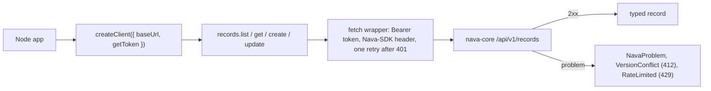

Story TICK-801 (kit TICK-830, PLAN-008). Verdict: **pending**. Date: **pending**. Both are set once the Technical Lead posts the story verdict. The [acceptance kit](../../../acceptance/S25/README.md) records PASS on all five criteria for its own fresh-stack run of 2026-11-14.

## What a user can now do

A developer installs `@nava/sdk` (a tarball CI builds) in a Node 20 project, hands it a function that returns a token, and lists, reads and creates incidents with typed results and typed errors. They write no HTTP code. A repeated create with the same key makes one record. A stale update, an invalid body and rate limiting each arrive as their own error type.

Nothing changes on the server: the SDK is a new directory, `sdk/ts/`, generated from `api/openapi.bundled.yaml` plus a thin hand-written layer (ADR-007 D10). How to use it is on [Using the TypeScript SDK](../operations/sdk.md).

## Flow

## API operations

<!-- gen:operations ids=listRecords,getRecord,createRecord,patchRecord -->

## How to try it

From the repository root, on the story branch `TICK-801/typescript-sdk`, with Docker and Node.js 20 or later:

1. `make dev-ca` once per checkout, then `docker compose down -v` and `docker compose up -d --wait`.
2. `sh docs/acceptance/S25/run.sh`. It seeds tenants A and B, builds and packs the SDK, installs the tarball into `examples/sdk-node/`, runs the example and the criteria walk, and counts the replayed create's `audit_log` rows. You should see `ALL PASS` and `PASS  C2 one audit_log row`.
3. By hand: in `examples/sdk-node/`, `node list-read-create.mjs my-key-1` twice prints the same `INC` number; `node criteria.mjs` prints one PASS or FAIL line per check.

There is no Bruno folder for this story: the client is the SDK, not raw HTTP.

| Criterion | What the kit checks |
|---|---|
| 1 | `list` follows cursors over every page; `get` returns the record and its version |
| 2 | two creates with one `idempotencyKey` make one record and one `audit_log` row |
| 3 | stale version gives `VersionConflict`; invalid body gives `NavaProblem` `record_invalid` with field errors; a 429 gives `RateLimited` with `retryAfter` |
| 4 | every request carries `Nava-SDK: ts/<version>`; the package version is `1.x` |
| 5 | changing the API bundle without regenerating fails the `sdk` CI job |
| Isolation | tenant B gets `404 not_found` on tenant A's record, does not see it in a list, and the same key in tenant B makes tenant B's own record |

## Verdict and evidence

- Verdict: pending. Date: pending.
- Recorded runs used: `docs/acceptance/S25/fresh-stack-run.txt` (fresh stack, Node 22) and `docs/acceptance/S25/node20-run.txt` (Node 20), both `ALL PASS`, listed in the [kit](../../../acceptance/S25/README.md). Not re-run for this page.
- Criterion 5 was shown on a probe PR (TICK-827) that was closed, not merged; the kit names its two runs. Handbook evidence points to committed files only.
- Known limits, from the kit: the package is `1.0.0-alpha.1` (a pre-release of major 1, D11's call); ESM only, so CommonJS needs `await import("@nava/sdk")`; nothing is published to a registry (PLAN-008 D-8-7).
- Not in this story: history, attachments, entity-type and admin calls; the embeddable widget (later ADR-007 stories); a browser example.

See also [Using the TypeScript SDK](../operations/sdk.md) and [ADR-007](../adr/adr-007.md).
