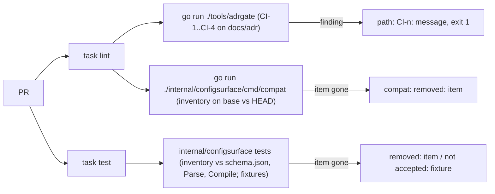

Story TICK-878 (tasks TICK-880, TICK-881, kit TICK-882; PLAN-009). Kit status: **ready**, all four criteria pass. Date: **2026-11-15**. The Technical Lead's verdict is posted on TICK-878. The [acceptance kit](../../../acceptance/s27-competitive-gate.md) records its own run on story branch head `69c1f116`.

## What a user can now do

ADR-008 made two promises, and a machine now checks both:

- **Every new design record has a Competitive Gate.** `task lint` fails, naming the file, when an ADR numbered above 008, or an amendment or erratum dated on or after ADR-008's acceptance, has no `## Competitive Gate` section or a bad `**Result:**` line. It also fails, naming the id, when any record under `docs/adr` cites a pain point `CP-…` that is not in the [register](../../../adr/competitive/pain-points.md) or a method `M-X…` that is not in ADR-008's "The axes" table. These are checks CI-1 to CI-4 from RFC-020 §8, in `tools/adrgate`.
- **An upgrade within a major version never removes what tenants configure** (ADR-008 D12). `internal/configsurface/testdata/inventory.json` lists every workflow step type, step field, condition operator, trigger and type-definition keyword tenants can use today. `task test` fails, naming the item, when a change removes one from the code (for example `removed: workflow.step_types/timer`). `task lint` fails when an item listed on `origin/main`'s inventory is gone from the branch's. This is the M-X2 upgrade-compatibility suite.

Nothing changes for a running tenant: both checks run only in `task lint`, `task test` and the existing CI `lint` and `unit` jobs. `.github/workflows/ci.yml` is unchanged.

## Flow

## How to try it

From the repository root, on the story branch `TICK-878/competitive-gate-checks`, with Go, go-task v3 and golangci-lint (no stack, no Docker). Follow [the kit](../../../acceptance/s27-competitive-gate.md); in short:

1. `cp docs/adr/_template-adr.md docs/adr/ADR-099-scratch.md`, set `date: 2026-11-15`, delete the `## Competitive Gate (ADR-008)` section, run `task lint`.
2. Restore the section, add a line citing `CP-SF-99` and `M-X9`, run `task lint`.
3. Remove `"timer", ` from the step `type` enum in `internal/workflow/def/schema.json`, run `go test ./internal/configsurface/...`.
4. Revert everything; `task lint` and `go test ./internal/configsurface/...` pass.

| Criterion | What the kit checks |
|---|---|
| 1 | `docs/adr/ADR-099-scratch.md: CI-1: no ## Competitive Gate section (ADR-008 D6)`; passes once the section is back |
| 2 | `CI-2: CP-SF-99 is not a row in docs/adr/competitive/pain-points.md` and `CI-4: M-X9 is not a method in ADR-008 "The axes"` |
| 3 | `removed: workflow.step_types/timer` from the suite |
| 4 | On the branch head both checks pass with no change to any existing ADR or to the register |

## Verdict and evidence

- Kit status: ready (TICK-882). Date: 2026-11-15. The run log `s27-kit-run.txt` is attached to the TICK-882 result comment, not committed; the handbook evidence is the kit itself.
- Not re-run for this page.
- Known limits, from the kit: the baseline check (`cmd/compat`) prints `nothing to compare` and passes until S27 merges into `main`, because `origin/main` has no inventory yet. It starts catching an item removed from both the code and the inventory on the first PR after the merge.
- Not in this story: the M-X1a timed run (S28), the M-X4 cost model and the M-X1b timed pilot. No script surface exists yet, so the inventory's `script` list is empty.

See also [ADR-008](../adr/adr-008.md) and [Troubleshooting](../operations/troubleshooting.md#a-lint-or-test-check-fails).
