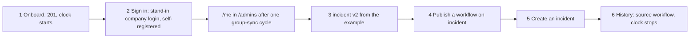

Story TICK-879 (kit and first run TICK-884, this page TICK-885; PLAN-009 D-9-3). Status: **delivered**. The kit and the agent-proxy run (PR #706), the acceptance run and handbook pages (PR #713) and the stand-in company login that removed the platform-staff sign-in step (TICK-967, PRs #725 and #728) are in the story branch `TICK-879/first-routed-record`.

## What a user can now do

Anyone can time how long a brand-new customer's first administrator takes to get from "the tenant was just created" to "a new incident was routed by a workflow I published myself", using only the handbook and the kit. This is ADR-008's axis **X1a**, measured by method **M-X1a**. The target is 8 hours, the aim 4.

- **Clock starts** when the onboarding call (tour step 1) answers `201`.
- **Clock stops** at the first record whose history has an entry with `source: workflow`.
- **Path:** sign in as the first admin, publish a type from a handbook example, publish a workflow on it, create a record, wait for the route.

## Measured so far

From [`docs/quality/x1a-first-routed-record.md`](../../../quality/x1a-first-routed-record.md):

| Run | Runner | Date | Total | Needed help |
|---|---|---|---|---|
| 1 | `agent proxy` (a fresh subagent with only the kit's "How to try", the handbook and the stack URL) | 2026-11-15 | **1.4 min** (07:20:01 to 07:21:24 UTC) | Step 2, sign-in: platform staff (F1) |
| 2 | acceptance run (`agent proxy`, a second fresh subagent, on the fixed tour) | 2026-11-15 | **2.7 min** (10:17:08 to 10:19:51 UTC), about 1 min of it the workflow's timer | Step 2, sign-in: platform staff (F1) |
| 3 | `human` | none yet | | |

Both are an agent's time: it sends each request right after reading the page. It shows the handbook path works end to end on a new tenant. Both runs predate TICK-967, so each logged sign-in as a platform-staff step (F1); that step is now self-service, verified on a fresh stack in CI run [44344844066](https://github.com/Navaladi2019/TicketingSystem/actions/runs/44344844066). It does not show how long a person takes. Until a human run exists, every X1a number is labelled `agent proxy`.

## Flow

## How to try it

Follow [the kit](../../../acceptance/s28-first-routed-record.md) on a fresh stack with the tunnels up; keep its stopwatch log and add your run to the quality page. The automated check is the Bruno folder `S28` (`sh docs/acceptance/guide/tools/api-test.sh S28`); in CI it is the stack case `s28_first_routed_record`.

| Criterion | Evidence |
|---|---|
| 1 Onboard, publish an example type, publish a workflow, create a record that routes, with the kit and the handbook only | Runs 1 and 2 in the quality page; Bruno `S28.1` to `S28.13` |
| 2 The history shows `source=workflow` | `S28.13`; run 1's entry at `2026-11-15T07:21:18.231Z`, run 2's at `2026-11-15T10:19:46.598Z` |
| 3 Two totals against the 8 h target | Run 1: 1.4 min. Run 2: 2.7 min. Both far below 8 h |
| 4 No database command, platform-staff action or operator route | Every step uses the public API only. Sign-in goes through the stand-in company login (TICK-967); `S28.3` makes no master-admin call. Fresh stack: CI run [44344844066](https://github.com/Navaladi2019/TicketingSystem/actions/runs/44344844066) |

## Findings and where they went

| # | Finding | Fixed in |
|---|---|---|
| F1 | The local stack has no company login, so the new admin signs in only through the kit's platform-staff stand-in | TICK-967: the stand-in company login and a default-off onboarding host list. [2. Sign in](../tour/02-sign-in.md#a-newly-onboarded-tenants-first-admin) |
| F2 | `/me` answers `401 tenant_unresolved` until group sync places the admin; troubleshooting said to run `seed.sh` | [2. Sign in](../tour/02-sign-in.md#a-newly-onboarded-tenants-first-admin), [Troubleshooting](../operations/troubleshooting.md) |
| F3 | `incident.json` answers `409` on a new tenant, which already has `incident` | [6. Create an entity type](../tour/06-create-an-entity-type.md#an-example-whose-type-the-tenant-already-has), `docs/handbook/examples/README.md` |
| F4 | Tour step 8 sent `$ADMIN_TOKEN`; the setup defines `$ADMIN` | [8. Workflows](../tour/08-workflows.md) |
| F5 | Tour step 8 said "as an agent"; a new tenant has no agent | [8. Workflows](../tour/08-workflows.md) |
| F6 | Tour step 8's "not re-run" caveat was out of date | [8. Workflows](../tour/08-workflows.md) |
| F7 | The history does not say which workflow wrote the change | Documented in [8. Workflows](../tour/08-workflows.md); no API change |
| F8 (run 2) | The new step-6 command needed `jq`, not in the prerequisites; an empty body gave `400` | [6. Create an entity type](../tour/06-create-an-entity-type.md#an-example-whose-type-the-tenant-already-has) |
| F9 (run 2) | Kit step 4 reads as no timer; the tour example has one | [8. Workflows](../tour/08-workflows.md) says the timer is optional |
| F10 (run 2) | No incident create example for a new tenant | [8. Workflows](../tour/08-workflows.md) |

## Not in this story

- A human timed run (optional; the verdict does not wait for one).
- X1b, the timed pilot go-live, and M-X4, the cost model.
- A customer's own company login on the local stack; the stand-in realm takes its place there.

See also [ADR-008](../adr/adr-008.md).
