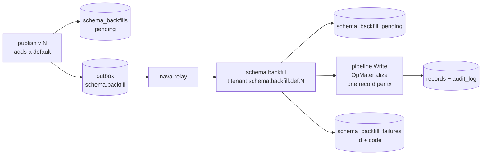

Story TICK-915, plan PLAN-010 (`docs/delivery/plan-adr-009.md`, TICK-914),
design [ADR-009](../adr/adr-009.md). **In progress: built on the story branch
`TICK-740/search-finish`, shared with [S22](s22.md). Not on `main`, not yet
accepted.** Every build task is merged; the acceptance kit (TICK-754) is open.

| Task | State |
|---|---|
| TICK-916: the three tables, `OpMaterialize` (TICK-917), the rollout migration (TICK-925) | merged (PR #921) |
| TICK-920: the `schema.backfill` workflow, relay-only start (TICK-918), supersede and one job per tenant (TICK-921) | merged (PR #924) |
| TICK-919: publish queues the job; D13; D14 | merged (PR #932) |
| TICK-1192: `backfill` object and failures route (D10), one effective-value helper (D11), filter shapes while a job is open (D12). Folded into TICK-919 on 2026-11-26 but not in PR #932 | merged (PR #960) |
| TICK-753 (absorbed TICK-926): adversarial isolation rows | all six rows run |
| TICK-754 (absorbed TICK-928): acceptance kit, verified on a fresh stack | open (PR #918) |
| TICK-927: 100k-record run with live writers (CI-12) | backlog; out of scope under the consolidation |

## What a user can now do

A tenant admin publishes a version of a ticket type that gives a field a
default, for example "priority defaults to 3". In the background, every
existing ticket that has no priority gets 3 stored. Each changed ticket gets
one audit entry. Its version moves, so an open edit form sees a `412` once,
but its "last updated" time does not change. No workflow is started by the
rewrite.

- A publish that also marks the field `x-nava-unique` is refused (`422
  invalid_definition`): two tickets would share the value.
- Making an existing field required is now allowed when the new version gives
  it a default (NeedsBackfill). Without a default it is still breaking.
- A second publish of the same type while the job runs replaces it; the
  newer job does the work.
- Types that already had a default before S29 get one job each from the
  rollout migration, except types that combine a default with
  `x-nava-unique`.

Right after the publish, a filter on priority 3 already finds the old tickets
that have no priority yet, with the right `total`, and keeps finding them
until the job ends; the results are the same before and after (D12). Every
read of a ticket, the list, the PATCH response and a workflow's record read
show priority 3 even before the ticket is rewritten (D11). The type's
`getEntityType` shows the job's state and counts, and an entity-type admin
can list the tickets that could not be rewritten, with a code and no value
(D10). See [metadata engine](../system/core-metadata.md#backfill-progress-on-the-entity-type-s29-story-branch)
and [Records](../database/records.md#filters-while-a-default-is-being-backfilled-s29-story-branch).

## How it works

- Publish: [metadata engine](../system/core-metadata.md), steps 3a and 6a.
- The job: [schema backfill workflow](../workflows/schema-backfill.md) and
  [its tables](../database/schema-backfill.md).
- The record write: [`OpMaterialize`](../system/core-write-pipeline.md#opmaterialize-the-schema-backfill-write).
- Temporal: `schema.backfill` is start-only and relay-only ([Temporal
  authorization](../security/05-temporal.md)).

## Attack paths

From `internal/tenancy/isolation/s22_s29_attack_paths.go`, `temporal-server/authz/adversarial_s22_s29_test.go`
and the review note
[tick-753-s22-s29-isolation-attacks.md](../../../reviews/tick-753-s22-s29-isolation-attacks.md):

| Row | What it proves | State |
|---|---|---|
| 1 | The three tables under RLS for `nava_app` and `nava_worker`: no tenant B row, no B insert, `nava_app` inserts only its own fresh pending job, nothing with no tenant, no value column; B's active job never blocks A's admission | runs |
| 2 | `getEntityType`, the failures route and a publish on B's key are the unknown key's 404 for A; a plain user's failures read is the same 404 | runs |
| 3 | With open windows in both tenants, the D12 shapes never return or count a B record, and the ACL holds in the `UNION ALL` arm | runs |
| 4 | `OpMaterialize` in A's transaction naming B's record or B as actor writes nothing; a patch, another source, a principal or another actor is refused | runs |
| 5 | The real workflow `t:A` rewrites A's records and none of B's, with the same key and B's own job; mismatched ids fill nothing; no value in history | runs |
| 6 | The relay marks a payload carrying `tenant_id` dead with no Temporal call, and always starts under the row's tenant | runs |
| authz | No worker command can start or continue-as-new `schema.backfill`; only nava-relay starts it; the queue is not a side door | runs |

## Not in this story

- CI-12 (100k records, four live writers, p95 within +25%) and the WAL,
  sealer-lag and history-size measures: TICK-927, backlog.
- The ADR-009 grants erratum that PLAN-010 D-10-11 calls for.
- R6's alert is a counter and a log line; no runbook yet.
