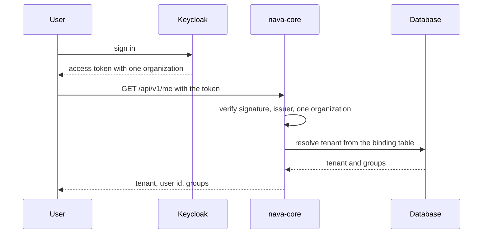

Story TICK-45. Verdict **READY**, 2026-10-27, recorded in the
[acceptance kit](../../../acceptance/s3-tenant-signin.md) (16 of 16 checks pass).

## What a user can now do

- Sign in through Keycloak as a seeded user and call `GET /api/v1/me`. The
  answer holds the tenant, the user id and the groups.
- Trust that the tenant comes only from the signed token and the platform's own
  binding table. A tenant id in a header, the query string or the body changes
  nothing.
- Be refused with a token that names no organization or more than one, an ID
  token, or a token from an issuer the platform does not trust.

## Flow

## API operations

<!-- gen:operations ids=getMe -->

## How to try it

1. `sh docs/acceptance/guide/tools/seed.sh`.
2. In Bruno run the folder `S3`, or headless
   `sh docs/acceptance/guide/tools/api-test.sh S3`.

| Operation | Bruno request file |
|---|---|
| `getMe` | `S3/S3-2.bru` (tenant user), `S3/S3-4.bru` (tenant admin) |
| `getMe` negatives | `S3-5` no token, `S3-6` garbage, `S3-7` tampered, `S3-8` ID token, `S3-10` wrong issuer, `S3-12` operator token, `S3-15` no organization, `S3-21` two organizations |

The sign-in and setup requests are `S3-1`, `S3-3`, `S3-9`, `S3-11`, `S3-13`
to `S3-14` and `S3-16` to `S3-20`. The step-by-step kit is the
[acceptance guide page for S3](../../../acceptance/guide/s3.html) and the
[kit](../../../acceptance/s3-tenant-signin.md); this page does not copy it.

## Verdict and evidence

- Verdict: READY, all 3 criteria, story step 3 and the cross-tenant check pass
  (QA, 2026-10-27).
- Recorded run used: the committed Bruno run
  [acceptance-run.md](../../../acceptance/guide/acceptance-run.md) (2026-10-29,
  145 requests and 466 tests, 0 failed) and the kit's own
  [transcript](../../../acceptance/s3-tenant-signin/transcript.txt). Not re-run
  for this page.
