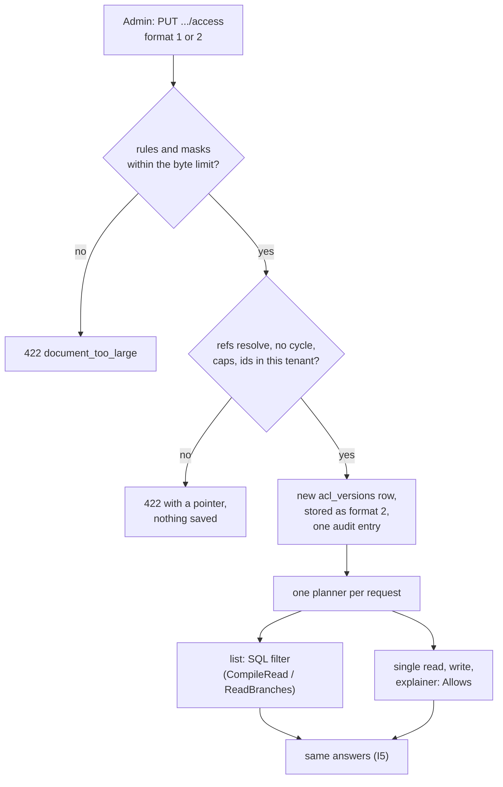

Story TICK-935 (kit TICK-944, plan PLAN-011, decision [ADR-010](../adr/adr-010.md)
and [ADR-010-A1](../adr/adr-010-a1.md)). Kit result **READY**, verified
2026-11-19 on a fresh stack, recorded in the
[acceptance kit](../../../acceptance/S30/README.md). Criteria 1 to 5 pass.

## What a user can now do

- As a tenant admin, write an entity type's access as **conditions** (named
  yes/no tests such as `in_assigned_group` or `is_requester`) and
  **policies** that combine them with `all` (AND), `any` (OR) and `not`. Each
  policy says which operations (`read`, `write`) it grants. Access is still
  allow-only: a user gets an operation when any policy granting it matches.
- Change one condition and every policy that uses it changes in the same
  publish.
- Save a broken document and get `422 invalid_access_policy` with a JSON
  pointer to the bad node. Nothing is saved; `GET` still shows the previous
  version. A group or user of another tenant is refused as `foreign_id`, and
  the id is not echoed.
- Ask why a user can or cannot read a ticket and get the granting `policy`,
  a `trace` of each named condition reached with its value, and any `invalid`
  (voided) policy with its code and pointer.
- Keep the S10 rules: a format-1 document still publishes, is stored as
  format 2, and gives the same answers. `GET` always returns format 2.

Not yet: the `under` (org-unit subtree) node is refused as `not_available`
until S31, and there is no UI for writing documents; the admin sends JSON to
the access route.

## Published limits

These are product limits (Competitive Gate risk CP-SF-02, item 2). They are
the SP-2 numbers of ADR-010-A1, lower than ADR-010 D4's first ceiling. Each
is checked by the access route and again by the database `CHECK`, and each
refusal is `422 invalid_access_policy` with the code and a pointer.

| Limit | Value | Problem code | Pointer points at |
|---|---|---|---|
| Nesting depth of a policy, after `ref` expands | 8 | `depth_exceeded` | the policy's `when`, `/rules/policies/<i>/when` |
| Children of one `all` or `any` | 1 to 16 | `child_count` | the `all` or `any` node |
| Policies per document | 64 | `policies_exceeded` | `/rules/policies` |
| Leaves per policy, after `ref` expands | 128 | `policy_leaves_exceeded` | the policy's `when`, `/rules/policies/<i>/when` |
| Leaves per document (every policy, after `ref` expands; unused conditions not counted) | 128 | `document_leaves_exceeded` | `/rules/policies` |
| Size of `rules`, and separately of `masks`, as stored `jsonb` text | the platform's configured limit, 32 KiB by default (operator range 16-128 KiB) | `document_too_large` | `/rules` or `/masks` |

The size limit is one platform-wide setting, never per tenant; the effective
value appears only in the `detail` of the `document_too_large` 422. Operators
set it with [`NAVA_ACL_MAX_DOCUMENT_BYTES`](../operations/acl-document-limit.md).
The other limits are fixed. The full list of codes is on the
[access API page](../system/access-api.md#problem-codes).

## Flow

## API operations

<!-- gen:operations ids=putEntityTypeAccess,getEntityTypeAccess,explainAccess,listRecords,getRecord,patchRecord -->

## How to try it

1. From the repository root on a fresh stack: `make dev-ca`,
   `docker compose down -v`, `docker compose up -d --wait`.
2. `sh docs/acceptance/S30/run.sh`. It seeds tenants A and B, runs the Bruno
   folder `S30 composable access` (47 requests) and then `S10 access`
   (66 requests), reads `authz_policy_invalid_total`, and ends with the D6
   check, whose last line is `D6: ... threshold 16: PASS`.
3. Or open `docs/acceptance/guide/bruno/` in Bruno with the `local`
   environment and run the folder `S30` top to bottom.

The story users are the seeded `admin@tenant-a.test` (admin),
`alice@tenant-a.test` (agent in `/service-desk`), `auditor@tenant-a.test`
(requester) and `bob@tenant-b.test` (tenant B).

| Operation | Bruno request file |
|---|---|
| `getEntityTypeAccess` | `S30/S30-9.bru` (the S10 default reads back as format 2), `S30/S30-35.bru` (unchanged after refused publishes) |
| `putEntityTypeAccess` | `S30/S30-21.bru` (republish the `GET` document), `S30/S30-28.bru` (3 conditions, 5 policies, lint `not_over_caller_leaf`), `S30/S30-32.bru` (`unresolved_ref`), `S30/S30-33.bru` (`ref_cycle`), `S30/S30-34.bru` (`foreign_id`), `S30/S30-37.bru` (edit one condition), `S30/S30-46.bru` (tenant B: 403) |
| `listRecords` | `S30/S30-14.bru` to `S30/S30-19.bru` and `S30/S30-22.bru` to `S30/S30-27.bru` (before and after the format-2 republish), `S30/S30-29.bru`, `S30/S30-31.bru`, `S30/S30-38.bru`, `S30/S30-44.bru` (tenant B sees none) |
| `getRecord` | `S30/S30-30.bru` (same 404 as `S30/S30-13.bru`'s missing id), `S30/S30-36.bru`, `S30/S30-39.bru`, `S30/S30-41.bru`, `S30/S30-45.bru` (tenant B: 404) |
| `patchRecord` | `S30/S30-40.bru` (the edited condition grants write) |
| `explainAccess` | `S30/S30-42.bru` (allow: policy and trace), `S30/S30-43.bru` (deny: trace, no policy) |

The document published at `S30.28`:

| Policy | Ops | When |
|---|---|---|
| `admins` | read, write | `member_of admins` |
| `agents_see_group_not_raised` | read | `member_of /service-desk AND in_assigned_group AND NOT is_requester` |
| `agents_edit_group_new` | write | `member_of /service-desk AND in_assigned_group AND is_new` |
| `requesters_see_own` | read | `NOT member_of /service-desk AND is_requester` |
| `requesters_edit_own_new` | write | `NOT member_of /service-desk AND is_requester AND is_new` |

## Verdict and evidence

- Kit result: READY, verified 2026-11-19 on a fresh stack at story branch
  commit `34e5299b`. `S30 composable access` 47 of 47 requests, 145 of 145
  tests; `S10 access` 66 of 66 requests, 220 of 220 tests, in
  [fresh-stack-run.txt](../../../acceptance/S30/fresh-stack-run.txt).
  Not re-run for this page.
- D6 check: 2 documents, both format 2, max 4 read branches against the
  threshold of 16.
- Benchmark: on 800k records the support-agent list is 108.7 ms p95 plain and
  81.4 ms p95 with the composed policy, against 150 ms. Format 2 produces the
  same SQL and plan as format 1. See [Benchmarks](../benchmarks/index.md) and
  [acl-perf-800k.md](../../../quality/acl-perf-800k.md).
- Alert: `AuthzPolicyInvalid` fires when `authz_policy_invalid_total` grows
  (ADR-010 R7). See [Traces, logs and metrics](../operations/observability.md).
- Isolation: TICK-943's adversarial tests; see
  [ACL and field masks on the read side](../security/09-acl-masks-read.md).
- Fixed after the kit run: TICK-996 (a format-1 rule over the child cap now
  gets `422 child_count`, not 500) and TICK-998 (S10 kit expects the
  format-2 `GET` shape).

## Known limits

- A fresh stack holds no format-1 row: since TICK-939 onboarding stores the
  default incident ACL as format 2. Criterion 5 is shown by republishing the
  S10 rules and by the S10 folder. Stored format-1 rows are proven equal in CI
  by `TestI5Format1ConvertedMatchesS10` and `TestTICK940MigrationOverFormat1Rows`.
- A format-1 rule id that is not a valid name is renamed when it is published:
  `r-desk` becomes `r_desk`, and the explainer's `rule_id` shows `r_desk`. A
  format-1 row stored before S30 keeps its old id as `legacy_id` when read.
- The `not_over_caller_leaf` lint on `NOT is_requester` is expected; every
  signed-in user has an id.
