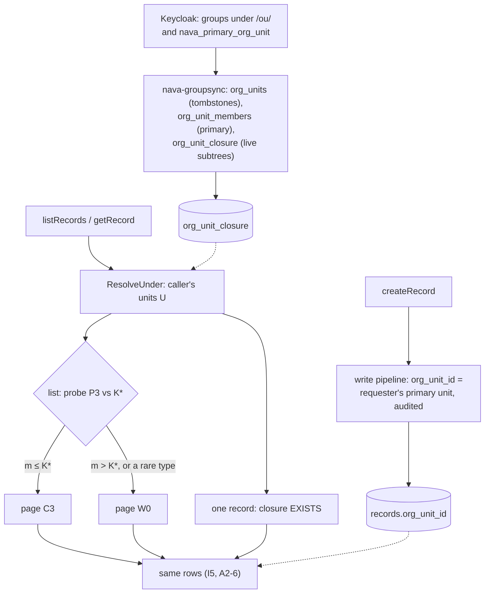

Story TICK-946 (kit TICK-953, plan PLAN-011, decision [ADR-010](../adr/adr-010.md)
D7 and D8 as amended by [ADR-010-A2](../adr/adr-010-a2.md)). Kit result
**READY**, verified 2026-11-22 on a fresh stack, recorded in the
[acceptance kit](../../../acceptance/S31/README.md). Criteria 1 to 5 pass.

## What a user can now do

- As a tenant admin, publish an access rule "agents see tickets from their
  region": `{"under": {"of": "caller"}}`. Anyone in an org unit sees the
  tickets of that unit and of every unit below it. `{"under": {"of": [ids]}}`
  names units instead.
- A ticket remembers the org unit of the person who raised it (their primary
  unit), set once when it is created. Moving a person to another unit does
  not move their old tickets.
- A ticket raised by someone with no unit is in nobody's region.
- When a unit is removed from the company directory, its tickets, and those
  of every unit below it, drop out of everyone's region after the next group
  sync. The sync still succeeds.
- A rule that names another tenant's unit is refused with
  `422 foreign_id`, and the id is not echoed.

Not yet: there is no UI or API to list org units or show a ticket's unit
(the kit reads both from the database), and moving tickets between units is
a later workflow step (ADR-010 D8).

## Flow

## API operations

<!-- gen:operations ids=putEntityTypeAccess,getEntityTypeAccess,createRecord,listRecords,getRecord -->

## How to try it

1. From the repository root on a fresh stack: `make dev-ca`,
   `docker compose down -v`, `docker compose up -d --build --wait`.
2. `sh docs/acceptance/S31/run.sh`. It seeds tenants A and B, prints tenant
   A's org-unit tree, runs the Bruno folder `S31 region` (38 requests), runs
   one group sync, runs `S31 region after sync` (16 requests), prints the unit
   each ticket kept, and checks that both ADR-010-A2 alerts are loaded. It
   runs once per stack: it deletes `EMEA/Germany` in Keycloak.
3. Or open `docs/acceptance/guide/bruno/` in Bruno with the `local`
   environment, fill `s31_a_unit` and `s31_b_unit` with the ids `run.sh`
   prints in its step 4, run `S31 region`, then
   `docker compose run --rm --no-deps nava-groupsync --once`, then
   `S31 region after sync`.

The story users, seeded in the realm fixture:

| Story user | Units in tenant A |
|---|---|
| `admin@tenant-a.test` | tenant admin (`/admins`) |
| `agent-emea@tenant-a.test` | `EMEA` |
| `requester-emea@tenant-a.test` | `EMEA` |
| `requester-germany@tenant-a.test` | `EMEA/Germany` |
| `requester-apac@tenant-a.test` | `APAC`, moved to `EMEA` during the run |
| `requester-none@tenant-a.test` | none (only the plain group `/requesters`) |
| `bob@tenant-b.test` | tenant B, for isolation |

The policy published at S31.16:

| Policy | Ops | When |
|---|---|---|
| `admins` | read, write | `member_of admins` |
| `in_my_region` | read | `under caller` |

| Operation | Bruno request file |
|---|---|
| `getEntityTypeAccess` | `S31/S31-15.bru` |
| `putEntityTypeAccess` | `S31/S31-16.bru` (publish `in_my_region`), `S31/S31-31.bru` (tenant B's unit: `422 foreign_id`), `S31/S31-32.bru` (tenant A's `EMEA`: accepted) |
| `createRecord` | `S31/S31-17.bru` to `S31/S31-20.bru` (one ticket per requester), `S31-after/S31B-14.bru` (the moved requester's new ticket) |
| `listRecords` | `S31/S31-21.bru` (AC1), `S31/S31-26.bru` to `S31/S31-29.bru` (AC2), `S31/S31-33.bru` (tenant B), `S31-after/S31B-9.bru`, `S31B-12.bru` (AC3), `S31B-15.bru`, `S31B-16.bru` (AC4) |
| `getRecord` | `S31/S31-22.bru` (reference 404), `S31/S31-23.bru` to `S31/S31-25.bru`, `S31/S31-30.bru`, `S31/S31-34.bru` (tenant B: 404), `S31-after/S31B-11.bru`, `S31B-13.bru` |

## Verdict and evidence

- Kit result: READY, verified 2026-11-22 on a fresh stack at story branch
  commit `8528ea4f` plus the kit. `S31 region` 38 of 38 requests, 130 of 130
  tests; `S31 region after sync` 16 of 16 requests, 47 of 47 tests; `run.sh`
  exit 0, in [fresh-stack-run.txt](../../../acceptance/S31/fresh-stack-run.txt).
  Not re-run for this page.
- AC3's sync: `org_units_deleted: 1`, `org_members_removed: 2`,
  `org_closure_rebuilt: true`, `org_closure_unrooted: 0`, `failed: 0`.
- AC4: the moved requester's old ticket stays `APAC`, the new one is `EMEA`.
- Benchmark (ADR-010-A2 R1, TICK-1037): **PASS**. On 800k records the region
  list is 70.08 ms p95 (agents) and 82.69 ms p95 (count-only) at 9,099 units,
  against 150 ms; every other row is at most 87.29 ms. See
  [Benchmarks](../benchmarks/index.md) and
  [acl-perf-region.md](../../../quality/acl-perf-region.md#s31-rerun-after-a2-tick-1037-r1-per-adr-010-a2-a2-11).
- Isolation: TICK-952's attack tests, no exploitable gap; see
  [ACL and field masks on the read side](../security/09-acl-masks-read.md#region-access-s31).
- Alerts: `GroupsyncOrgUnitsAboveCertified` and `EntityRecordEstimatesStale`
  are loaded and inactive after the run
  ([Traces, logs and metrics](../operations/observability.md)).

## What changed underneath

| Area | Page |
|---|---|
| `org_units` tombstones, `org_unit_members`, `org_unit_closure` | [Org units (tables)](../database/org-units.md) |
| `records.org_unit_id` and its index | [Records (tables)](../database/records.md) |
| `entity_record_estimates` and the worker's read of `tenant_identity_binding` | [Record estimates (tables)](../database/record-estimates.md) |
| The `under` leaf, C3 or W0, K\*, the publish checks | [Core: record ACL](../system/core-acl.md#the-under-leaf-s31), [Access API](../system/access-api.md#problem-codes) |
| The unit on create; `org_unit_id` reserved in schemas | [The write pipeline](../system/core-write-pipeline.md), [Metadata engine](../system/core-metadata.md) |
| Group sync of units, primary units, the closure and its metrics | [nava-groupsync](../system/nava-groupsync.md#org-units-s31), [Keycloak](../system/keycloak.md) |
| The hourly estimates refresh | [nava-worker](../system/nava-worker.md#the-estimates-refresh-job-s31) |

## Known limits

- **One pass per fresh stack.** The kit deletes `EMEA/Germany` and leaves
  tenant A's incident access as S31.16 published it.
- **A requester raising their own ticket is not walked.** The admin creates
  every ticket with `requester` set; the pipeline's tests cover the
  self-raised path (`TestCreateSetsOrgUnitFromRequestersPrimaryUnit`,
  `TestOrgUnitOnEveryInsertPath`).
- **`nava_primary_org_unit` is not walked.** Every seeded user has one unit;
  `TestOrgMembersAndPrimaryWritten` covers the attribute. Filling it from a
  tenant's identity provider is a follow-up.
- **`groupsync_org_units_live_max` has no sample right after start.** The
  long-running service sets it on its first cycle; the `--once` run's log
  line carries the same tree numbers.
- **Access changes wait for the next sync** (ADR-010 R3, `AR-TICK-901-01`):
  a user moved out of a unit keeps region access until then.
- **Latency shows the page shape** inside one tenant (`AR-TICK-1040-01`).
- **ADR-010-A3** (shape R for a type concentrated under a large subtree) is
  accepted but not built; it does not gate S31 and has its own follow-up.
