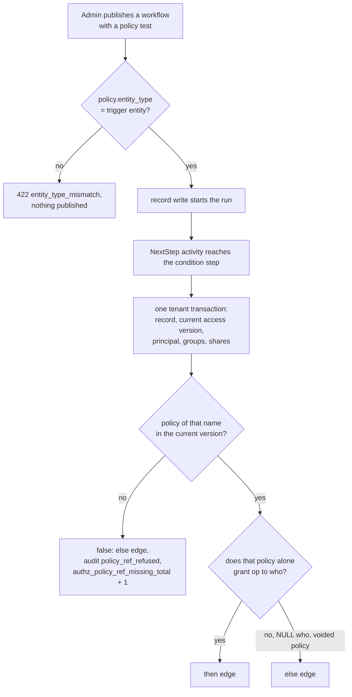

Story TICK-955 (tasks TICK-956, TICK-957, TICK-958, plan PLAN-011, decision
[ADR-010](../adr/adr-010.md) D9). Kit result **READY**, verified 2026-11-21 on
a fresh stack, recorded in the
[acceptance kit](../../../acceptance/S32/README.md). Criteria 1 to 4 pass.

## What a user can now do

- As a tenant admin, write a workflow `condition` step that asks "may this
  record's assignee (or its requester) read it (or change it) under policy
  X?" and branch on the answer. The step names the policy; it does not copy
  the rule.
- Narrow or widen that policy and see workflows that are already running
  follow it from their next check. The check reads the entity type's current
  access version every time; it is not pinned to the version the run started
  with.
- Name a policy that does not exist and get "no": the step takes its `else`
  edge, and the audit log gets a `policy_ref_refused` entry.
- A workflow can test only its own trigger entity's type. Naming another type
  is refused at publish with `422 entity_type_mismatch`. A policy that only
  another tenant has is the same as a missing name.

- Since S31 a named policy may hold a region condition (`under`); the check
  answers it as a record read does (TICK-1114).

Not yet: no UI or canvas for the policy test; the admin sends the workflow
JSON to `POST /api/v1/workflow-definitions/{key}/versions`.

## The step

```json
{ "key": "check", "type": "condition",
  "policy": { "entity_type": "incident", "name": "agents_write" },
  "who": "assignee", "op": "write",
  "then": "triaged", "else": "needs_owner" }
```

| Field | Values | Checked at publish |
|---|---|---|
| `policy.entity_type` | an entity type key | must be the trigger entity, else `422 entity_type_mismatch` at `/steps/<key>/policy/entity_type` |
| `policy.name` | a policy name, `^[a-z][a-z0-9_]{0,62}$` | shape only; the name is looked up at run time |
| `who` | `assignee`, `requester` | yes |
| `op` | `read`, `write` | yes |

A policy test replaces `field` and `value`; a step with both is refused.
The full step catalog is on [Workflows (tour)](../tour/08-workflows.md#the-named-policy-test).

## Flow



## API operations

<!-- gen:operations ids=publishWorkflowDefinitionVersion,putEntityTypeAccess,createRecord,getRecord,getRecordHistory,listAuditEntries -->

## How to try it

1. From the repository root on a fresh stack: `make dev-ca`,
   `docker compose down -v`, `docker compose up -d --build --wait`.
2. `sh docs/acceptance/S32/run.sh`. It seeds tenants A and B, makes
   `admin@tenant-b.test` tenant B's admin, checks tenant A has no other
   incident workflow, runs the Bruno folder `S32 workflow policy`
   (39 requests), checks from the database that the AC2 run was waiting when
   the policy was narrowed (`AC2: PASS`), and lists the refused-reference audit
   entries and `authz_policy_ref_missing_total`.
3. Or open `docs/acceptance/guide/bruno/` in Bruno with the `local`
   environment and run the folder `S32` top to bottom. After a failed pass use
   a fresh stack: the restore steps run only at the end.

The story users are the seeded `admin@tenant-a.test` (admin, creates the
incidents), `alice@tenant-a.test` (agent in `/service-desk`, the assignee),
`auditor@tenant-a.test` (requester) and `admin@tenant-b.test` (tenant B).

| Criterion | Bruno requests |
|---|---|
| 1. assignee may write under `agents_write`: `triaged` | `S32/S32-13.bru` (publish), `S32/S32-16.bru` (`triaged`), `S32/S32-18.bru` (history `source: workflow`), `S32/S32-17.bru` (control: requester as assignee gets `needs_owner`) |
| 2. narrowed while waiting: `needs_owner` | `S32/S32-19.bru` (timer `PT20S` before the check), `S32/S32-20.bru` (create), `S32/S32-21.bru` (still `new`), `S32/S32-22.bru` (narrow `agents_write` to admins), `S32/S32-23.bru` (`needs_owner`), then `run.sh` step 5 |
| 3. `does_not_exist`: `needs_owner` and an audit entry | `S32/S32-24.bru` (restore `agents_write`), `S32/S32-25.bru` (publish accepts the unknown name), `S32/S32-27.bru`, `S32/S32-28.bru` (audit) |
| 4. tenant B's policy: same as missing | `S32/S32-30.bru` (tenant B adds `tenant_b_only`), `S32/S32-31.bru` to `S32/S32-35.bru`, `S32/S32-36.bru` (another entity type: 422) |

## Finding the missing-policy entry

Read `GET /api/v1/audit/entries?domain=config&subject_type=acl_policy&from=...`
as a tenant admin and look for `"action": "policy_ref_refused"` with
`actor_system: "workflow"` and `source: "workflow"`. The subject is the
entity type's access policy, the same subject as the admin's own access
publishes. **The entry holds no policy name**: `content_sha256` is the SHA-256
of `<entity_type>/<name>`, so hash the name to match it
(`printf 'incident/does_not_exist' | sha256sum`). The nava-worker log line
`authz: workflow policy reference names no policy, it denies` has the name in
plain text.

## Verdict and evidence

- Kit result: READY, verified on a fresh stack at story branch commit
  `f249b7b5`. `S32 workflow policy` 39 of 39 requests, 102 of 102 tests, and
  `AC2: PASS`, in [fresh-stack-run.txt](../../../acceptance/S32/fresh-stack-run.txt).
  A second pass on the same stack: 38 passed and S32.10 skipped, 100 of 100
  tests. The S30 folder still passes (47 of 47). Not re-run for this page.
- `authz_policy_ref_missing_total{entity_type="incident"}` went from no series
  to 2, one for criterion 3 and one for criterion 4.
- Isolation: the adversarial tests under RLS are TICK-957's
  (`internal/records/pipeline/policyref_integration_test.go`): the same entity
  type key and policy name in two tenants with different rules, another
  tenant's record, and a run with no `workflow_ref` of the tenant. The worker's
  reads of `principals` and `group_members` and the new audit action are
  TICK-1025's.
- S32 has no stack CI case (`s32_*.sh`); the fresh-stack kit is the gate. See
  the [decision](../../../delivery/decisions/2026-11-21-s32-no-stack-ci-case.md).

## Known limits

- **The audit entry stores only a hash of the name.** An admin has to hash the
  name or read the worker log to match an entry. Adding the name is a product
  follow-up ([decision](../../../delivery/decisions/2026-11-21-s32-policy-ref-audit-hash-only.md)).
- **A Temporal retry can audit and count one refusal twice.** The test commits
  its own transaction, so a later failure in the same `NextStep` that Temporal
  retries evaluates the reference again. Accepted: a retry is a new evaluation.
- **No alert** on `authz_policy_ref_missing_total`. It should stay at zero; a
  rise means a workflow names a policy that was removed (ADR-010 R5).
- `who: requester` and `op: read` are not walked in the kit; TICK-957's
  integration tests cover both. A voided policy is covered by unit tests only.
- AC2 depends on the clock: the narrowing must land inside the 20 s timer.
  `run.sh` fails if it does not.
