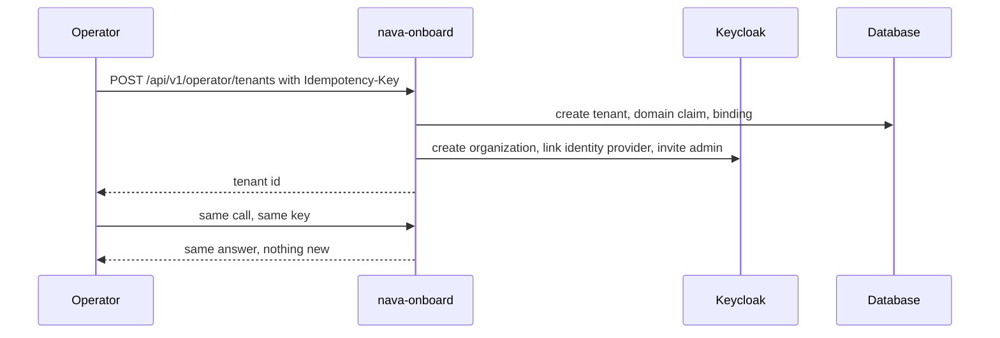

Story TICK-46. Verdict **READY**, 2026-10-28, recorded in the
[acceptance kit](../../../acceptance/operator-onboards-tenant.md).

## What a user can now do

- As an operator, create a new tenant with one API call. It creates the
  tenant's sign-in organization, connects the tenant's own identity provider and
  invites the tenant's first admin.
- Send the same call again with the same `Idempotency-Key`: the same answer, and
  nothing is created twice.
- As the invited admin, sign in with the company account and see only your own
  tenant.
- Someone who already signs in through another tenant's identity provider cannot
  be made this tenant's admin.

## Flow

## API operations

<!-- gen:operations ids=onboardTenant -->

The route is served by `nava-onboard` (operator token only), not by the tenant
ingress.

## How to try it

1. `sh docs/acceptance/guide/tools/seed.sh`, then
   `sh docs/acceptance/guide/tools/tunnels.sh up` (it forwards the onboarding
   service to the host).
2. In Bruno run the folder `S4`, or headless
   `sh docs/acceptance/guide/tools/api-test.sh S4`.

| Operation | Bruno request file |
|---|---|
| `onboardTenant` | `S4/S4-8.bru` onboard a new tenant; `S4/S4-9.bru` replay with the same key |
| `onboardTenant` negatives | `S4-3` no token, `S4-4` a tenant admin's token, `S4-5` route not on the tenant ingress, `S4-6` no key, `S4-7` private identity provider address, `S4-10` same key with a different body, `S4-11` and `S4-12` domain already claimed, `S4-13` tenant id in body or header ignored, `S4-14` operator routes only |

`S4-1` and `S4-2` sign in as the operator and as a tenant admin. The
step-by-step kit is the
[acceptance guide page for S4](../../../acceptance/guide/s4.html) and the
[kit](../../../acceptance/operator-onboards-tenant.md); this page does not copy it.

## Verdict and evidence

- Verdict: READY (QA, 2026-10-28, on the story branch up to date with `main`).
- Recorded run used: the committed Bruno run
  [acceptance-run.md](../../../acceptance/guide/acceptance-run.md) (2026-10-29,
  145 requests and 466 tests, 0 failed) and the kit. Not re-run for this page.
- Regression of milestone 1 on `main`:
  [S4 evidence](../../../acceptance/regression-milestone-1-evidence/rerun-76350ef/s4-operator-onboards-tenant.md).
