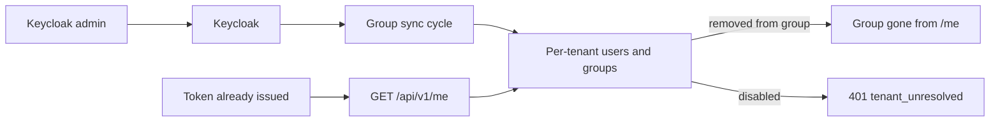

Story TICK-47. Verdict **READY**, 2026-10-27, recorded in the
[acceptance kit](../../../acceptance/s5-group-changes-within-10-minutes.md).

## What a user can now do

- As an administrator, remove someone from a team in Keycloak: the platform
  stops treating them as a member within 10 minutes, even on a sign-in they
  already hold.
- As an administrator, disable someone: they cannot sign in again, and the
  sign-in they already hold stops working within 10 minutes.
- Rely on each customer's copy of its users and teams holding only its own
  people.
- Rely on a set of automated attacks on sign-in (forged or swapped tokens,
  tampering with the login page, another customer's login system) being refused,
  on every PR.

## Flow

## API operations

<!-- gen:operations ids=getMe -->

## How to try it

1. `sh docs/acceptance/guide/tools/seed.sh` (it also runs one group sync).
2. In Bruno run the folder `S5`, or headless
   `sh docs/acceptance/guide/tools/api-test.sh S5`. The polling requests wait
   for the sync, so the folder takes several minutes.

| Operation | Bruno request file |
|---|---|
| `getMe` before and after a group change | `S5/S5-4.bru`, then the poll `S5/S5-6.bru` (the same token loses its group), `S5/S5-10.bru` (restored) |
| `getMe` after a disable | `S5/S5-13.bru` (the same token gets 401 `tenant_unresolved`), `S5/S5-17.bru` (re-enabled) |

The Keycloak changes themselves (`S5-5`, `S5-8`, `S5-11`, `S5-15`) and the sign-in
negative (`S5-12`) call Keycloak, not the platform API; `S5-3`, `S5-7` and
`S5-14` are the unaffected control user. The step-by-step kit is the
[acceptance guide page for S5](../../../acceptance/guide/s5.html) and the
[kit](../../../acceptance/s5-group-changes-within-10-minutes.md); this page does not copy it.

## Verdict and evidence

- Verdict: READY, all six criteria pass (QA, 2026-10-27, fresh stack).
- Recorded run used: the committed Bruno run
  [acceptance-run.md](../../../acceptance/guide/acceptance-run.md) (2026-10-29,
  145 requests and 466 tests, 0 failed), the kit, and the timed attack-suite
  report [ci5-report.md](../../../acceptance/s5-evidence/ci5-report.md). Not
  re-run for this page.
