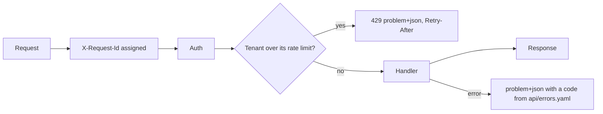

Story TICK-48. Verdict **READY**, 2026-10-29, recorded in the
[acceptance kit](../../../acceptance/s6-api-ground-rules.md). Criteria 1, 2 and 4
pass on the stack; criterion 3 (pagination) passes in automated tests only,
because no endpoint returned pages when the kit ran (S9 later added list
endpoints).

## What a user can now do

- Read the API contract at `/api/v1/docs`; it lists every endpoint and links the
  OpenAPI 3.1 file.
- Get every error in one shape: `application/problem+json` with a `code` from
  one list (`api/errors.yaml`).
- Resend an onboarding request with the same `Idempotency-Key` and get the same
  answer; reusing the key for a different request is refused.
- Be slowed down with `429` when one tenant floods the API, while other tenants
  are not affected.

## Flow

## API operations

<!-- gen:operations ids=getMe -->

The documentation routes `/api/v1/docs` and `/api/v1/openapi.yaml` are public
and are not operations in the bundle.

## How to try it

1. `sh docs/acceptance/guide/tools/seed.sh`.
2. In Bruno run the folder `S6`, or headless
   `sh docs/acceptance/guide/tools/api-test.sh S6`.

| What | Bruno request file |
|---|---|
| contract and docs page | `S6/S6-1.bru` (`/api/v1/openapi.yaml`), `S6/S6-2.bru` (`/api/v1/docs`) |
| `getMe` wrong method | `S6/S6-7.bru` (with a token), `S6/S6-8.bru` (no token) |
| unknown routes | `S6-4`, `S6-5`, `S6-6` |
| request id and trace header | `S6-9` |
| no request input in an error | `S6-10` |
| rate limit | `S6-12` tenant A gets 429 while tenant B succeeds, `S6-13` served again after `Retry-After` |

`S6-3` and `S6-11` sign in. The step-by-step kit is the
[acceptance guide page for S6](../../../acceptance/guide/s6.html) and the
[kit](../../../acceptance/s6-api-ground-rules.md); this page does not copy it.

## Verdict and evidence

- Verdict: READY (QA, 2026-10-29, on `main`, fresh stack).
- Recorded run used: the committed Bruno run
  [acceptance-run.md](../../../acceptance/guide/acceptance-run.md) (2026-10-29,
  145 requests and 466 tests, 0 failed) and the kit's own
  [transcript](../../../acceptance/s6-api-ground-rules/transcript.txt). Not
  re-run for this page.
