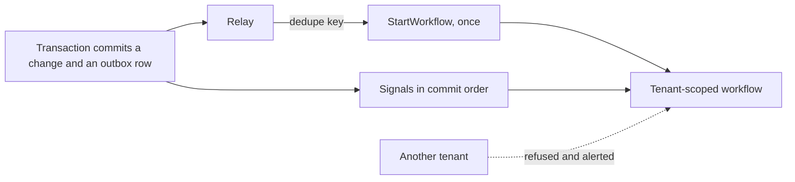

Story TICK-49. Verdict **READY**, 2026-10-27, recorded in the
[acceptance kit](../../../acceptance/outbox-row-runs-one-workflow.md). All 5 criteria and the
cross-tenant check pass.

## What a user can now do

- Rely on background work starting exactly once when the platform saves a change
  that should start it, even if the hand-off is repeated or the process doing it
  crashes halfway.
- Rely on follow-up messages for that work arriving in the order they were
  saved.
- Rely on one tenant's background work being unable to touch another tenant's
  work: the attempt is refused and raises an alert.
- As an operator, watch all of this in the Temporal UI.

## Flow

## API operations

No public API operations. The work is started by the relay from the outbox,
not through `api/openapi.bundled.yaml`.

## How to try it

1. Start the stack with the operator profile so the Temporal UI runs, then
   `sh docs/acceptance/guide/tools/seed.sh` and
   `sh docs/acceptance/guide/tools/tunnels.sh up` (it forwards the Temporal UI).
2. Write the demo rows: `make demo-outbox DEDUPE_KEY=try-it`, and once more
   with the same key.
3. In Bruno run the folder `S7`, or headless
   `sh docs/acceptance/guide/tools/api-test.sh S7`.

| What | Bruno request file |
|---|---|
| the demo's workflow has exactly one execution | `S7/S7-1.bru` |
| its history holds the start and two signals in commit order | `S7/S7-2.bru` |

The step-by-step kit, including the crash case, is the
[acceptance guide page for S7](../../../acceptance/guide/s7.html) and the
[kit](../../../acceptance/outbox-row-runs-one-workflow.md); this page does not copy it.

## Verdict and evidence

- Verdict: READY (QA, 2026-10-27, fresh stack on the story branch with `main`
  merged).
- Recorded run used: the committed Bruno run
  [acceptance-run.md](../../../acceptance/guide/acceptance-run.md) (2026-10-29,
  145 requests and 466 tests, 0 failed) and the kit. Not re-run for this page.
