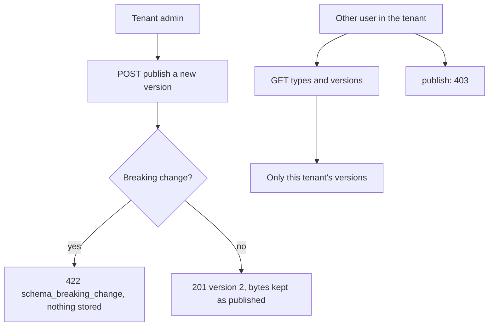

Story TICK-333 (kit TICK-346). Verdict **READY**, 2026-11-01, recorded in the
[acceptance kit](../../../acceptance/s8-entity-types.md). All five criteria pass.

## What a user can now do

- Start every new tenant with three ticket types, `incident`, `request` and
  `change`, at version 1.
- As a tenant admin, change the `incident` type and publish it as version 2.
  Every version reads back exactly as it was published.
- Be refused when a change would break existing tickets (a field changing type):
  `422 schema_breaking_change`, and nothing is stored.
- As another user of the tenant, read the types but not publish them (`403`).
  Another tenant sees only its own types.

## Flow

## API operations

<!-- gen:operations ids=listEntityTypes,getEntityType,publishEntityTypeVersion,getEntityTypeVersion,onboardTenant -->

## How to try it

1. `sh docs/acceptance/guide/tools/seed.sh` (run it again if you seeded before
   this story: it adds the admins group and the three types), then
   `sh docs/acceptance/guide/tools/tunnels.sh up`.
2. In Bruno run the folder `S8`, or headless
   `sh docs/acceptance/guide/tools/api-test.sh S8`. The kit also names the
   stack case `deploy/compose/test/cases/s8_entity_types.sh` for the database
   half of AC5.

| Operation | Bruno request file |
|---|---|
| `listEntityTypes` | `S8/S8-4.bru` (tenant A user), `S8/S8-14.bru` (tenant B user) |
| `getEntityType` | `S8/S8-5.bru`, `S8/S8-10.bru` (current version unchanged), `S8/S8-15.bru` (tenant B's own) |
| `publishEntityTypeVersion` | `S8/S8-11.bru` publish (201), `S8/S8-8.bru` breaking change (422), `S8/S8-7.bru` non-admin (403) |
| `getEntityTypeVersion` | `S8/S8-6.bru` and `S8/S8-13.bru` (version 1), `S8/S8-12.bru` (the new version), `S8/S8-9.bru` (nothing stored), `S8/S8-16.bru` and `S8/S8-17.bru` (the same 404) |
| `onboardTenant` | `S8/S8-19.bru` (a new tenant starts with three types) |

`S8-1` to `S8-3` and `S8-18` sign in. The step-by-step kit is the
[acceptance guide page for S8](../../../acceptance/guide/s8.html) and the
[kit](../../../acceptance/s8-entity-types.md); this page does not copy it.

## Verdict and evidence

- Verdict: READY, five of five criteria pass, plus the cross-tenant check (QA).
- Recorded run used: the kit's committed result table. Its fresh-stack run
  executed in GitHub Actions; that run is not linked here, because handbook
  evidence points to committed files only. The committed Bruno run
  [acceptance-run.md](../../../acceptance/guide/acceptance-run.md) (2026-10-29)
  predates S8 and does not cover it. Not re-run for this page.
