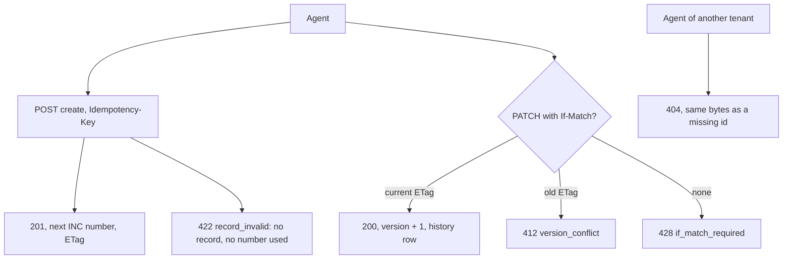

Story TICK-335 (kit TICK-359). Verdict **READY**, 2026-11-02, recorded in the
[acceptance kit](../../../acceptance/s9-records.md). All five criteria and the
cross-tenant check pass.

## What a user can now do

- Create incidents over the API. Each gets the tenant's next number
  (`INC0000001`, `INC0000002`, ...) and an `ETag`.
- Send the same create again with the same `Idempotency-Key` and get the same
  incident back, not a second one.
- Update an incident with the `ETag` of the copy you read. An update from an
  out-of-date copy is refused (`412 version_conflict`); one with no `If-Match`
  is refused too (`428 if_match_required`).
- Read an incident's history: one row per change, naming who made it.
- Another tenant gets the same `404` for your incident as for an id that does
  not exist. Numbers are counted per tenant.

Until S10, any member of a tenant can read and write every record of that
tenant (accepted risk AR-S9-01). S10 closes that.

## Flow

## API operations

<!-- gen:operations ids=createRecord,getRecord,patchRecord,getRecordHistory,getMe -->

## How to try it

1. `sh docs/acceptance/guide/tools/seed.sh` (again if you seeded before S8), then
   `sh docs/acceptance/guide/tools/tunnels.sh up`.
2. In Bruno run the folder `S9`, or headless
   `sh docs/acceptance/guide/tools/api-test.sh S9`. The stack case
   `deploy/compose/test/cases/s9_records.sh` adds the database checks.

| Operation | Bruno request file |
|---|---|
| `createRecord` | `S9/S9-4.bru` (201, number, ETag), `S9/S9-5.bru` (same Idempotency-Key), `S9/S9-6.bru` (422 field errors), `S9/S9-8.bru` (next number, no gap), `S9/S9-20.bru` (tenant B counts its own) |
| `getRecord` | `S9/S9-7.bru` (reads back), `S9/S9-12.bru` (refused updates changed nothing), `S9/S9-16.bru` (tenant B: 404), `S9/S9-19.bru` (A's incident untouched) |
| `patchRecord` | `S9/S9-9.bru` (200), `S9/S9-10.bru` (412), `S9/S9-11.bru` (428), `S9/S9-8a.bru` (a requester cannot triage: 403), `S9/S9-17.bru` (tenant B: 404) |
| `getRecordHistory` | `S9/S9-13.bru`, `S9/S9-14.bru` (create and update rows, source `user`), `S9/S9-18.bru` (tenant B: 404) |
| `getMe` | `S9/S9-3.bru` (the principal id that history names) |

`S9-1`, `S9-2` and `S9-2a` sign in; `S9-15` is the reference 404. The step-by-step
kit is the [acceptance guide page for S9](../../../acceptance/guide/s9.html) and the
[kit](../../../acceptance/s9-records.md); this page does not copy it.

## Verdict and evidence

- Verdict: READY, 2026-11-02, five of five criteria pass, plus the cross-tenant check.
- Recorded run used: the kit's committed Bruno output
  [s9-fresh-stack-run.txt](../../../acceptance/s9-evidence/s9-fresh-stack-run.txt)
  (20 of 20 requests, 67 of 67 tests) and the isolation extracts in
  [s9-evidence](../../../acceptance/s9-evidence/isolation-report-ci2-ci8.md). That
  run executed on a fresh stack in GitHub Actions; the run is not linked here,
  because handbook evidence points to committed files only. Not re-run for this page.
