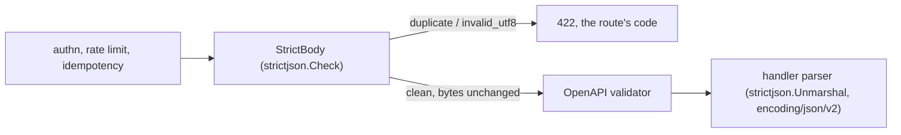

How every `/api/v1` error looks, and the 422 a request body gets when it has a duplicate member name or invalid UTF-8. The error shape has been on `main` since S6. The strict-body rule is on the story branch `TICK-961/go-1-27-upgrade` until the Go 1.27 story merges to `main`.

## One shape for every error

Every error is RFC 9457 `application/problem+json`. Its `code` comes from one registry, `api/errors.yaml`; a contract test fails on a response whose code is not listed there, and on a listed code no Go constant names. `detail` is fixed text and never echoes request input.

```json
{
  "type": "urn:nava:problem:record_invalid",
  "title": "Record invalid",
  "status": 422,
  "code": "record_invalid",
  "detail": "The record is not accepted. See errors for the failing fields.",
  "instance": "urn:nava:request:…",
  "errors": [{ "pointer": "/body/data/tags/0/label", "rule": "duplicate" }]
}
```

`errors` (when present) lists `{pointer, rule}` pairs. `pointer` is an RFC 6901 pointer, rooted at `/body` for the request body. It says where the problem is and never carries a value.

| Status | Typical codes | Meaning |
|---|---|---|
| 400 | `validation_failed`, `invalid_cursor`, `masked_field` | The request does not match the OpenAPI contract, including JSON that does not parse, or a bad cursor or masked field |
| 401 | `invalid_token`, `tenant_unresolved` | No valid token, or the token maps to no tenant |
| 403 | `forbidden` | The token does not allow the operation |
| 409 | `idempotency_key_reuse`, `domain_claimed` and others | Conflict with stored state |
| 422 | `record_invalid`, `invalid_definition`, … | The body parses but is not accepted |
| 429 | `rate_limited` | Retry after `Retry-After`; other tenants are not affected |

The full list, with each code's status, title and detail, is `api/errors.yaml`.

## Strict JSON bodies (422 `duplicate` / `invalid_utf8`)

Every operation with a request body refuses, at any depth:

| `rule` | The body has | Examples |
|---|---|---|
| `duplicate` | the same member name twice in one object, compared after unescaping | `{"a":1,"a":2}`; `a` and `a` in one object |
| `invalid_utf8` | bytes that are not UTF-8, or a lone surrogate escape | `"\ud800"`, overlong `C0 AF`, UTF-8-encoded surrogate `ED A0 80` |

`encoding/json` v1 kept the last duplicate and turned bad bytes into U+FFFD, so the validator, a handler and PostgreSQL could each read a different document from the same body. Names that differ only by case are different names. A syntax error (truncated body, trailing data) is still `400 validation_failed`.

The answer is `422` with the code the operation already uses for a bad body; no new code was added. `errors` has exactly one entry: the first problem found. For invalid UTF-8 inside a member name the pointer stops at the enclosing object, so the bad bytes are never echoed.

| Operation | `code` |
|---|---|
| `onboardTenant` | `invalid_idp_config` |
| `createEntityType`, `publishEntityTypeVersion` | `invalid_definition` |
| `putEntityTypeAccess` | `invalid_access_policy` |
| `publishWorkflowDefinitionVersion` | `workflow_definition_invalid` |
| `createNumberFormat`, `publishNumberFormatVersion`, `republishLinkedTypes` | `number_format_invalid` |
| `putTenantTimeZone` | `invalid_time_zone` |
| `createRecord`, `patchRecord` | `record_invalid` |



`StrictBody` (`internal/platform/apihttp`) runs before the OpenAPI validator and passes a clean body on byte for byte. The handler parsers also decode with `encoding/json/v2`, so they refuse the same bodies if ever reached without the middleware. An entity schema with invalid UTF-8 is refused too. `TestStrictBodyRefusalsCoverTheContract` fails when an operation with a body has no code in the table; `TestEveryTenantWriteRefusesNonStrictJSONAndWritesNothing` sends three bad bodies to every tenant write against real PostgreSQL and checks nothing was stored. The normative note is `docs/api/strict-json-bodies.md`.
