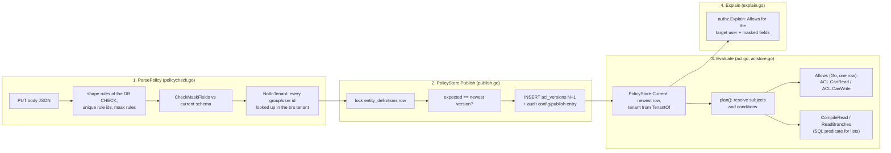

## Purpose

Each entity type has a versioned, allow-only access policy. It is checked in
four steps: an admin's JSON is parsed and checked, the policy is published as
a new `acl_versions` row, every read and write is evaluated against the
newest version, and the explainer reports a decision with the same evaluator.
The policy model and every rule are in the normative
[record-acl.md](../../../architecture/record-acl.md); field masks are on
[core-masks](core-masks.md).

## Entry point

- HTTP: `getEntityTypeAccess`, `putEntityTypeAccess`, `explainAccess` in
  `internal/server/access.go` (tenant admins only, `authz.RequireTenantAdminTx`
  first).
- Evaluation: `authz.ACL` (`internal/authz/aclstore.go`), the
  `authz.Authorizer` the pipeline and the record handlers hold.

## Steps

| # | Step | Where | Invariant | Proving test |
|---|---|---|---|---|
| 1 | Parse and check the PUT body: database shape rules first (so no raw constraint error), then unique rule ids and mask rules; collect every referenced id | `authz.ParsePolicy` (`policycheck.go`) | A stored policy always decodes | `TestParsePolicyAcceptsTheShapesTheCheckAccepts`, `TestParsePolicyRefusesWithPointers`, `TestParsePolicyCollectsEveryIdAsATenantRef` |
| 1b | Mask fields must be top-level properties of the current schema; every id must be a live group or user of the transaction's tenant | `authz.CheckMaskFields`, `authz.NotInTenant` (`explain.go`) | I1: a policy names only its own tenant's ids; foreign and unknown ids answer alike | `TestCheckMaskFields` |
| 2 | Publish version N+1 under the entity type's row lock, with one `config` / `publish` audit entry in the same transaction | `PolicyStore.Publish`, `publishLocked` (`publish.go`); `PolicyStore.PublishIfNone` for the onboarding default | `audit_commit_check` refuses an unaudited insert | `TestP335ACLPublishWithoutAnAuditEntryIsRefused` |
| 3 | Load the newest policy of the type in the caller's transaction; refuse a principal of another tenant first | `PolicyStore.Current`, `PolicyStore.QueuePolicy`, `ACL.policy` | No published version fails closed | `TestPolicyStoreReadsTheNewestVersionOfItsTenant`, `TestNoPublishedACLRefusesUserWrites` |
| 3a | Read one record: `ACL.CanRead` -> `Allows(pol, p, read, row)`; shares loaded pair-matched by `SharesFor` | `aclstore.go`, `acl.go` | Unreadable is the same 404 as missing | `TestACLCanRead`, `TestSharesMatchOnKindAndID` |
| 3b | Write: `ACL.CanWrite(before, after)`; both rows must be in write scope | `aclstore.go` | A write cannot move a record out of scope | `TestACLCanWrite`, `TestWriteScopeIsEnforcedBeforeAndAfter` |
| 3c | List: `CompileRead` / `ReadBranches` render the same planned rules as SQL inside the query | `acl.go` | I5: ACL inside the query, Go and SQL agree | `TestCompileReadAgreesWithAllows`, `TestI5Agreement`, `TestI5SharedWithIsPairMatched` |
| 4 | Explain: the target user's decision with the same `Allows`, and only the masked fields the asking admin may read | `authz.Explain`, `authz.PrincipalOf` (`explain.go`) | The explainer cannot disagree with enforcement | `TestExplainMatchesTheEnforcementOnState`, `TestExplainNeverListsAFieldTheAdminCannotRead`, `TestExplainWithNoPolicyDeniesAtVersionZero` |

## Errors

| Error | HTTP |
|---|---|
| not a tenant admin (`RequireTenantAdminTx`) | `403 forbidden` |
| unknown or foreign entity type, no published version (GET), unknown record or user (explain) | `404 not_found` (one body) |
| `If-Match` missing or `*` | `428 if_match_required` |
| `*authz.ConflictError` (stale `If-Match`) | `412 version_conflict` with the current `ETag` |
| body not a JSON object | `400 validation_failed` |
| `ParsePolicy` / `CheckMaskFields` / `NotInTenant` problems | `422 invalid_access_policy` with pointers |
| `authz.ErrNotVisible` on a record read | `404 not_found` |
| `authz.ErrForbidden` on a write | `403 forbidden` |

## Notes

- The order of the PUT checks (admin, entity type, `If-Match`, body, write)
  and the default incident ACL are defined in the normative note.
- There is no separate "compiler" stage: `CompileRead` is the SQL rendering of
  the same planned rules `Allows` evaluates.

## Links

- Tables `acl_versions`, `record_shares`: [database section](../database/index.md).
- Masks: [core-masks](core-masks.md). Where the pipeline calls the ACL:
  [core-write-pipeline](core-write-pipeline.md).
- Isolation and ACL guarantees: [security section](../security/index.md).
