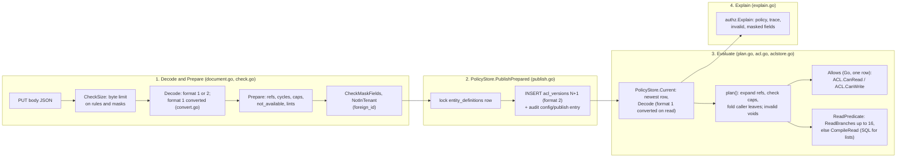

## Purpose

Each entity type has a versioned, allow-only access policy. Since S30 it is a
**format-2 document**: named conditions, combined with `all`, `any` and `not`
into named policies (ADR-010). It is handled in four steps: the admin's JSON
is decoded and checked, the document is published as a new `acl_versions`
row, every read and write is evaluated against the newest version by **one
planner rendered twice** (Go and SQL), and the explainer reports a decision
with the same planner. The model is in the normative
[record-acl.md](../../../architecture/record-acl.md), the document grammar in
[access-document-format2.md](../../../architecture/access-document-format2.md).
The routes, the check order and every problem code are on the
[Access API page](access-api.md); field masks are on [core-masks](core-masks.md).

## Entry point

- HTTP: `getEntityTypeAccess`, `putEntityTypeAccess`, `explainAccess` in
  `internal/server/access.go` (tenant admins only, `authz.RequireTenantAdminTx`
  first; the byte limit is checked before it).
- Evaluation: `authz.ACL` (`internal/authz/aclstore.go`), the
  `authz.Authorizer` the pipeline and the record handlers hold.

## Steps

| # | Step | Where | Invariant | Proving test |
|---|---|---|---|---|
| 1 | Check the byte limit on `rules` and `masks`, measured as stored `jsonb` text, before a connection is taken | `authz.CheckSize` (`check.go`) | ADR-010-A1 A1-2 | `TestPrepareByteLimitIsOnStoredTextAndOnMasks` |
| 1a | Decode the grammar: format 1 (converted, D12) or format 2; names, one kind per node, 1 to 16 children, no repeated key | `authz.Decode`, `ConvertFormat1` (`document.go`, `convert.go`) | A stored policy always decodes | `TestDecodeFormat2RoundTrips`, `TestDecodeInvalidFixturesYieldExactlyTheirProblems`, `TestFormat1ConvertsToGoldenTree` |
| 1b | Whole-document checks: refs resolve, no cycle, depth 8, 64 policies, 128 leaves per policy and per document, `under` not available; lints; the stored canonical text | `authz.Prepare` (`check.go`) | D4; the database `CHECK` gives one of the same problems | `TestPrepareRefusesTheFixture`, `TestPrepareFormat1IsStoredAsFormat2` |
| 1c | Mask fields must be top-level properties of the current schema; every id must be a live group or user of the transaction's tenant | `authz.CheckMaskFields`, `authz.NotInTenant` (`explain.go`) | I1: foreign and unknown ids answer alike (`foreign_id`) | `TestCheckMaskFields` |
| 2 | Publish version N+1 (always format 2) under the entity type's row lock, with one `config` / `publish` audit entry in the same transaction; only `nava_app` may insert | `PolicyStore.PublishPrepared`, `PolicyStore.PublishIfNone` for the onboarding default (`publish.go`) | `audit_commit_check` refuses an unaudited insert | `TestP335ACLPublishWithoutAnAuditEntryIsRefused` |
| 3 | Load the newest policy of the type in the caller's transaction; refuse a principal of another tenant first | `PolicyStore.Current`, `PolicyStore.QueuePolicy`, `ACL.policy` | No published version fails closed | `TestPolicyStoreReadsTheNewestVersionOfItsTenant`, `TestNoPublishedACLRefusesUserWrites` |
| 3a | Plan once per request: for each policy granting the op, expand refs, check caps, fold the caller's leaves (`member_of`, `self`, `my_groups`). A policy that fails is **voided**: it grants nothing and adds one to `authz_policy_invalid_total{entity_type}` | `plan()` (`plan.go`) | D5: invalid grants nothing; NULL makes a leaf false | `TestPlanInvalidVoidsThePolicy`, `TestReadPredicateCountsVoidedOnce` |
| 3b | Read one record: `ACL.CanRead` -> `Allows(pol, p, read, row)`; shares loaded pair-matched by `SharesFor` | `aclstore.go`, `acl.go` | Unreadable is the same 404 as missing | `TestAllows`, `TestACLCanRead`, `TestSharesMatchOnKindAndID` |
| 3c | Write: `ACL.CanWrite(before, after)`; both rows must be in write scope | `aclstore.go` | A write cannot move a record out of scope | `TestACLCanWrite`, `TestWriteScopeIsEnforcedBeforeAndAfter` |
| 3d | List: `ReadPredicate` renders the same plan as SQL inside the query, as branches (one index each) up to the SP-2 threshold, else as one `CompileRead` predicate | `acl.go` | I5: ACL inside the query, Go and SQL agree | `TestCompileReadAgreesWithAllows`, `TestReadBranchesThreshold`, `TestReadBranchesFormat1Golden`, `TestI5Agreement`, `TestI5Format2Agreement`, `TestI5Format1ConvertedMatchesS10`, `TestI5SharedWithIsPairMatched` |
| 4 | Explain: the target user's decision with the same plan: the granting `policy`, a `trace` of each named condition reached, voided policies as `invalid`, and only the masked fields the asking admin may read | `authz.Explain`, `authz.PrincipalOf` (`explain.go`) | The explainer cannot disagree with enforcement | `TestExplainMatchesTheEnforcementOnState`, `TestExplainPolicyTraceAndInvalid`, `TestExplainNeverListsAFieldTheAdminCannotRead`, `TestExplainWithNoPolicyDeniesAtVersionZero` |

## The SP-2 branch threshold (ADR-010 D6)

A list query answers each branch from its own index and merges them, which
is fast when one branch is heavy. Branch `i` repeats the negation of the
branches before it, so the SQL text and its planning time grow with the
square of the branch count. SP-2 (TICK-933, `docs/data/acl-format2-caps.md`)
measured the crossover:

- **Threshold: 16 branches in total** across a document's read policies,
  `maxReadBranches` in `internal/authz/acl.go`. TICK-1004 exports it so
  `tools/acceptance/acld6` stops keeping its own copy.
- **At most 16:** `ReadBranches` returns one branch per disjunct and the list
  query uses them.
- **Above 16:** `ReadBranches` returns no branch, the caller falls back to
  the single `CompileRead` predicate (the slower OR form, same rows), and
  `authz_read_branches_fallback_total{entity_type}` goes up by one.
  `ReadPredicate` plans once, so a fallback and a voided policy are each
  counted once per request. Both counters carry the entity type key, never a
  tenant id.
- **`ReadBranchBound(doc)`** (`branchbound.go`) is the most branches a
  document can give any caller, following every shape a node can fold to.
  The D6 check (`tools/acceptance/acld6`, run by the S30 kit) compares it with
  the threshold for each tenant's newest document. On the S30 fresh stack the
  maximum is 4.

`authz_read_branches_fallback_total` should stay at zero; a rise means a
tenant's document lists more than 16 read branches and its lists use the
slower form. `authz_policy_invalid_total` above zero fires the
`AuthzPolicyInvalid` alert ([observability](../operations/observability.md)).

## The node registry (ADR-010 D11)

`authz.Kinds()` lists every node kind with `SQLSafe` and `Available`.
`TestRegistryKindsAreRendered` fails a kind that is available but has no Go
rendering, SQL rendering or I5 generator coverage. `under` is `SQLSafe` but
not `Available` until S31.

## Errors

| Error | HTTP |
|---|---|
| request refused by the API middleware (body not a JSON object, no `Idempotency-Key`) | `400 validation_failed` |
| `rules` or `masks` over the byte limit | `422 invalid_access_policy`, `document_too_large` |
| not a tenant admin (`RequireTenantAdminTx`) | `403 forbidden` |
| unknown or foreign entity type, no published version (GET), unknown record or user (explain) | `404 not_found` (one body) |
| `If-Match` missing or `*` | `428 if_match_required` |
| `*authz.ConflictError` (stale `If-Match`) | `412 version_conflict` with the current `ETag` |
| `Decode` / `Prepare` / `CheckMaskFields` / `NotInTenant` problems, or a 23514 from `acl_versions` | `422 invalid_access_policy` with pointers ([codes](access-api.md#problem-codes)) |
| `authz.ErrNotVisible` on a record read | `404 not_found` |
| `authz.ErrForbidden` on a write | `403 forbidden` |

## Notes

- There is no separate "compiler" stage: `CompileRead` and `ReadBranches`
  are the SQL rendering of the same plan `Allows` evaluates.

## Links

- Tables `acl_versions`, `record_shares`: [database section](../database/acl.md).
- Routes and problem codes: [Access API](access-api.md).
- Masks: [core-masks](core-masks.md). Where the pipeline calls the ACL:
  [core-write-pipeline](core-write-pipeline.md).
- Isolation and ACL guarantees: [security section](../security/09-acl-masks-read.md).
