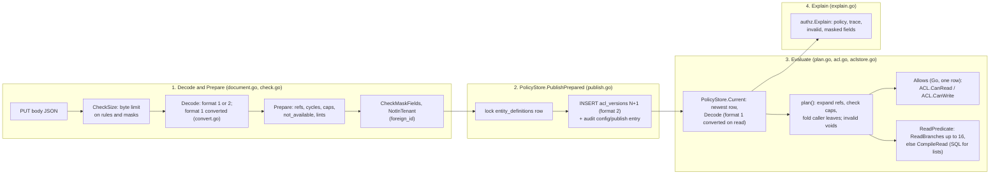
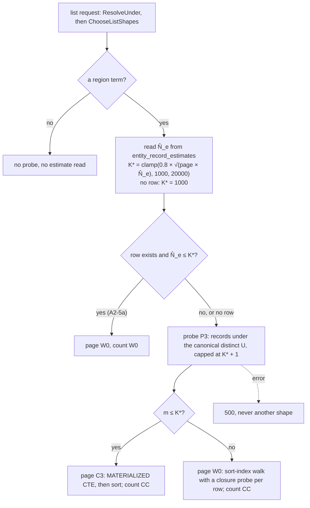

## Purpose

Each entity type has a versioned, allow-only access policy. Since S30 it is a
**format-2 document**: named conditions, combined with `all`, `any` and `not`
into named policies (ADR-010). It is handled in four steps: the admin's JSON
is decoded and checked, the document is published as a new `acl_versions`
row, every read and write is evaluated against the newest version by **one
planner rendered twice** (Go and SQL), and the explainer reports a decision
with the same planner. The model is in the normative
[record-acl.md](../../../architecture/record-acl.md), the document grammar in
[access-document-format2.md](../../../architecture/access-document-format2.md).
The routes, the check order and every problem code are on the
[Access API page](access-api.md); field masks are on [core-masks](core-masks.md).

## Entry point

- HTTP: `getEntityTypeAccess`, `putEntityTypeAccess`, `explainAccess` in
  `internal/server/access.go` (tenant admins only, `authz.RequireTenantAdminTx`
  first; the byte limit is checked before it).
- Evaluation: `authz.ACL` (`internal/authz/aclstore.go`), the
  `authz.Authorizer` the pipeline and the record handlers hold.

## Steps

| # | Step | Where | Invariant | Proving test |
|---|---|---|---|---|
| 1 | Check the byte limit on `rules` and `masks`, measured as stored `jsonb` text, before a connection is taken | `authz.CheckSize` (`check.go`) | ADR-010-A1 A1-2 | `TestPrepareByteLimitIsOnStoredTextAndOnMasks` |
| 1a | Decode the grammar: format 1 (converted, D12) or format 2; names, one kind per node, 1 to 16 children, no repeated key | `authz.Decode`, `ConvertFormat1` (`document.go`, `convert.go`) | A stored policy always decodes | `TestDecodeFormat2RoundTrips`, `TestDecodeInvalidFixturesYieldExactlyTheirProblems`, `TestFormat1ConvertsToGoldenTree` |
| 1b | Whole-document checks: refs resolve, no cycle, depth 8, 64 policies, 128 leaves per policy and per document, at most 4 distinct `under` start sets per policy, no duplicate or nested `under` ids; lints; the stored canonical text | `authz.Prepare` (`check.go`) | D4; the database `CHECK` gives one of the same problems | `TestPrepareRefusesTheFixture`, `TestPrepareFormat1IsStoredAsFormat2` |
| 1c | Mask fields must be top-level properties of the current schema; every id must be a live group, user or org unit of the transaction's tenant | `authz.CheckMaskFields`, `authz.NotInTenant` (`explain.go`) | I1: foreign and unknown ids answer alike (`foreign_id`) | `TestCheckMaskFields` |
| 2 | Publish version N+1 (always format 2) under the entity type's row lock, with one `config` / `publish` audit entry in the same transaction; only `nava_app` may insert | `PolicyStore.PublishPrepared`, `PolicyStore.PublishIfNone` for the onboarding default (`publish.go`) | `audit_commit_check` refuses an unaudited insert | `TestP335ACLPublishWithoutAnAuditEntryIsRefused` |
| 3 | Load the newest policy of the type in the caller's transaction; refuse a principal of another tenant first | `PolicyStore.Current`, `PolicyStore.QueuePolicy`, `ACL.policy` | No published version fails closed | `TestPolicyStoreReadsTheNewestVersionOfItsTenant`, `TestNoPublishedACLRefusesUserWrites` |
| 3a | Plan once per request: for each policy granting the op, expand refs, check caps, fold the caller's leaves (`member_of`, `self`, `my_groups`; `under` after `ResolveUnder` binds U). A policy that fails is **voided**: it grants nothing and adds one to `authz_policy_invalid_total{entity_type}` | `plan()` (`plan.go`) | D5: invalid grants nothing; NULL makes a leaf false | `TestPlanInvalidVoidsThePolicy`, `TestReadPredicateCountsVoidedOnce` |
| 3b | Read one record: `ACL.CanRead` -> `Allows(pol, p, read, row)`; shares loaded pair-matched by `SharesFor` | `aclstore.go`, `acl.go` | Unreadable is the same 404 as missing | `TestAllows`, `TestACLCanRead`, `TestSharesMatchOnKindAndID` |
| 3c | Write: `ACL.CanWrite(before, after)`; both rows must be in write scope | `aclstore.go` | A write cannot move a record out of scope | `TestACLCanWrite`, `TestWriteScopeIsEnforcedBeforeAndAfter` |
| 3d | List: `ReadPredicate` renders the same plan as SQL inside the query, as branches (one index each) up to the SP-2 threshold, else as one `CompileRead` predicate | `acl.go` | I5: ACL inside the query, Go and SQL agree | `TestCompileReadAgreesWithAllows`, `TestReadBranchesThreshold`, `TestReadBranchesFormat1Golden`, `TestI5Agreement`, `TestI5Format2Agreement`, `TestI5Format1ConvertedMatchesS10`, `TestI5SharedWithIsPairMatched` |
| 4 | Explain: the target user's decision with the same plan: the granting `policy`, a `trace` of each named condition reached, voided policies as `invalid`, and only the masked fields the asking admin may read | `authz.Explain`, `authz.PrincipalOf` (`explain.go`) | The explainer cannot disagree with enforcement | `TestExplainMatchesTheEnforcementOnState`, `TestExplainPolicyTraceAndInvalid`, `TestExplainNeverListsAFieldTheAdminCannotRead`, `TestExplainWithNoPolicyDeniesAtVersionZero` |

## The SP-2 branch threshold (ADR-010 D6)

A list query answers each branch from its own index and merges them, which
is fast when one branch is heavy. Branch `i` repeats the negation of the
branches before it, so the SQL text and its planning time grow with the
square of the branch count. SP-2 (TICK-933, `docs/data/acl-format2-caps.md`)
measured the crossover:

- **Threshold: 16 branches in total** across a document's read policies,
  `maxReadBranches` in `internal/authz/acl.go`. TICK-1004 exports it so
  `tools/acceptance/acld6` stops keeping its own copy.
- **At most 16:** `ReadBranches` returns one branch per disjunct and the list
  query uses them.
- **Above 16:** `ReadBranches` returns no branch, the caller falls back to
  the single `CompileRead` predicate (the slower OR form, same rows), and
  `authz_read_branches_fallback_total{entity_type}` goes up by one.
  `ReadPredicate` plans once, so a fallback and a voided policy are each
  counted once per request. Both counters carry the entity type key, never a
  tenant id.
- **`ReadBranchBound(doc)`** (`branchbound.go`) is the most branches a
  document can give any caller, following every shape a node can fold to.
  The D6 check (`tools/acceptance/acld6`, run by the S30 kit) compares it with
  the threshold for each tenant's newest document. On the S30 fresh stack the
  maximum is 4.

`authz_read_branches_fallback_total` should stay at zero; a rise means a
tenant's document lists more than 16 read branches and its lists use the
slower form. `authz_policy_invalid_total` above zero fires the
`AuthzPolicyInvalid` alert ([observability](../operations/observability.md)).

## The under leaf (S31)

`{"under": {"of": "caller"}}` holds when the record's `org_unit_id` is at or
below one of the caller's org units; `{"under": {"of": [ids]}}` when it is at
or below one of the listed units. Those start units are **U**. Both
renderings read `org_unit_closure` ([Org units](../database/org-units.md)):
Go never builds the subtree, and no request walks the tree. Normative note:
`docs/architecture/access-under-leaf.md`; decision: ADR-010 D7 as amended by
[ADR-010-A2](../adr/adr-010-a2.md).

- **Resolve first.** `authz.ResolveUnder` runs before `Allows`, `CompileRead`
  or `ReadList`, in one statement: the caller's units, and for a single read
  the rows' ancestors in U. A policy whose `under` was not resolved for the
  principal is voided as `under_unresolved` (fails closed, counted in
  `authz_policy_invalid_total`). U is made `DISTINCT` and canonical on every
  request.
- **One record** (`Allows`): one closure primary-key `EXISTS`.
- **NULL and tombstones.** A record with no unit is never under anything, so
  `not under` is true for it. A tombstoned unit, and every unit below it, has
  no closure row and is outside every region. A caller with no units gets
  `under caller` false.

### The list page: C3 or W0 (ADR-010-A2 A2-5, A2-5a, A2-9)

A list's region term (an `under` leaf, or an `all` with one as a child)
picks its SQL shape per request. The shape changes the SQL text only, never
the rows (A2-6): every shape computes the predicate `Allows` computes, so a
wrong estimate or probe count costs time, never rows.

| Statement | What it does |
|---|---|
| P3, the probe | Counts the type's records under U, stopping at K\* + 1. It never sees a request filter |
| C3 page | Reads the region's records into a `MATERIALIZED` CTE, then sorts and takes the page. Chosen when m ≤ K\* |
| W0 page | Walks the sort index and probes the closure primary key for each row (`OFFSET 0` SubPlan). Chosen above K\*, and for a rare type (A2-5a) |
| CC count | Always used for the region term's count, whatever the probe says, except under A2-5a: the units of U not below another unit of U, then each unit's closure, then at most 1,001 records (`TotalCap` + 1) |

- **K\*** = clamp(0.8 × √(page × N̂_e), 1,000, 20,000), about 3,600 at bench
  scale. N̂_e is the tenant's live-record estimate for the type, refreshed
  hourly ([Record estimates](../database/record-estimates.md)). No row means
  K\* = 1,000 and the probe runs.
- **Rare-type shortcut (A2-5a).** A type with N̂_e ≤ K\* skips the probe and
  uses W0 for both the page and the count.
- **Fail closed.** A probe error returns 500. There is no fallback shape.
- **Nothing leaks.** The shape, the probe count, K\* and N̂_e reach no
  response, header, log line or error text. Every statement binds the
  transaction's tenant. Within one tenant, page latency can still show which
  shape was chosen (one coarse bit, `AR-TICK-1040-01`).
- **Metrics** (no tenant label): `authz_under_list_shape_total{shape}`, with
  `shape` `c3` or `walk` (A2-5a counts as `walk`), and the histogram
  `authz_under_probe_seconds`.
- **No size cap.** The old 10,000-unit `MaxUnderSet`, its 500
  `access_scope_too_large` and `authz_under_set_too_large_total` are gone
  (TICK-1034). The tree is certified to 10,111 live units per tenant; above
  that `GroupsyncOrgUnitsAboveCertified` fires, and group sync never refuses
  a sync ([nava-groupsync](nava-groupsync.md)).

**Operations note (TICK-1036 security review).** A slow P3 probe's SQL text
includes `LIMIT K*+1`. Keep `log_min_duration_statement` and `auto_explain`
off for the app role, and never ship the PostgreSQL server log anywhere a
tenant can read it.

### Publish checks for under

| Check | Answer |
|---|---|
| A listed unit is another tenant's, tombstoned or unknown | `422 foreign_id` at `.../under/of/<i>`, the id not echoed |
| More than 4 distinct U in one policy, refs expanded | `422 under_sets_exceeded` at `/rules/policies/<i>` |
| One `of` lists a unit twice | `422 under_duplicate_id` at each repeat's `.../under/of/<i>` (A2-8) |
| One `of` lists a unit and one of its ancestors | `422 under_nested` at that leaf's `.../under/of` |

The database `CHECK` repeats `foreign_id` and `under_sets_exceeded`.
`under_nested` has no database backstop: it reads the closure, which a
`CHECK` cannot.

**Freshness.** The closure is as current as the last group sync. Until it
runs, a tombstoned or moved unit still grants its old subtree (ADR-010 R3).

## The node registry (ADR-010 D11)

`authz.Kinds()` lists every node kind with `SQLSafe` and `Available`.
`TestRegistryKindsAreRendered` fails a kind that is available but has no Go
rendering, SQL rendering or I5 generator coverage. Since S31 every kind,
`under` included, is both `SQLSafe` and `Available`.

## Errors

| Error | HTTP |
|---|---|
| request refused by the API middleware (body not a JSON object, no `Idempotency-Key`) | `400 validation_failed` |
| `rules` or `masks` over the byte limit | `422 invalid_access_policy`, `document_too_large` |
| not a tenant admin (`RequireTenantAdminTx`) | `403 forbidden` |
| unknown or foreign entity type, no published version (GET), unknown record or user (explain) | `404 not_found` (one body) |
| `If-Match` missing or `*` | `428 if_match_required` |
| `*authz.ConflictError` (stale `If-Match`) | `412 version_conflict` with the current `ETag` |
| `Decode` / `Prepare` / `CheckMaskFields` / `NotInTenant` problems, or a 23514 from `acl_versions` | `422 invalid_access_policy` with pointers ([codes](access-api.md#problem-codes)) |
| `authz.ErrNotVisible` on a record read | `404 not_found` |
| `authz.ErrForbidden` on a write | `403 forbidden` |

## Notes

- There is no separate "compiler" stage: `CompileRead` and `ReadBranches`
  are the SQL rendering of the same plan `Allows` evaluates.

## Links

- Tables `acl_versions`, `record_shares`: [database section](../database/acl.md).
- Routes and problem codes: [Access API](access-api.md).
- Masks: [core-masks](core-masks.md). Where the pipeline calls the ACL:
  [core-write-pipeline](core-write-pipeline.md).
- Isolation and ACL guarantees: [security section](../security/09-acl-masks-read.md).
