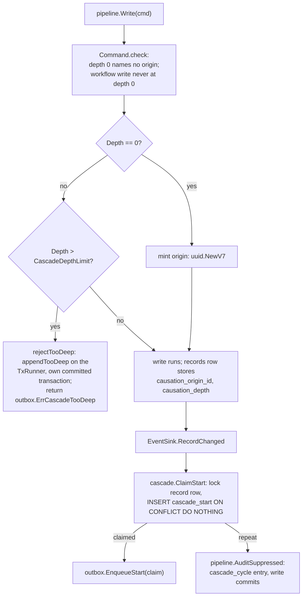

## Purpose

A record write can start a workflow, which can write a record, which can start
another workflow. ADR-001 I9 bounds that chain two ways: every write carries a
causation (origin id and depth) and a write deeper than the limit is refused,
and a workflow definition starts at most once per (tenant, origin, record).
This page shows where both checks run inside the write pipeline.

## Entry point

- Depth: `Pipeline.perform` in `internal/records/pipeline/pipeline.go`
  compares `Command.Causation.Depth` with `config.CascadeDepthLimit`
  (`internal/platform/config/config.go`) before any statement but the tenant
  read.
- Start key: `cascade.ClaimStart(ctx, tx, cascade.Key)` in
  `internal/records/cascade/cascade.go`, called by the event sink in the
  triggering write's transaction; a repeat is audited by
  `pipeline.AuditSuppressed`.

## Steps

| # | Step | Where | Invariant | Proving test |
|---|---|---|---|---|
| 1 | Refuse a given origin at depth 0 and a workflow write at depth 0; mint the origin for a depth-0 write | `Command.check`, `Pipeline.perform` | Origin and depth never come from a request or payload (A5-3, A5-7) | `TestDepthZeroWritesMintTheirOrigin`, `TestWorkflowWriteAtDepthZeroIsInvalidEntry` |
| 2 | Refuse a write beyond the depth limit; write one `cascade_too_deep` audit entry in a transaction of its own on the `TxRunner`, committed before `Write` returns | `Pipeline.rejectTooDeep`, `appendTooDeep` (`audit.go`) | I9 depth bound; nothing in the caller's transaction changes | `TestCI10_DepthBeyondLimitRejectedAndAuditedOnTheRunner`, `TestCI10_TooDeepUpdateOfAnotherTenantsRecordLeaksNothing`, `TestTooDeepAuditFailure` |
| 3 | Store the causation on the record row with the write | `write.causation` | The start key is read from the row, never passed in | `TestClaimStartReadsTheKeyFromTheRecord` |
| 4 | Claim the start key K(tenant, origin, record, definition): lock the record row (naming the tenant), insert into `cascade_start` | `cascade.ClaimStart` | A5: at most one start per key; per tenant | `TestCI10_StartKeyIsPerTenant`, `TestCI10_ConcurrentClaimsOfOneKey`, `TestCI10_RetriedActivityCreatesNoSecondStart` |
| 5 | Claimed: enqueue the start through `outbox.EnqueueStart`, which only takes a claimed `cascade.Claim` | outbox producer | I6: starts only through the outbox | `TestCascadeStartGuards` |
| 6 | Repeat: enqueue nothing, append a `cascade_cycle` entry, let the write commit | `pipeline.AuditSuppressed` | A5-4: a cycle is suppressed, not failed | `TestCIA17CycleEntries`, `TestCI10_WriteBackToTriggeringRecordCommits`, `TestCI10_SiblingAndSelfRetriggeringWritesAreNotCycles` |

## Errors

| Error | Meaning |
|---|---|
| `outbox.ErrCascadeTooDeep` | depth past `config.CascadeDepthLimit`; joined with the audit failure if the entry could not be written |
| `cascade.ErrRecordNotFound` | no such record in the transaction's tenant, or no tenant |
| `cascade.ErrNoOrigin` | the record row has no causation |
| `cascade.ErrInvalidKey` | no record or definition in the key; `AuditSuppressed` called with a claimed start |

None of these reach an HTTP client: the record routes always write at depth 0.

## Notes

- The limit's value lives only in `internal/platform/config/config.go`; this
  page does not copy it.

## Links

- The workflow side (outbox, relay, interpreter):
  [workflows section](../workflows/index.md).
- Tables `cascade_start`, `outbox`, `audit_log`:
  [database section](../database/index.md).
- The write this hangs off: [core-write-pipeline](core-write-pipeline.md).
