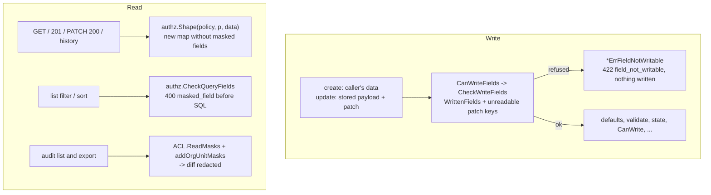

## Purpose

A field mask hides one top-level property from every principal its `read`
subject does not name, and makes it unwritable for every principal its
`write` subject does not name. Masks live in the `acl_versions` document of
the entity type, in its `masks` array beside `rules`, and are published,
versioned and audited with the rules ([core-acl](core-acl.md)). The rules are
in the normative
[record-field-masks.md](../../../architecture/record-field-masks.md).

## Entry point

- Write: `write.canWriteFields` in `internal/records/pipeline/pipeline.go`
  calls `ACL.CanWriteFields` (`internal/authz/aclstore.go`), which calls
  `authz.CheckWriteFields` (`internal/authz/mask.go`).
- Read: the record handlers call `authz.Shape` through `shapeRecord`
  (`internal/server/records.go`); lists call `authz.CheckQueryFields`
  (`internal/server/records_list.go`); the audit list and the audit export get
  the caller's masks from `ACL.ReadMasks` and `addOrgUnitMasks`
  (`internal/server/audit.go`).

## Steps

| # | Step | Where | Invariant | Proving test |
|---|---|---|---|---|
| 1 | Decide per field and principal: `Readable` / `Writable`; only `Groups` and `Users` in a mask subject match; every mask on a field must admit | `authz.Readable`, `authz.Writable` (`mask.go`) | A2: one answer per caller and field, row-independent | `TestReadableAndWritableFollowGroupsAndUsers`, `TestRowDependentMaskSubjectsNeverMatch`, `TestEveryMaskOnAFieldMustAdmit` |
| 2 | Write check, first on the caller's data (before defaults, validation, state, `CanWrite`, unique); system sources skip it | `write.canWriteFields`, `ACL.CanWriteFields`, `authz.CheckWriteFields`, `authz.WrittenFields` | I5: masks apply on write; no other error depends on a masked field | `TestFieldCheckRunsBeforeValidationAndTheStateModel`, `TestFieldCheckSeesOnlyTheCallersWrite`, `TestFieldNotWritableWritesNothing` |
| 2a | A patch key the caller cannot read counts as a write whatever its value | `authz.CheckWriteFields` | A patch is no oracle for a masked value | `TestUnreadablePatchKeyIsAlwaysAWrite`, `TestPatchingAMaskedFieldIsRefusedEvenWithItsStoredValue` |
| 3 | Shape every record body and every history `before` / `after` | `authz.Shape`, `authz.MaskedFields` | I5: masks apply on read; input never mutated | `TestShapeDropsMaskedFieldsAndNeverMutates` |
| 3a | Drop `org_unit_id` from history `before` and `after`, after shaping and before `changed` is computed, for every reader (TICK-1119) | `GetRecordHistory` (`records_patch.go`) | The org unit is no schema property, so no mask can name it | `TestRecordHistoryNeverShowsTheOrgUnit` |
| 4 | Refuse a list filter or sort on a field the caller cannot read, before any SQL | `authz.CheckQueryFields` | A hidden field cannot be filtered, sorted or counted | `TestCheckQueryFields` |
| 5 | Redact masked fields in the diffs of the audit list and of the audit export (TICK-1127) | `ACL.ReadMasks` -> `read.FieldMasks` | The reader role needs no new grant | `TestExportAppliesTheCallersFieldMasks`; the list in `internal/audit/read` |
| 5a | Where the caller may not read the property mapped to the requester, redact `org_unit_id` too: the unit derives from the requester (TICK-1119) | `addOrgUnitMasks` (`audit.go`), as `nava_app`, tenant-filtered | Fails closed: a query or decode error, or a type with no version row, is a 500 | `TestAuditListMasksOrgUnitWithTheRequester`, `TestAuditListOrgUnitMaskIsPerTenant`, `TestAddOrgUnitMasks`, `TestExportFailsClosedWhenAMaskReadFails` (the decode error) |
| 5b | Give each export request its own copy of the exporter with its masks, read before the lease | `ExportAuditEntries` (`audit_export.go`) | Two overlapping exports never share masks; a failed mask read leaves no file bytes, lease or `audit/export` entry | `TestOverlappingExportsKeepTheirOwnMasks`, `TestExportFailsClosedWhenAMaskReadFails` |

A caller who may read the requester still sees `org_unit_id` in the diffs of the
audit list (permission `audit.read`) and the audit export (`audit.export`).

## Errors

| Error | HTTP |
|---|---|
| `*authz.ErrFieldNotWritable{Fields}` | `422 field_not_writable`, one pointer per field, rule `mask` |
| `*authz.ErrMaskedField{Field}` | `400 masked_field` |
| a mask naming `requester`, `assignee` or `shared`, or an unknown property | `422 invalid_access_policy` at publish |

## Links

- Storage (`acl_versions.masks`): [database section](../database/index.md).
- Masking guarantees: [security section](../security/index.md).
