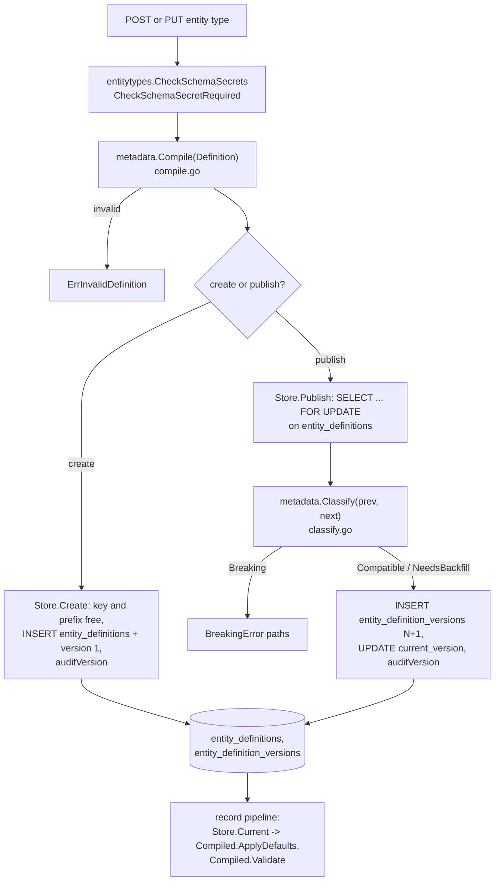

## Purpose

A tenant describes each entity type (incident, request, change, or its own) as
a JSON Schema 2020-12 document plus a number prefix, fixed-column mapping and
state model. The metadata engine turns that definition into a
`*metadata.Compiled`, the one object every record write validates against, and
decides whether a new version can be published over the current one. This
page shows where each step lives; the rules themselves are in the normative
[metadata-engine.md](../../../architecture/metadata-engine.md).

## Entry point

- HTTP: `createEntityType` and `publishEntityTypeVersion` in
  `internal/server/entitytypes.go`.
- Go: `entitytypes.Store.Create` and `entitytypes.Store.Publish`
  (`internal/entitytypes/entitytypes.go`), which call `metadata.Compile` and
  `metadata.Classify`.
- Read side, used by the record pipeline: `entitytypes.Store.Current` and
  `entitytypes.Store.Version` (the `pipeline.DefinitionReader` interface), and
  `entitytypes.Store.QueueCurrent` for the batched prefetch.

`internal/metadata` is pure: no database, network or file-system import.
`internal/entitytypes` is the database half.

## Steps

| # | Step | Where | Invariant | Proving test |
|---|---|---|---|---|
| 1 | Refuse a schema that marks a property secret and also requires it, or carries a secret-looking default | `entitytypes.CheckSchemaSecrets` (`audit.go`), `entitytypes.CheckSchemaSecretRequired` (`secretrequired.go`) | ADR-004-E5 D9 | `TestCheckSchemaSecretRequired`, `TestAdversarialSecretDefaultIsRefused` |
| 2 | Scan size and depth, walk the schema (local `$ref` only, closed root), compile with a fresh `jsonschema` compiler and a deny-all loader | `metadata.Compile` (`compile.go`), `denyAllLoader`, `walker.walk`, `walker.checkRefs` | One compiler per call, so no tenant sees another's schema | `TestCompileRefusesExternalRefs`, `TestCompilerLoaderDeniesEverything`, `TestSharedCompilerWouldLeak`, `TestCompileCapsAreInclusive` |
| 3 | Check defaults against their own schema, fixed-column types and the state enum | `metadata.Compile` | A definition the pipeline cannot satisfy never stores | `TestCompileRefusesBadStateModelsAndShapes`, `TestCompileAcceptsBaseDefinition` |
| 4 | Create: key, then prefix uniqueness; insert type and version 1 with `compat = 'initial'`; append the config audit entry | `entitytypes.Store.Create`, `auditVersion` | Every config change is audited in the same transaction | `TestCreateRefusals` |
| 5 | Publish: lock the type row, compile the next version, classify it against the current one | `entitytypes.Store.Publish`, `metadata.Classify` (`classify.go`) | Fail-closed classification: anything not listed is Breaking | `TestClassify`, `TestClassifyRemoveTransition`, `TestPublishRefusalsAndFailures` |
| 6 | Insert version N+1 (number from `max(version) + 1` under the row lock), move `current_version`, audit | `entitytypes.Store.Publish` | Concurrent publishes queue and number with no gap or duplicate | `TestPublishRefusalsAndFailures` |
| 7 | Change numbering mode (`gaps` or `gapless`) with its own audited config entry | `entitytypes.Store.SetNumberingMode` | See [core-numbering](core-numbering.md) | `TestP336fSetNumberingMode`, `TestP336fNumberingModeCrossTenant` |
| 8 | Use at write time: defaults then validation against the **current** version; stored rows are read under the version they were written with | `metadata.Compiled.ApplyDefaults`, `metadata.Compiled.Validate` (`validate.go`), called from `pipeline.write.create` / `write.update` | I4: JSON Schema runs before every write | `TestApplyDefaults`, `TestValidateReportsEachKindOfFailure`, `TestUpdateUnderNewVersionFillsDefaults` |

The tenant on every statement comes from the caller's `tenancy.InTenantTx`
transaction (row-level security plus the explicit `tenant_id` the inserts
take). See [core-tenancy](core-tenancy.md).

## Errors

| Error | Where | HTTP |
|---|---|---|
| `*metadata.ErrInvalidDefinition` (sorted JSON pointers) | `metadata.Compile` | `422 invalid_definition` |
| `entitytypes.ErrKeyExists` | `Store.Create` | `409 entity_type_exists` |
| `entitytypes.ErrPrefixTaken` | `Store.Create` | `409 number_prefix_taken` |
| `*entitytypes.BreakingError{Paths}` | `Store.Publish` | `422 schema_breaking_change` |
| `*entitytypes.SecretRequiredError` | `CheckSchemaSecretRequired` | `422 definition_secret_required` |
| `*entitytypes.SecretInContentError` | `CheckSchemaSecrets` | `422 config_secret_in_content` |
| `entitytypes.ErrNotFound` | `Store.Publish`, `Store.GetVersion` | `404 not_found` (another tenant's type is the same 404) |

The mapping is in `internal/server/entitytypes.go`; codes and statuses are in
`api/errors.yaml`.

## Notes

- Seed definitions `incident`, `request` and `change` live in
  `internal/metadata/templates/` (`metadata.Template`) and are seeded at
  onboarding by `entitytypes.Store.Seed`.
- The compatibility classes and the caps are listed only in the normative
  note; this page does not repeat them.

## Links

- Tables: [database section](../database/index.md) (`entity_definitions`,
  `entity_definition_versions`).
- Next step of a write: [core-write-pipeline](core-write-pipeline.md).
- ADR-001 I4 and I8 (configuration, not code): [ADR summaries](../adr/index.md).
