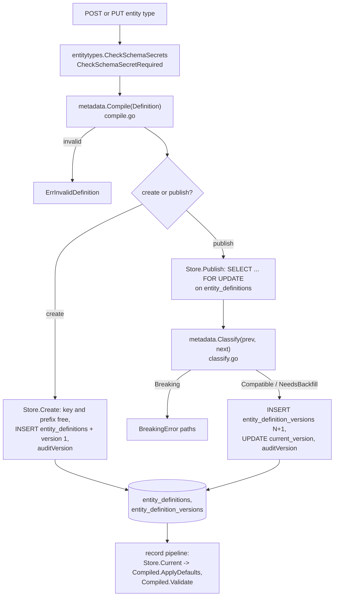

## Purpose

A tenant describes each entity type (incident, request, change, or its own) as
a JSON Schema 2020-12 document plus a number prefix, fixed-column mapping and
state model. The metadata engine turns that definition into a
`*metadata.Compiled`, the one object every record write validates against, and
decides whether a new version can be published over the current one. This
page shows where each step lives; the rules themselves are in the normative
[metadata-engine.md](../../../architecture/metadata-engine.md).

## Entry point

- HTTP: `createEntityType` and `publishEntityTypeVersion` in
  `internal/server/entitytypes.go`.
- Go: `entitytypes.Store.Create` and `entitytypes.Store.Publish`
  (`internal/entitytypes/entitytypes.go`), which call `metadata.Compile` and
  `metadata.Classify`.
- Read side, used by the record pipeline: `entitytypes.Store.Current` and
  `entitytypes.Store.Version` (the `pipeline.DefinitionReader` interface), and
  `entitytypes.Store.QueueCurrent` for the batched prefetch.

`internal/metadata` is pure: no database, network or file-system import.
`internal/entitytypes` is the database half.

## Steps

| # | Step | Where | Invariant | Proving test |
|---|---|---|---|---|
| 1 | Refuse a schema that marks a property secret and also requires it, or carries a secret-looking default | `entitytypes.CheckSchemaSecrets` (`audit.go`), `entitytypes.CheckSchemaSecretRequired` (`secretrequired.go`) | ADR-004-E5 D9 | `TestCheckSchemaSecretRequired`, `TestAdversarialSecretDefaultIsRefused` |
| 2 | Scan size and depth, walk the schema (local `$ref` only, closed root), compile with a fresh `jsonschema` compiler and a deny-all loader | `metadata.Compile` (`compile.go`), `denyAllLoader`, `walker.walk`, `walker.checkRefs` | One compiler per call, so no tenant sees another's schema | `TestCompileRefusesExternalRefs`, `TestCompilerLoaderDeniesEverything`, `TestSharedCompilerWouldLeak`, `TestCompileCapsAreInclusive` |
| 3 | Check defaults against their own schema, fixed-column types and the state enum | `metadata.Compile` | A definition the pipeline cannot satisfy never stores | `TestCompileRefusesBadStateModelsAndShapes`, `TestCompileAcceptsBaseDefinition` |
| 3a | Create, publish and seed only: refuse a property with both `default` and `x-nava-unique` (S29, ADR-009 D13). A stored version that already has the pair still compiles on read | `metadata.CompileNew` (`compile.go`) | A backfill never writes one value into a unique field twice | `TestCompileNewRefusesDefaultWithUnique`, `TestPublishDefaultWithUniqueIsRefusedAndWritesNothing`, `TestStoredDefaultWithUniqueStillReadsAndWritesButPublishIsRefused` |
| 4 | Create: key, then prefix uniqueness; insert type and version 1 with `compat = 'initial'`; append the config audit entry | `entitytypes.Store.Create`, `auditVersion` | Every config change is audited in the same transaction | `TestCreateRefusals` |
| 5 | Publish: lock the type row, compile the next version, classify it against the current one | `entitytypes.Store.Publish`, `metadata.Classify` (`classify.go`) | Fail-closed classification: anything not listed is Breaking | `TestClassify`, `TestClassifyRemoveTransition`, `TestPublishRefusalsAndFailures` |
| 6 | Insert version N+1 (number from `max(version) + 1` under the row lock), move `current_version`, audit | `entitytypes.Store.Publish` | Concurrent publishes queue and number with no gap or duplicate | `TestPublishRefusalsAndFailures` |
| 6a | When the new version adds a top-level default, or is NeedsBackfill: insert a `pending` `schema_backfills` job and its `schema.backfill` outbox row in the same transaction (S29, ADR-009 D1). A version that adds no default writes neither | `entitytypes.queueBackfill` (`backfill.go`), `outbox.EnqueueSchemaBackfill` | I6: the job and its start commit with the version or not at all | `TestPublishAddingADefaultWritesOneJobAndOneOutboxRow`, `TestPublishAddingNoDefaultWritesNoJob`, `TestRolledBackPublishAfterJobInsertWritesNoJobAndNoOutboxRow`, `TestPublishReplayWithADefaultKeepsOneVersionOneJobOneOutboxRow` |
| 7 | Change numbering mode (`gaps` or `gapless`) with its own audited config entry | `entitytypes.Store.SetNumberingMode` | See [core-numbering](core-numbering.md) | `TestP336fSetNumberingMode`, `TestP336fNumberingModeCrossTenant` |
| 8 | Use at write time: defaults then validation against the **current** version; stored rows are read under the version they were written with | `metadata.Compiled.ApplyDefaults`, `metadata.Compiled.Validate` (`validate.go`), called from `pipeline.write.create` / `write.update` | I4: JSON Schema runs before every write | `TestApplyDefaults`, `TestValidateReportsEachKindOfFailure`, `TestUpdateUnderNewVersionFillsDefaults` |

The tenant on every statement comes from the caller's `tenancy.InTenantTx`
transaction (row-level security plus the explicit `tenant_id` the inserts
take). See [core-tenancy](core-tenancy.md).

## Errors

| Error | Where | HTTP |
|---|---|---|
| `*metadata.ErrInvalidDefinition` (sorted JSON pointers) | `metadata.Compile` | `422 invalid_definition` |
| `entitytypes.ErrKeyExists` | `Store.Create` | `409 entity_type_exists` |
| `entitytypes.ErrPrefixTaken` | `Store.Create` | `409 number_prefix_taken` |
| `*entitytypes.BreakingError{Paths}` | `Store.Publish` | `422 schema_breaking_change` |
| `*entitytypes.SecretRequiredError` | `CheckSchemaSecretRequired` | `422 definition_secret_required` |
| `*entitytypes.SecretInContentError` | `CheckSchemaSecrets` | `422 config_secret_in_content` |
| `entitytypes.ErrNotFound` | `Store.Publish`, `Store.GetVersion` | `404 not_found` (another tenant's type is the same 404) |

The mapping is in `internal/server/entitytypes.go`; codes and statuses are in
`api/errors.yaml`.

## Compatibility classes

The full lists are in the normative note. In short:

| Class | Publish | Example |
|---|---|---|
| Compatible | accepted | add an optional property; widen an enum; add or remove `x-nava-filterable` |
| NeedsBackfill | accepted, and a schema backfill is queued | add a required property with a default; add a default to an existing property; **make an existing property required when the next version gives it a default** (ADR-009 D14, S29) |
| Breaking | `422 schema_breaking_change` | change a type; remove a property; change or remove a default; make a property required without a default |

Adding an optional property **with** a default is Compatible, but it also
queues a backfill, so old records get the value stored (ADR-009 D1). The job
is described on [Schema backfill](../workflows/schema-backfill.md), and its
tables on [Schema backfill tables](../database/schema-backfill.md).

## Backfill progress on the entity type (S29, story branch)

ADR-009 D10, TICK-1192. Both routes read the job tables as `nava_app`, SELECT
only, in the request's tenant transaction.

- `getEntityType` carries a `backfill` object from the type's newest job (the
  highest `target_version`): `state`, `target_version`, `rewritten`,
  `skipped`, `failed`, `remaining`, `started_at`, `finished_at` (UTC). It is
  absent when the type has no job. `remaining` is the job's queued plus failed
  records, counted up to 1,001, where 1,001 means "more than 1,000".
- `GET /api/v1/entity-types/{key}/backfill/failures`
  (`listEntityTypeBackfillFailures`) lists the newest job's failed records as
  `{items: [{record_id, code}], next_cursor}`, keyset by `record_id`, `limit`
  1 to 100 (default 50). It never returns a value. It needs the entity-type
  admin permission that publish needs. Anyone else, an unknown key and another
  tenant's key all get the same `404 not_found`. An admin's own type with no
  job gets `200` with empty `items`. A bad `limit` or cursor is `400
  validation_failed`, refused before the database is read.

## Filterable fields (S21, S22, story branch)

On the story branches `TICK-739/filterable-fields` (S21) and
`TICK-740/search-finish` (S22), not yet on `main` (ADR-006 D8, D11, D12;
TICK-743, TICK-744, TICK-750, TICK-751):

- `metadata.Compile` accepts `"x-nava-filterable": true` only directly on a
  top-level property, and maps the property's JSON Schema type to a value type
  (`text`, `num`, `ts`, `bool`; `internal/metadata/filterable.go`). Adding the
  flag is a Compatible change. `x-nava-searchable` is reserved and refused
  anywhere.
- `Store.Create` (version 1) and `Store.Publish` write, inside the audited
  version write, one `record_index_fields` row (`backfilling`, progress 0,
  `requested_version` = the version) and one `field_index.backfill` outbox row
  per newly flagged field (`internal/entitytypes/fieldindex.go`). A tenant
  advisory lock around the quota count stops two concurrent publishes from both
  passing. This is the only `nava_app` path that writes the registry. See
  [Field index](../database/field-index.md) and
  [Field-index backfill](../workflows/field-index-backfill.md).
- **Unflag (S22).** A publish that drops the flag is accepted. In the same
  transaction the registry row flips to `removing` and one `field_index.remove`
  outbox row is written per unflagged field (`entitytypes.retireFilterable`).
  A filter on the field answers `400 field_not_filterable` from that commit
  on; flagging it again is `409 field_index_busy` until the removal ends. See
  [removal](../workflows/field-index-backfill.md#removal).
- **Per-tenant quota (S22).** The per-type limit is 5, or the tenant's
  `tenant_limits.filterable_fields_per_type` (up to 10) when an operator has
  raised it, read through `tenantlimits.PerType`. See
  [Tenancy](../database/tenancy.md).

| Error | Where | HTTP |
|---|---|---|
| `*metadata.RefusalError` `filterable_field_not_top_level` | `metadata.Compile` | `422` |
| `*metadata.RefusalError` `searchable_not_available` | `metadata.Compile` | `422` |
| `*metadata.RefusalError` `filterable_field_type_change` | `metadata.Classify` | `422` |
| `*entitytypes.IndexQuotaError` (5 per type, or the tenant's raised limit up to 10; 50 per tenant) | `entitytypes.Store.Create`, `Store.Publish` | `422 index_quota_exceeded` |
| `*entitytypes.FieldIndexBusyError` (the field's index is being removed) | `entitytypes.Store.Publish` | `409 field_index_busy` |
| Deleting a flagged property outright | `metadata.Classify` | `422 schema_breaking_change` (removing a property is breaking) |

## Notes

- `org_unit_id` is a reserved property name (S31): the compiler refuses a
  schema that declares it, because the write pipeline owns
  `records.org_unit_id` and puts it in the audit payload under that name
  (ADR-010 D8).

- Seed definitions `incident`, `request` and `change` live in
  `internal/metadata/templates/` (`metadata.Template`) and are seeded at
  onboarding by `entitytypes.Store.Seed`.
- The caps are listed only in the normative note; this page does not repeat
  them.

## Links

- Tables: [database section](../database/index.md) (`entity_definitions`,
  `entity_definition_versions`).
- Next step of a write: [core-write-pipeline](core-write-pipeline.md).
- ADR-001 I4 and I8 (configuration, not code): [ADR summaries](../adr/index.md).
