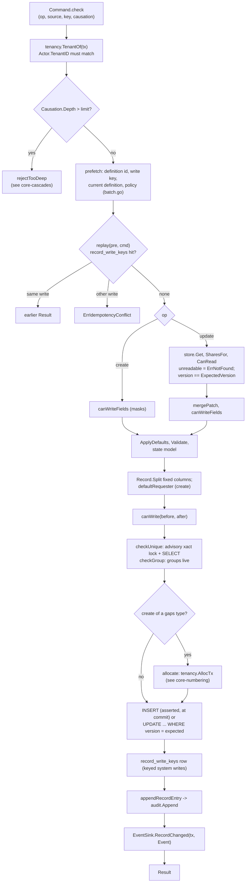

## Purpose

`pipeline.Write` is the only way to create or update a record (ADR-001 I4).
It runs inside the caller's `tenancy.InTenantTx` transaction and never
commits, so the record, its write key, its audit entry and whatever the
`EventSink` wrote commit together or not at all. Reads go through
`pipeline.Get` and `pipeline.List`; only the pipeline imports
`internal/records/store`. The rules are in the normative
[record-write-pipeline.md](../../../architecture/record-write-pipeline.md).

## Entry point

- HTTP: `createRecord` (`handlers.CreateRecord`, `internal/server/records.go`),
  `patchRecord` (`internal/server/records_patch.go`), `getRecord`,
  `listRecords` (`internal/server/records_list.go`).
- Go: `(*pipeline.Pipeline).Write(ctx, tx, pipeline.Command)` in
  `internal/records/pipeline/pipeline.go`; `pipeline.Get`, `pipeline.QueueGet`
  and `pipeline.List` in `internal/records/pipeline/read.go`.
- Other writers (workflows, rules) call the same `Write` with a system
  `Source`; the architecture test `TestRecordWritersOnlyInPipeline` fails on
  any other writer of `records`.

## Steps

| # | Step | Where | Invariant | Proving test |
|---|---|---|---|---|
| 1 | Check the command's shape: op and record, source, a user write with an idempotency key, a depth-0 write that names an origin (`Write` mints it), a workflow write at depth 0, an AI write without `source_ref` | `Command.check` | A cascade origin is minted, never given (ADR-001 A5) | `TestWriteRefusesBadCommands`, `TestDepthZeroWritesMintTheirOrigin` |
| 2 | Tenant from the transaction; an actor of another tenant is refused | `Pipeline.perform`, `tenancy.TenantOf` | I1, I2 | `TestWriteTakesTheTenantFromTheTransaction`, `TestWriteRefusesAnActorOfAnotherTenant`, `TestCrossTenantWritesRefused` |
| 3 | Prefetch in one batch (definition id, write key, current definition, ACL policy); on the HTTP create the same batch carries BEGIN and the request's idempotency claim | `Pipeline.QueuePrefetch`, `Pipeline.prefetch` (`batch.go`), `idempotency.ResolveClaim` in the handler | The claim is the transaction's first write | `TestCreateRecordFailureInFirstOrLastTripLeavesNothing` |
| 4 | Replay a keyed system write from `record_write_keys`, per principal | `replay`, `store.QueueWriteKeyByKey` | I7: a retry never acts twice | `TestIdempotencyKeyReplays`, `TestIdempotencyKeyIsScopedByPrincipal`, `TestIdempotencyKeyMismatchConflicts` |
| 5 | Update only: load the record, check read access (unreadable = not found), then the version | `write.update`, `store.Get`, `authz.SharesFor`, `ACL.CanRead` | No version or existence oracle | `TestUpdateOfAnUnreadableRecordIsNotFound`, `TestConcurrentUpdatesOneWins` |
| 6 | Mask write check on the caller's own data, before anything else can depend on a masked field | `write.canWriteFields` -> `ACL.CanWriteFields` | I5 (see [core-masks](core-masks.md)) | `TestFieldCheckRunsBeforeValidationAndTheStateModel`, `TestFieldNotWritableWritesNothing` |
| 7 | JSON Merge Patch (update), defaults, JSON Schema, state model | `mergePatch` (`patch.go`), `Compiled.ApplyDefaults`, `Compiled.Validate`, `Compiled.AllowsTransition` | I4: validation before every write | `TestCreateValidatesBeforeWriting`, `TestInvalidCreateWritesNothing`, `TestIncidentTransitions` |
| 8 | Split fixed columns out of `data`; default `requester_id` to the caller on a user/AI create | `store.Record.Split`, `write.defaultRequester` | A fixed property is stored only in its column | `TestFixedColumnsOnlyInTheirColumn` |
| 9 | Row write check on before and after rows (skipped for `rule`, `workflow`, `function`, `system`) | `write.canWrite` -> `ACL.CanWrite` | I5 (see [core-acl](core-acl.md)) | `TestWriteChecksTheRowBeforeAndAfter`, `TestOnlyTheSystemSourcesSkipTheAuthorizer` |
| 10 | Unique properties: `pg_advisory_xact_lock` on the canonical value, then a `SELECT`; assignment group must be live | `write.checkUnique`, `store.LockUnique`, `store.UniqueTaken`, `write.checkGroup`, `store.GroupLive`; batched on create by `write.checkCreate` | Safe under PgBouncer transaction pooling | `TestUniqueConcurrentCreatesOneWins`, `TestUniqueConcurrentUpdateAndCreateOneWins`, `TestCreateChecksEveryUniquePropertyInOneBatch`, `TestGroupLive` |
| 11 | Number (create): see [core-numbering](core-numbering.md) | `write.allocate` | I4: a refused create never moves the counter | `TestRefusedCreatesLeaveTheCounter` |
| 12 | Write: create `INSERT` (queued at commit and asserted against the 201, or sent now); update `UPDATE ... version = version + 1 WHERE version = expected` | `write.writeCreateAtCommit`, `store.QueueInsertRecordAsExpected`, `write.writeCreate`, `store.Update` | One version bump per write (optimistic concurrency) | `TestInsertRecordAsExpected`, `TestEveryWriteBumpsVersionOnce`, `TestCreateChecksWhatTheInsertStored` |
| 13 | Keyed write row, audit entry (diff built from the stored jsonb; secrets refused), event sink, all in the same transaction | `write.finish`, `store.InsertWriteKey`, `appendRecordEntry` -> `audit.Append`, `EventSink.RecordChanged` | I6 entry point: the sink runs in the write's transaction; the wired sink on `main` is `NoopSink` (S11b replaces it) | `TestAuditAndSinkInTheWriteTransaction`, `TestDiffIsBuiltFromStoredJSONB`, `TestSecretInRecordDiffIsRefused`, `TestCreateRollsBackAtEveryStage`, `TestPipelineKill` |

## Read and list

- **Get**: `pipeline.Get` answers a record created in the same transaction from
  the memo, otherwise `store.Get`. The handler then calls `ACL.CanRead`
  (unreadable is the same 404 as missing) and shapes the body with
  `authz.Shape`. `pipeline.QueueGet` puts the read in the GET's single batch.
- **List**: the handler builds the predicate with `authz.CompileRead` (or
  `authz.ReadBranches` for one index-ordered branch per subject) and checks
  every filter and sort field with `authz.CheckQueryFields`, before any SQL.
  `store.List` (`list.go`) counts (capped at `TotalCap`) and pages by keyset
  over a `listable` column; a data-property filter runs under
  `DataFilterTimeout` and maps a cancel to `ErrStatementTimeout`.
- Proving tests: `TestCompileReadAgreesWithAllows`, `TestBranchedStatements`,
  `TestTimedOutMapsOnlyADataFilterCancel`.

## Errors

Written by hand from the mapping in `handlers.recordError`
(`internal/server/records.go`) and the PATCH handler
(`internal/server/records_patch.go`), statuses from `api/errors.yaml`. Every
pipeline error raised after the definition was read is wrapped in
`*pipeline.ErrAtVersion`, so error pointers are built from the version the
write used.

| Pipeline result | HTTP | `code` |
|---|---|---|
| `ErrNotFound` (also an unreadable record on update) | 404 | `not_found` |
| `authz.ErrForbidden` | 403 | `forbidden` |
| `*authz.ErrFieldNotWritable` | 422 | `field_not_writable` |
| `*ErrValidation` (incl. rule `audit_secret_in_diff`) | 422 | `record_invalid` |
| `*ErrIllegalTransition` | 422 | `illegal_transition` |
| `ErrAssignmentGroupRemoved` | 422 | `assignment_group_removed` |
| `*ErrUniqueViolation` | 409 | `unique_violation` (names the property only) |
| `ErrVersionConflict` | 412 | `version_conflict` (current `ETag` re-read) |
| `ErrRetryable` (deadlock, serialization failure, allocation timeout) | 503 | `retry_later` |
| foreign-key `23503` on a fixed column | 422 | `record_invalid` (rule `reference`) |
| `ErrInvalidCommand`, `*ErrIdempotencyConflict`, `outbox.ErrCascadeTooDeep` | 500 | `internal_error`: the HTTP handlers never send a key or causation, so these are system-writer results only |

The HTTP request's own `Idempotency-Key` is a separate layer
(`idempotency_keys`, `409 idempotency_key_reuse` / `idempotency_in_flight`),
not `record_write_keys`.

## Notes

- The handbook generator has no error-table block (the TICK-720 gate was
  cancelled), so the table above is written by hand from the two files named;
  check it against them when either changes.
- The round-trip layout of a create is on [core-tenancy](core-tenancy.md).

## Links

- Tables: [database section](../database/index.md).
- What the event sink starts: [workflows section](../workflows/index.md);
  cascade bounds on [core-cascades](core-cascades.md).
