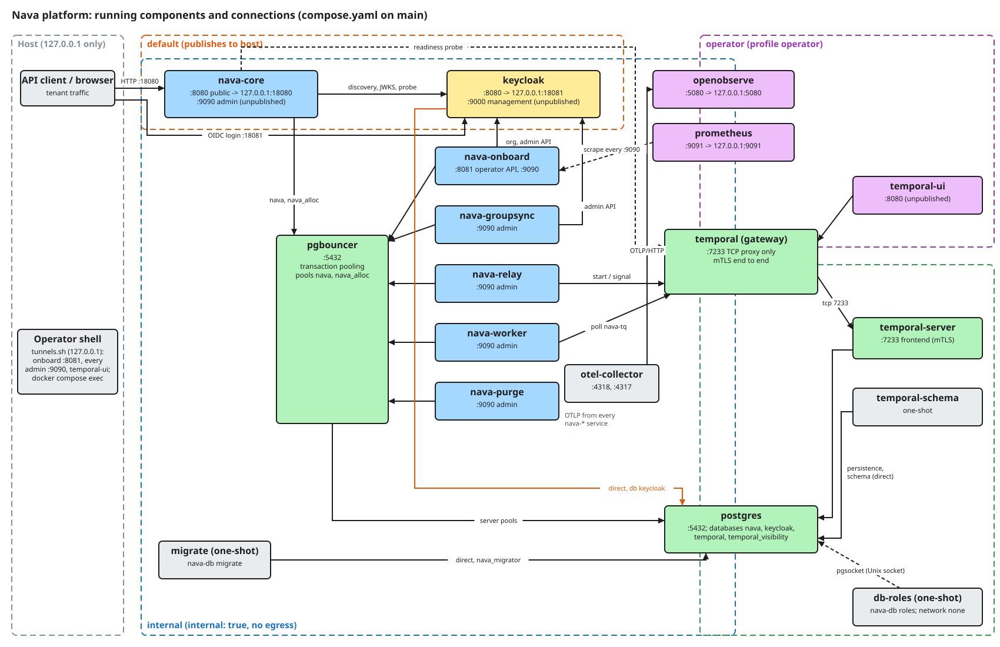
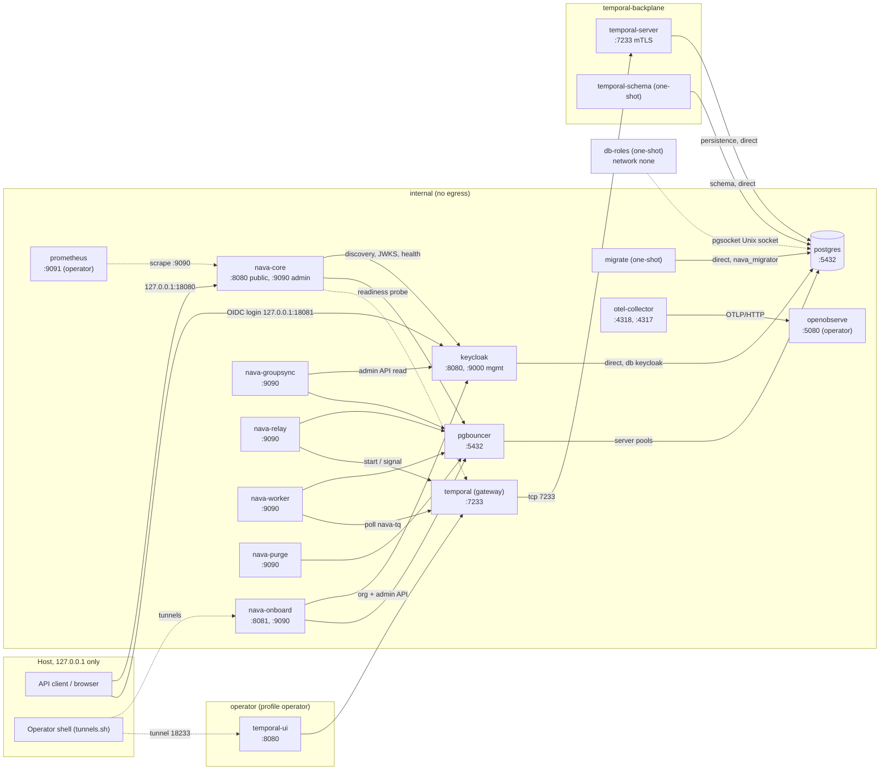

Every container that `docker compose up` starts from `compose.yaml` on `main`, the network each one sits on, and who talks to whom. Each component has its own page (listed below) with its listeners, database role and the work that introduced it. How the code inside a service is organised is not covered here.

## The map

The SVG embeds its Excalidraw scene. To change it, open the file in Excalidraw, edit it, and export again with **Embed scene**. If the SVG and `compose.yaml` disagree, the Mermaid version below was updated with the code and is the one to trust.

Not drawn, to keep the map readable: every `nava-*` service exports OTLP to `otel-collector:4318`, and Prometheus scrapes the `:9090` admin listener of all six `nava-*` services (`deploy/compose/prometheus/prometheus.yml`).

## Networks

| Network | Kind | Who is on it |
|---|---|---|
| `default` | publishes ports to the host (loopback only) | nava-core, keycloak |
| `internal` | `internal: true`, no egress | every backing service and every `nava-*` service |
| `operator` | not internal, so the UIs can publish on 127.0.0.1 | temporal-ui, temporal (gateway), openobserve, prometheus |
| `temporal-backplane` | `internal: true` | postgres, temporal-schema, temporal-server, temporal (gateway) |

No platform process joins `temporal-backplane`, so the server's internode and membership ports have no route from `internal`. `db-roles` has no network (`network_mode: none`); it reaches PostgreSQL only over the Unix socket on the `pgsocket` volume, which only `postgres` and `db-roles` mount. `deploy/compose/compose.internal.yaml` makes `default` and `operator` internal as well.

## Rules every edge follows

- Every `nava-*` service reaches PostgreSQL only through PgBouncer. The direct connections are `migrate` (as `nava_migrator`, which PgBouncer refuses), `db-roles` (the superuser, over the socket), Temporal's persistence (`temporal-schema`, `temporal-server`) and Keycloak's own database.
- Clients reach Temporal only through the `temporal` gateway at `temporal:7233`, which forwards to `temporal-server`. The workflow edges are `nava-relay` (start and signal) and `nava-worker` (poll `nava-tq`). `nava-core` dials the gateway only for its readiness probe. `nava-onboard`, `nava-groupsync` and `nava-purge` have no Temporal edge.
- Among the `nava-*` services, only `nava-core` publishes a port (`127.0.0.1:18080`). No `:9090` admin listener is published. The other published ports are Keycloak (`127.0.0.1:18081`) and, with the `operator` profile, OpenObserve (`127.0.0.1:5080`) and Prometheus (`127.0.0.1:9091`), all on loopback.
- Everything else is reached from the host through `docs/acceptance/guide/tools/tunnels.sh` (local forwards on 127.0.0.1) or `docker compose exec`.

## Components

| Component | Kind | Listeners (container) | Host port | DB role(s) | Introduced by |
|---|---|---|---|---|---|
| [postgres](postgres.md) | backing | `:5432`, Unix socket | none | (server) | PLAN-001 T02 (TICK-51) |
| [pgbouncer](pgbouncer.md) | backing | `:5432` | none | `pgbouncer_auth` (lookup) | PLAN-001 T02 (TICK-51) |
| [nava-db: db-roles, migrate](nava-db.md) | one-shot | none | none | superuser; `nava_migrator` | PLAN-001 T03 |
| [keycloak](keycloak.md) | backing | `:8080`, `:9000` management | `127.0.0.1:18081` | `keycloak` | PLAN-001 T02 (TICK-51) |
| temporal-schema | one-shot | none | none | `temporal` | PLAN-001 T28 |
| [temporal-server](temporal-server.md) | backing | `:7233` frontend (+ internode) | none | `temporal` | PLAN-001 T28 |
| [temporal (gateway)](temporal.md) | backing | `:7233` | none | none | PLAN-001 T02, gateway since T28 |
| [temporal-ui](temporal-ui.md) | operator profile | `:8080` | none (tunnel 18233) | none | PLAN-001 T28 |
| [otel-collector](otel-collector.md) | backing | `:4318`, `:4317`, `:13133` health | none | none | PLAN-001 T02 (TICK-51) |
| [openobserve](openobserve.md) | operator profile | `:5080` | `127.0.0.1:5080` | none | TICK-634 |
| [prometheus](prometheus.md) | operator profile | `:9091` | `127.0.0.1:9091` | none | TICK-330 |
| [nava-core](nava-core.md) | platform | `:8080` public, `:9090` admin | `127.0.0.1:18080` | `nava_app`, `nava_audit_reader` | PLAN-001 T02 (TICK-51) |
| [nava-worker](nava-worker.md) | platform | `:9090` admin | none | `nava_worker` | PLAN-001 T31b (TICK-159) |
| [nava-relay](nava-relay.md) | platform | `:9090` admin | none | `nava_relay` | PLAN-001 T30b (TICK-85) |
| [nava-purge](nava-purge.md) | platform | `:9090` admin | none | `nava_purge` | PLAN-001 T13 (TICK-143) |
| [nava-onboard](nava-onboard.md) | platform | `:8081` operator API, `:9090` admin | none | `nava_app`, `nava_onboard` | PLAN-001 T21 (TICK-234) |
| [nava-groupsync](nava-groupsync.md) | platform | `:9090` admin | none | `nava_groupsync` | PLAN-001 T25 (TICK-234) |

"Introduced by" names the work that first added the service to the compose file. The story manifest does not list these yet, so they are named in prose here, not linked.

### temporal-schema (one-shot)

Runs `setup-schema.sh` from the `nava/temporal-server` image once per `up`. It connects straight to PostgreSQL as `temporal` (not through PgBouncer) and creates or upgrades the schema in the `temporal` and `temporal_visibility` databases, then exits. It is on `temporal-backplane` only; `temporal-server` waits for it to complete.

## Binaries that are not services

| Binary | What it is | Covered on |
|---|---|---|
| `cmd/nava-db` | the `db-roles` and `migrate` one-shots | [nava-db](nava-db.md) |
| `cmd/nava` | offline operator CLI, `nava audit verify <file>`; no database, no network | the audit-chain page in Security and the Operations section |
| `cmd/openapi-compat` | CI tooling: fails when `api/openapi.yaml` removes or narrows anything | not a runtime component |
| `cmd/demo-outbox`, `cmd/demo-interpreter` | demos run by scripts under `scripts/dev/` | excluded: not part of the running platform |
